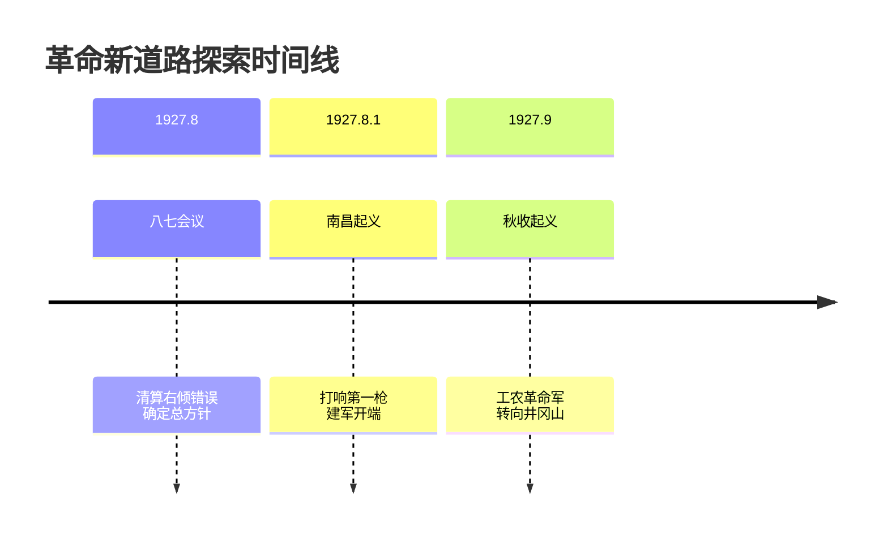

# 大革命失败后中国共产党人对革命新道路的探索（南昌起义、八七会议、秋收起义）

## 大革命失败后的转折与探索

1927年国民党反动派发动“四一二”和“七一五”反革命政变，大革命宣告失败。面对白色恐怖，中国共产党人并未屈服，而是开启了从**城市中心**向**农村包围城市**的战略转变。这一过程以八七会议为枢纽，以南昌起义、秋收起义为实践起点。

> [!IMPORTANT]
> ==核心转折==：八七会议确立了**土地革命**和**武装反抗**国民党反动统治的总方针。这是由大革命失败到土地革命战争兴起的历史性转折。

## 关键事件辨析

许多同学容易混淆这几次起义的历史地位，请通过下表厘清区别：

| 事件 | 时间/地点 | 核心意义/考点 | 常见误区 |
| :--- | :--- | :--- | :--- |
| **八七会议** | 1927.8 / 汉口 | 纠正陈独秀**右倾**机会主义；提出“枪杆子里出政权”。 | 误以为此时已解决“左”倾情绪（实际未清理）。 |
| **南昌起义** | 1927.8.1 / 南昌 | ==打响武装反抗第一枪==；标志中共**独立领导**革命战争、创建人民军队的开始。 | 误选为“确立党对军队绝对领导”（那是三湾改编）。 |
| **秋收起义** | 1927.9 / 湘赣边界 | 公开打出**工农革命军**旗号；毛泽东决定向农村进军，创建井冈山根据地。 | 忽略其“从城市转向农村”的战略首创性。 |

> [!TIP]
> **解题技巧**：看到“第一枪”、“建军开始”选**南昌起义**；看到“工农革命军”、“农村根据地”选**秋收起义**；看到“总方针”、“转折点”选**八七会议**。

## 为什么需要探索新道路？

大革命时期，党的工作重心在城市，依赖国共合作。失败后，敌人力量集中在城市，而农村统治薄弱。
*   **怎么做**：毛泽东在秋收起义受挫后，果断放弃攻打长沙，引兵井冈。
*   **深层逻辑**：只有依靠农民，进行**土地革命**，才能获得最广泛的群众基础。正如后续历史证明，土地政策的调整（如打土豪分田地）是红军得以生存和发展的根本保障。

> [!WARNING]
> **高危误区**：八七会议虽然纠正了右倾错误，但党内随后滋长了**“左”倾**情绪（如盲目暴动），这一问题直到遵义会议前都未得到彻底清理。做题时若问“八七会议是否彻底清除所有错误”，答案是否定的。

## 典型例题解析

**题目**：中国共产党独立领导革命战争和创建人民军队的开始是？
A. 南昌起义  B. 八七会议  C. 秋收起义  D. 广州起义

**解析**：
1.  **定位关键词**：“独立领导”、“创建人民军队”、“开始”。
2.  **排除干扰**：八七会议是决策会议，非军事行动起点；秋收起义虽重要，但时间晚于南昌起义。
3.  **结论**：**A. 南昌起义**。1927年8月1日的南昌起义，标志着中共有了自己的武装力量，因此8月1日也被定为建军节。
