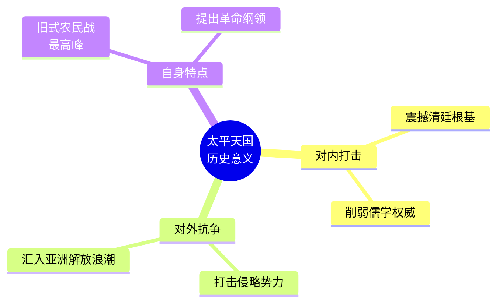
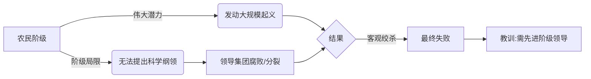

# 太平天国农民战争的意义、失败原因及教训

## 太平天国：旧式农民战争的巅峰与局限

太平天国运动（1851-1864）是中国近代史上规模最宏大的一次农民战争。在《纲要》复习中，核心在于辩证看待其**历史功绩**与**失败必然性**。它既是封建王朝的掘墓人，也因阶级局限无法成为新社会的建筑师。

## 历史意义：为何它是“最高峰”？

太平天国之所以被称为==旧式农民战争的最高峰==，不仅因为持续14年、波及18省，更因为它提出了《天朝田亩制度》等相对完整的纲领。

> [!IMPORTANT]
> 五大历史意义
> 1. **打击清廷**：沉重打击封建统治，加速清王朝衰败。
> 2. **最高峰**：具有以往农民战争没有的新特点（如纲领、外交）。
> 3. **冲击儒学**：动摇孔子及儒家经典正统权威，削弱精神支柱。
> 4. **抗击侵略**：有力打击外国侵略势力（如击毙华尔）。
> 5. **亚洲影响**：推动19世纪中叶亚洲民族解放运动。

## 失败原因：主观局限与客观绞杀

太平天国的失败是**内因**（阶级局限）与**外因**（中外反动势力联合）共同作用的结果。

| 维度 | 关键原因 | 具体表现 |
| :--- | :--- | :--- |
| **主观** | **阶级局限性** | 农民不是新生产力代表；无法提出科学纲领；领导集团腐败分裂（天京事变）。 |
| **主观** | **思想理论缺陷** | 拜上帝教非科学理论；未能正确对待儒学；对西方侵略者缺乏理性认识。 |
| **客观** | **敌人强大** | 中外反动势力勾结（湘军、淮军+洋枪队）联合镇压。 |

> [!WARNING]
> 易错点辨析
> *   **不是**因为军事指挥失误导致最终失败，根本原因是**农民阶级的局限性**。
> *   **不是**完全排斥西方，而是缺乏理性认识，早期曾幻想西方支持，后期才坚决抗争。

## 核心教训：农民阶级的历史天花板

太平天国的兴衰揭示了一个铁律：在半殖民地半封建的中国，==农民具有伟大的革命潜力，但单纯依靠农民战争无法完成反帝反封建的历史重任==。

## 典型例题解析

**题目**：太平天国之所以是中国农民战争的最高峰，最主要是因为（ ）
A. 其规模和延续时间均属空前
B. 建立了与清政府对立的政权
C. 制定了比较完整的革命纲领
D. 对封建王朝的打击空前沉重

> [!TIP]
> 解题逻辑
> “最高峰”区别于以往农民起义（如李自成、黄巢）的关键，在于其**制度化**和**纲领化**。
> *   A、B、D 虽也是特点，但历代大型起义皆有类似表现。
> *   **C 选项**《天朝田亩制度》和《资政新篇》体现了前所未有的社会改革方案，是“质”的提升。

**正确答案：C**
