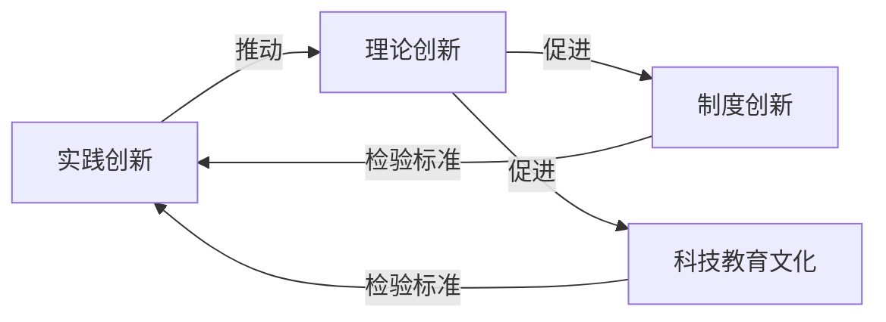

# 改革开放进程中实践创新和理论创新的辩证关系（创新应以实践为标准、理论创新促多方面创新）

> [!IMPORTANT]
> 在改革开放进程中，==实践创新与理论创新是辩证统一的关系==：实践创新推动理论创新，理论创新促进多方面创新，而一切创新最终必须以实践为标准。

## 它是什么

改革开放既是社会主义制度的自我完善和发展，也是经济体制等各方面体制的根本变革，这本身就是一个伟大的**实践创新**。在这个过程中，我们党始终坚持“在实践中推进理论创新，在理论创新中推进实践创新”，这是马克思主义关于实践与认识的辩证关系在改革开放中的具体运用和体现。

我们可以先想一个问题：对于一个大国大党而言，要成就改革这样一项伟大事业，如果只埋头苦干而没有科学理论的指导，能走得远吗？显然不能。因此，在各方面创新中，==理论创新是起带头作用的==。

## 为什么需要

回顾历史，1978 年党的十一届三中全会彻底否定了“两个凡是”的错误方针，重新确立了解放思想、实事求是的指导思想，揭开了改革开放的序幕。全会明确提出，党中央在理论战线上的崇高任务，就是把马列主义、毛泽东思想的普遍原理同社会主义现代化建设的具体实践结合起来，并在新的历史条件下加以发展。

这就回答了为什么需要理论创新：没有思想路线的拨乱反正，就不可能有工作重点的转移；没有理论上的突破，改革的实践就会失去方向。

## 怎么做

理论创新不是凭空想象，而是沿着“实践—认识—再实践—再认识”的路径螺旋上升的。

- **理论创新促多方面创新**：正因为我们在坚持毛泽东思想的过程中丰富和发展了毛泽东思想（即理论创新），才有了建立农村家庭联产承包责任制、建立社会主义市场经济体制、建立以公有制为主体多种所有制经济共同发展的基本经济制度等一系列**制度创新**，进而带动了科技、教育和文化等多方面的创新。
- **创新应以实践为标准**：取得一系列成果后，党没有安于现状。党的十五大把邓小平理论写入党章，同时提出了两项新任务：一是坚持邓小平理论，二是发展邓小平理论。面对各种突发事件和新情况，始终坚持以实践为标准不断开拓前进。江泽民同志在 2000 年提出的“三个代表”重要思想，正是在坚持邓小平理论过程中丰富和发展该理论的最重要思想成果。

> [!TIP]
> 记忆口诀：**实践出理论，理论带全面，行不行看实践。**

## 算对了的例子

以真题“在不断推进改革开放和现代化建设的历史进程中，实践创新和理论创新的关系是怎样的？试举例说明”为例，标准作答逻辑如下：

1. **定性**：指出两者是实践与认识的辩证关系在改革开放中的运用，强调理论创新的带头作用。
2. **举例（实践推理论）**：引用十一届三中全会提出的理论任务，说明改革实践如何呼唤并推动了理论的发展。
3. **举例（理论促创新）**：列举家庭联产承包责任制、社会主义市场经济体制等制度创新，说明它们是理论创新的直接产物。
4. **升华（实践为标准）**：结合十五大提出的“坚持与发展邓小平理论”双重任务，以及“三个代表”重要思想的提出，论证我国 20 多年改革开放史就是理论创新与实践创新协调发展的历程。

> [!WARNING]
> 答题时切忌只谈“理论”或只谈“实践”。必须点明两者的**双向互动**，且一定要落脚到“以实践为标准”上，否则会被扣分。

## 相近概念辨析

| 维度 | 实践创新 | 理论创新 |
| :--- | :--- | :--- |
| **内涵** | 经济体制等各方面体制的根本变革 | 把普遍原理同具体实践结合并加以发展 |
| **地位** | 理论创新的源泉和最终检验标准 | 在各方面创新中起**带头作用** |
| **典型表现** | 家庭联产承包责任制、市场经济体制 | 邓小平理论、“三个代表”重要思想 |

> [!CAUTION]
> 不要将“理论创新”等同于“否定原有理论”。课件明确指出，我们是在“坚持毛泽东思想的过程中丰富和发展毛泽东思想”，理论创新是继承基础上的发展，而非割裂历史。
