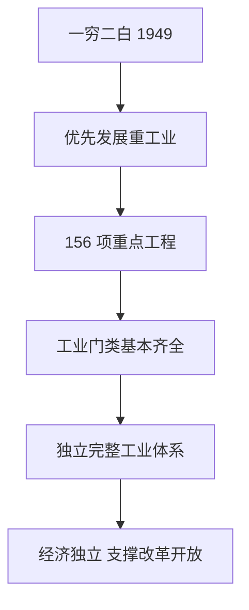

# 建立独立的、比较完整的工业体系和国民经济体系的重大意义

## 它是什么

“独立的、比较完整的工业体系和国民经济体系”，指 1949—1978 年间，中国在一穷二白的基础上，依靠自己的力量建立起的、门类基本齐全且不受外部势力控制的工业与国民经济系统。所谓“独立”，指不受制于人；“比较完整”，指轻重工业、基础原材料、装备制造等门类基本齐备，国民经济各部门能够相互配套、自主循环。

## 为什么需要

可以先问自己两个问题：

- 没有工业体系，政治独立能守得住吗？旧中国“小米加步枪”，列强用几艘军舰就能打开国门，说明没有工业基础，主权随时可能被重新剥夺。
- 没有自己的工业，衣食住行和国防靠什么？洋布、洋火、洋油全靠进口，一旦遭遇封锁，整个社会运转都会瘫痪。

因此，新中国必须建立独立的工业体系。这既是==赢得经济独立、巩固政治独立==的根本途径，也是实现现代化的物质前提。

## 怎么做

- 1953 年起实施第一个五年计划，确立优先发展重工业的方针。
- 以苏联援建的 156 项重点工程为核心，布局钢铁、煤炭、电力、机械、化工等基础工业。
- 在“自力更生、艰苦奋斗”方针下，逐步建立起独立的、比较完整的工业体系和国民经济体系。

## 重大意义

> [!IMPORTANT]
> 独立的、比较完整的工业体系和国民经济体系的建立，是了不起的巨大成就，是中国人民在中国共产党领导下英勇奋斗的伟大成果，是社会主义制度优越性的生动体现，具有极其重要的战略意义。

具体可从三个层面把握：

| 层面 | 意义 | 关键表述 |
|------|------|----------|
| 战略层面 | 为继续推进社会主义建设开拓了可以依靠的阵地 | “阵地”意味着有了自主发展的立足点 |
| 物质基础 | 为实现现代化的伟大事业奠定了初步的物质基础 | 改革开放后的腾飞离不开这一积累 |
| 经济独立 | 工业在国民经济中的主导地位日益明显，使中国在赢得政治独立之后赢得了经济上的独立 | 政治独立是前提，经济独立是保障 |

工业部门的作用体现在四个方面：

1. 为改善人民生活提供大量日用消费品；
2. 为国民经济其他部门和国防建设提供燃料、动力、原材料和技术装备；
3. 为出口提供相当数量的产品；
4. 支撑国防现代化（如“两弹一星”），维护国家主权。

## 与相近概念的区别

| 概念 | 含义 | 与“独立完整工业体系”的关系 |
|------|------|---------------------------|
| 政治独立 | 1949 年新中国成立，推翻帝国主义压迫 | 是前提，但政治独立不等于经济独立 |
| 经济独立 | 不受外部势力控制，自主发展经济 | 是建立独立工业体系的直接成果 |
| 现代化建设 | 工业、农业、国防、科技全面现代化 | 以独立工业体系为物质技术基础 |

> [!WARNING]
> 易错点：不要把“建立独立的工业体系”与“实现现代化”混为一谈。前者是==初步的物质基础==，后者是更高阶段的奋斗目标，二者是“奠基”与“建成”的关系。

## 常见的坑

- 只答“成就巨大”，不展开“为什么巨大”。答题时应落到“经济独立”“物质基础”“制度优越性”等关键词上。
- 忽略时间跨度。这一体系是在 1949—1978 年间逐步建立的，不是改革开放后的产物。
- 与“社会主义市场经济体制初步建立”混淆。后者是 1992 年以后的目标，前者是计划经济时期奠定的基础。

## 一个算对了的例子

以 2005 年数据为例：国内生产总值达 2.2 万亿美元（世界第四位），人均 GDP 近 1700 美元，分别是 1949 年的 25.8 倍和 25 倍，是 1978 年的 18.8 倍和 18 倍。主要工农业产品产量跃居世界前列。这组数据说明：正是以独立完整的工业体系为==物质技术基础==，改革开放才能释放出巨大能量，实现综合国力和人民生活水平的大幅度提高。

> [!TIP]
> 答题口诀：一穷二白起步 → 艰苦奋斗建成 → 经济独立巩固 → 物质基础奠基 → 制度优越性体现。
