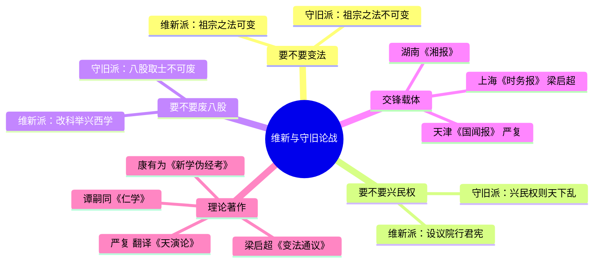

# 戊戌维新运动的历史意义、失败原因及教训
把“维新变法”放到当时中国所处的十字路口来看，才能理解这次运动的分量。甲午战败后，列强掀起了瓜分中国的狂潮，民族危机空前加剧。传统的封建专制体制与“天朝上国”的陈旧观念，在坚船利炮面前彻底破产。中国到底要往何处去？正是在这种救亡图存的迫切需求下，维新派登上了历史舞台。

### 为什么说它是“爱国救亡”和“政治改革”？

你可以先问自己一个问题：如果只是皇帝想改几个政策，那和历史上的“变法”有什么本质区别？区别在于目标和阶级属性。

维新派虽然打着孔子的旗号，但他们主张的已经不是修补封建旧屋，而是要改建成一座 **“君主立宪”的新式建筑**。他们希望让中国像日本明治维新那样，发展资本主义，摆脱被宰割的命运。

> [!IMPORTANT]
> 戊戌维新运动的性质：它是一次爱国救亡运动，同时也是一场==资产阶级性质的政治改革运动==。

这体现在它的核心主张上：兴民权、设议院、实行君主立宪。这些主张直接触碰了封建君主专制制度的根基，是过去洋务运动不敢想、更不敢碰的“禁区”。

### 为什么它又是一场“思想启蒙”运动？

这场运动不仅是在政治上“动手”，更在思想上“动脑”。我们来看维新派与守旧派这场关键论战，就能看清思想的冲击力。

这场论战的核心成果，是让**进化论**等新思想第一次大规模地在中国知识分子中传播开来。严复翻译的《天演论》带来的“物竞天择，适者生存”观念，无异于一枚思想炸弹。因此，我们说：

> [!TIP]
> 维新运动是近代中国第一次思想解放潮流，是一场==思想启蒙运动==，推动了中华民族的觉醒。

### 失败的深层原因是什么？

维新变法仅仅持续了103天就宣告失败。表面上看是慈禧太后发动政变，但失败的根本原因需要从维新派自身去寻找。

首先，他们**不敢彻底否定封建主义**。维新派虽然想要发展资本主义，却在政治上依赖一个没有实权的皇帝，经济上不碰封建土地所有制。这就像一个建筑师想建新式高楼，却不敢动旧地基。

其次，他们**对帝国主义抱有幻想**。他们以为英、美、日等列强会真心帮助中国变法图强，结果却被列强与守旧派联手绞杀。

> [!CAUTION]
> 最大的误区：维新派为何失败？因为他们==惧怕人民群众==！他们的活动局限于官僚士大夫和知识分子的小圈子，把老百姓看作是无知的群氓，而不是可以依靠的力量。失去了最广泛的支持，改革就成了空中楼阁，一推就倒。

### 失败留下了什么教训？

这个结果告诉我们一个冰冷的现实：

> [!IMPORTANT]
> ==在半殖民地半封建的中国，企图通过统治者自上而下的改良道路，根本行不通。==

这次失败不仅暴露了中国民族资产阶级的软弱性和妥协性，也让后来的革命者认清了一个真理：要拯救中国，必须放弃改良幻想。

想争取国家的独立、民主和富强，只有一条路——用革命的手段，推翻帝国主义和封建主义联合统治的==半殖民地半封建的社会制度==。

这也为后来孙中山领导的辛亥革命埋下了思想的种子和逻辑的起点。
