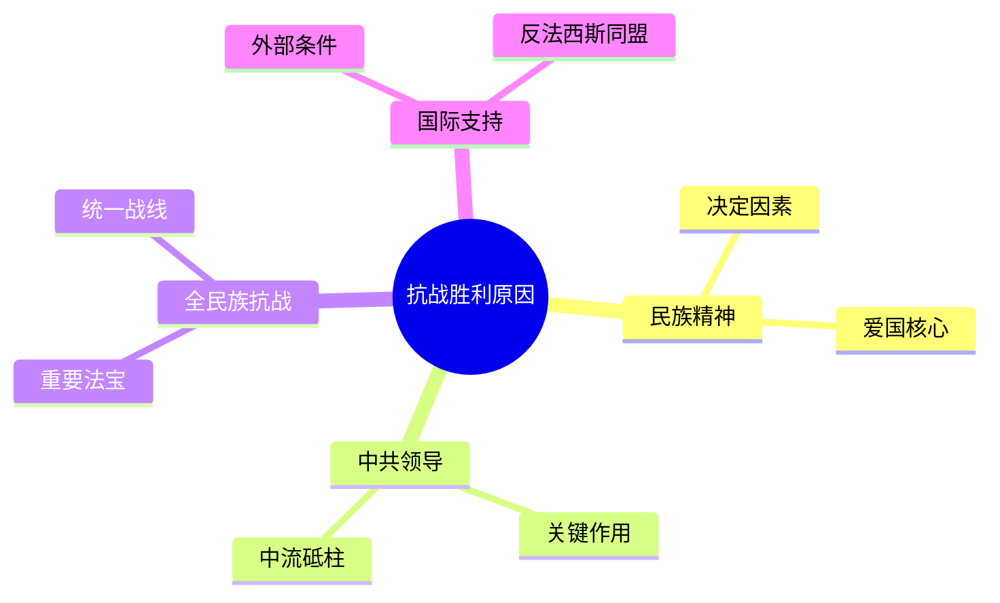

# 中国人民抗日战争胜利的主要原因和历史意义

## 抗战胜利的主要原因

面对敌强我弱的悬殊差距，中国为何能取得近代以来反侵略战争的第一次完全胜利？这并非单一因素所致，而是多重力量汇聚的结果。

> [!IMPORTANT]
> ==以爱国主义为核心的民族精神是决定因素==，==中国共产党的中流砥柱作用是关键==，==全民族抗战是重要法宝==，国际支持是外部条件。四者缺一不可，但地位有别。

在答题时，务必区分“决定因素”与“关键”。民族精神解决的是“愿不愿打、敢不敢打”的问题；而中国共产党的中流砥柱作用，则体现在提出全面抗战路线、开辟敌后战场、坚持持久战战略以及维护统一战线等具体实践中，解决了“怎么打、如何赢”的问题。全民族抗战则是这两者在组织形态上的体现，即抗日民族统一战线的巩固与扩大。

## 抗战胜利的历史意义

这场胜利仅仅是一场军事上的成功吗？不，它更是中华民族命运的根本转折。

> [!TIP]
> 记忆口诀：==一转折、二捍卫、三团结、四贡献、五开启==。对应简答题五个得分点，逻辑层层递进。

| 维度 | 核心表述 | 关键词 |
| :--- | :--- | :--- |
| 历史定位 | 从深重危机走向伟大复兴的==历史转折点== | 转折点 |
| 国家主权 | 粉碎殖民图谋，洗刷屡战屡败耻辱 | 捍卫主权 |
| 民族精神 | 促进大团结，形成伟大抗战精神 | 民族团结 |
| 世界影响 | 东方主战场，国际地位显著提高 | 大国地位 |
| 未来征程 | 坚定独立意志，奠定新民主主义革命基础 | 凤凰涅槃 |

[!NOTE]
> “历史转折点”是总领性论断，其余四点为具体展开。论述题需将“抗战精神”的内涵（天下兴亡、匹夫有责等）适当展开，简答则点到为止。

## 易错辨析与真题示范

> [!WARNING]
> 常见误区：将“中共领导”等同于“唯一原因”，或忽略“国际支持”；混淆“决定因素”（精神）与“关键”（政党）。答题必须四点并列，主次分明。

以真题“如何理解抗日战争胜利对实现中华民族伟大复兴的意义”为例，标准答案结构如下：

1.  **定性**：是中华民族从危机走向复兴的==历史转折点==。
2.  **主权**：彻底粉碎日本殖民奴役图谋，洗刷民族耻辱。
3.  **精神**：促进中华民族大团结，形成伟大抗战精神。
4.  **国际**：为世界反法西斯战争作出历史性贡献，国际地位显著提升。
5.  **前途**：坚定追求独立解放意志，开启浴火重生新征程，为新民主主义革命胜利奠定基础。

此答案完整覆盖五大要点，且逻辑由内到外、由过去到未来，既符合教材规范，又契合阅卷采分习惯。切记不可遗漏“奠定新民主主义革命胜利基础”这一衔接后续章节的关键句，它是贯通第六章与第七章的逻辑枢纽。
