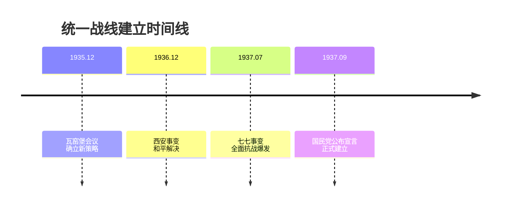

# 抗日民族统一战线的建立过程及抗战时期巩固统一战线的策略总方针

抗日民族统一战线是中国共产党在抗日战争时期，为动员全民族力量抗击日本侵略而倡导、促成并维护的广泛政治联盟。

> [!IMPORTANT]
> 统一战线、武装斗争、党的建设，是中国共产党在中国革命中战胜敌人的==三大法宝==。

## 建立过程：从对立到合作

面对亡国灭种的危机，国内各阶级能否放下恩怨一致对外？统一战线的建立并非一蹴而就，而是经历了从“反蒋抗日”到“逼蒋抗日”再到“联蒋抗日”的转变。

1. **策略转变**：1935年12月，毛泽东作《论反对日本帝国主义的策略》报告，系统解决了党的政治路线问题，批判了关门主义，阐明了建立抗日民族统一战线的新政策。
2. **初步形成**：1936年西安事变的和平解决，成为扭转时局的关键，标志着十年内战基本结束，抗日民族统一战线初步形成。
3. **正式建立**：1937年9月，国民党中央通讯社发表《中共中央为公布国共合作宣言》，以第二次国共合作为基础的抗日民族统一战线正式建立。

## 巩固策略总方针：发展、争取与孤立

统一战线建立后，内部摩擦不断。如何既维持合作又保持独立性？中国共产党制定了巩固抗日民族统一战线的==策略总方针==：“发展进步势力，争取中间势力，孤立顽固势力”。

| 势力分类 | 具体对象 | 核心策略 |
| :--- | :--- | :--- |
| **进步势力** | 工人、农民、城市小资产阶级 | ==发展==（壮大基本盘） |
| **中间势力** | 民族资产阶级、开明绅士、地方实力派 | ==争取==（扩大同盟军） |
| **顽固势力** | 大地主大资产阶级的抗日派（如蒋介石集团） | ==孤立==（有理有利有节） |

对顽固势力的斗争，必须坚持“有理、有利、有节”的原则，即自卫原则、胜利原则和休战原则，绝不能把顽固派等同于汉奸亲日派。

> [!TIP]
> 记忆口诀：**“发进、争中、孤顽”**。对应三大法宝中的“统一战线”，是南邮简答题的高频考点。

## 易混辨析与常见坑

> [!WARNING]
> 考试极易将不同时期的土地政策混淆！必须认清主要矛盾的变化决定了政策的调整。

* **土地革命战争时期**：没收地主土地分给农民（打土豪分田地）。
* **抗日战争时期**：实行==地主减租减息，农民交租交息==。目的是联合地主阶级共同抗日，同时提高农民的抗日和生产积极性。
* **解放战争时期**：废除封建剥削制度，实行耕者有其田。

> [!CAUTION]
> 不要认为抗战时期共产党放弃了农民利益。减租减息是在民族矛盾上升为主要矛盾时的让步，是为了最大限度动员全国军民共同抗战。

## 真题实战解析

结合复习提纲中的“简答8”，我们来看看如何组织标准答案：

**题目**：抗战时期巩固抗日民族统一战线的策略总方针是什么？

**满分作答逻辑**：
1. **点明总方针**：直接写出“发展进步势力，争取中间势力，孤立顽固势力”。
2. **解释进步势力**：指工人、农民和城市小资产阶级，这是统一战线的基础，必须大力发展。
3. **解释中间势力**：指民族资产阶级等，争取他们是孤立顽固势力的重要条件。
4. **解释顽固势力及斗争原则**：指大地主大资产阶级抗日派，对其斗争须坚持“有理、有利、有节”原则。

> [!NOTE]
> 这一方针充分体现了中国共产党作为凝聚全民族抗战力量的杰出组织者，将马克思列宁主义基本原理同中国具体实践相结合的政治智慧。
