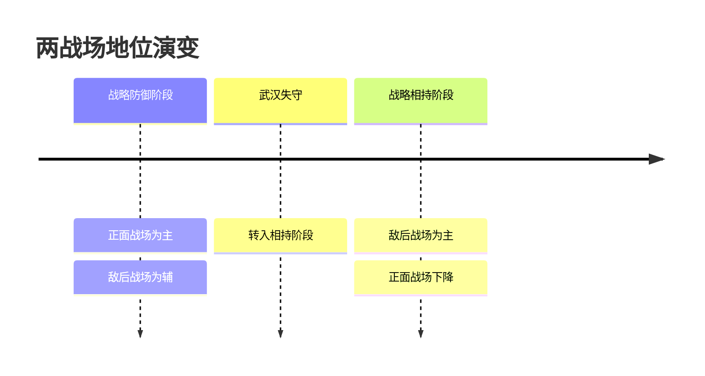

# 敌后战场的开辟与正面战场的抗战及其相互关系

抗日战争是一场弱国对抗强国的全面战争。如果只靠正规军在一条防线上硬顶，能撑多久？要拖垮侵略者，必须在敌人背后再“点一把火”。这就引出了抗战中两个缺一不可的战场。

## 它是什么

- **正面战场**：由国民党军队主导，在主要交通线和战略要地以==正规战、阵地防御战==抗击日军进攻。
- **敌后战场**：由中国共产党领导的人民军队深入日军占领区，通过==游击战==开辟抗日根据地，从背后打击和牵制敌人。

> [!IMPORTANT]
> 核心结论：在全民族抗战中，游击战被提到战略地位，具有全局性意义。

两者并非孤立，而是随战争阶段动态配合。用时间线来看它们的地位变化：

## 为什么需要两个战场

日本企图“速战速决”，中国必须“持久抗战”。单靠正面阵地战消耗极大，而敌后游击战能迫使日军将用于进攻的兵力抽调回来保守占领区，从而减轻正面压力，使战争转入相持阶段。

> [!NOTE]
> 延伸辨析：国民党执行的是片面抗战路线（单纯政府和正规军抗战）；共产党实行全面抗战路线（放手发动武装民众）。路线差异决定了两个战场的不同走向。

## 怎么做：游击战的战略作用

结合真题，我们一步步拆解游击战在各阶段的具体做法与作用：

1. **战略防御阶段**：广泛开展敌后游击战、开辟根据地 $\rightarrow$ 牵制日军 $\rightarrow$ 阻止进攻、减轻正面压力 $\rightarrow$ ==促成向相持阶段转变的关键==。
2. **战略相持阶段**：日军主力转向扫荡敌后（如华北千人以上大“扫荡”达 109 次，动用 50 万人以上）。此时敌后游击战成为主要作战方式，任务是削弱敌人、壮大自己，为战略反攻准备条件。有利条件下也打运动战（如参战 105 个团、20 余万人的百团大战）。

## 对比与易混点

| 比较维度 | 正面战场 | 敌后战场 |
| :--- | :--- | :--- |
| **领导力量** | 国民党政府 | 中国共产党 |
| **抗战路线** | 片面抗战路线 | 全面抗战路线 |
| **主要战法** | 正规战、阵地防御 | 游击战（辅以运动战） |
| **防御阶段地位** | 主要 | 辅助，但起关键转折作用 |
| **相持阶段表现** | 作用明显下降，制造反共摩擦 | 成为主要抗日作战方式 |

> [!WARNING]
> 易错坑：不要以为“辅助”等于“不重要”。防御阶段敌后战场虽是辅助，但对使战争转入相持阶段起了==关键性作用==。

> [!CAUTION]
> 高危误区：阶段转折点记错！是==武汉失守==标志着抗日战争从防御阶段进入相持阶段，不是卢沟桥事变或南京沦陷。

## 答题示范

以简答题“怎样评价国民党政府在抗日战争中执行的路线及正面战场的地位与作用？”为例，展示如何踩准得分点组织答案：

> [!TIP]
> 解题技巧：评价类简答按“路线定性 $\rightarrow$ 总体肯定 $\rightarrow$ 分阶段辩证分析”三步走。

**标准作答逻辑：**

第一，先定性路线：指出其执行的是片面抗战路线，不敢放手发动民众，战术上采取单纯的阵地防御战。
第二，给总体评价：肯定正面战场对抗日战争胜利做出了重要贡献，特别是在战略防御阶段。
第三，分阶段论述：防御阶段积极抗战、起重要作用；相持阶段作用下降并制造摩擦；反攻阶段对夺取最后胜利作用有限。
