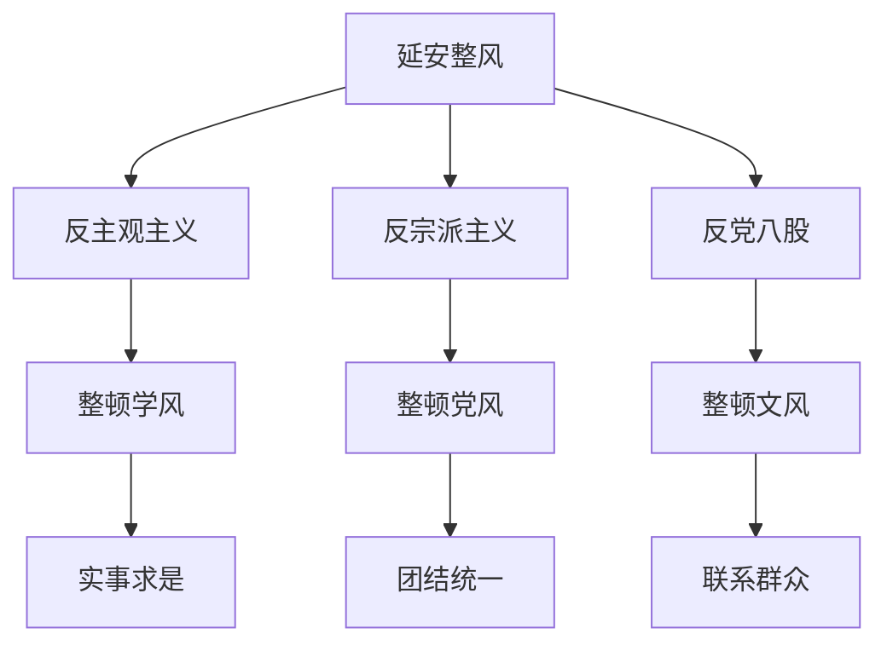

# 延安整风运动的主要内容（反对主观主义、宗派主义、党八股）及其深远意义

## 为什么需要延安整风

遵义会议结束了王明“左”倾错误在党中央的统治，但党内长期存在的教条主义影响并未彻底清除。抗战时期党员队伍迅速扩大，许多新党员虽有革命热情，却缺乏系统的马克思主义教育。如何把马克思主义基本原理同中国具体实际结合起来，成为全党必须解决的问题。

因此，1942—1945年的延安整风，不只是纠正几篇文章、几种作风，而是一次普遍的马克思主义思想教育运动。

## 主要内容：三个“反对”

| 整顿对象 | 主要指向 | 核心要求 |
|---|---|---|
| 反对主观主义以整顿学风 | 教条主义、经验主义，其中教条主义是重点 | 坚持调查研究，做到理论联系实际、实事求是 |
| 反对宗派主义以整顿党风 | 山头主义、本位主义，闹独立性、破坏团结 | 坚持民主集中制，维护党的团结统一 |
| 反对党八股以整顿文风 | 空话套话、形式主义、脱离群众 | 写文章、做报告要有实际内容，采用群众易懂的语言 |

> [!IMPORTANT]
> 整风的中心内容是==反对主观主义以整顿学风==；主观主义的主要表现形式是教条主义和经验主义，其中教条主义危害更大。

毛泽东先后发表《改造我们的学习》《整顿党的作风》《反对党八股》等报告，为整风运动提供了重要指导。其中，《改造我们的学习》对“实事求是”作出新的解释，强调从客观实际出发，研究事物内部规律，而不是照搬书本和外国经验。

## 怎么做：整风的基本方法

整风采取“惩前毖后、治病救人”的方针，通过认真学习文件、联系实际检查思想、开展批评与自我批评，达到既要弄清思想、又要团结同志的目的。它不是简单追究个人责任，更不是用残酷斗争代替思想教育。

> [!TIP]
> 可用“学风—党风—文风”串联记忆：==主观主义坏学风，宗派主义坏党风，党八股坏文风==；方法记住“学习—检查—批评—团结”。

## 深远意义

延安整风使全党受到一次普遍的马克思主义教育，进一步清算了教条主义影响，确立了实事求是的思想路线，增强了党的团结和统一。它为党的七大召开作了重要思想准备，也为毛泽东思想在全党指导地位的确立创造了条件，并为抗日战争胜利和新民主主义革命在全国的胜利奠定了重要思想基础。

> [!WARNING]
> 不要混淆：王明“左”倾冒险主义的主要特征是**教条主义**；毛泽东最早提出反对教条主义任务的文章是《反对本本主义》；对“实事求是”作出全新解释的是《改造我们的学习》。

## 例题

**题目：** 毛泽东对“实事求是”这句古语作出全新解释的文章是（　）

A.《反对本本主义》  
B.《关于纠正党内的错误思想》  
C.《改造我们的学习》  
D.《〈共产党人〉发刊词》

**答案：C。**《反对本本主义》侧重反对教条主义、强调调查研究；《改造我们的学习》则直接阐述实事求是的学习态度，与延安整风反对主观主义、整顿学风紧密对应。
