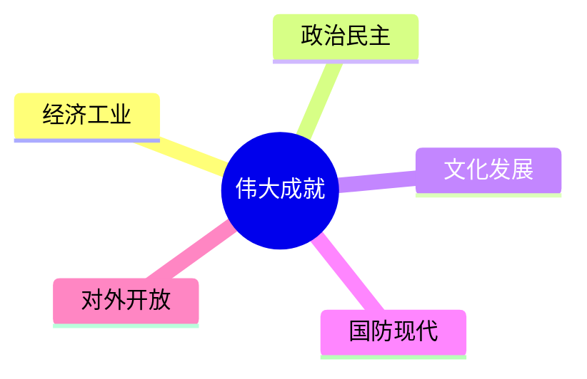

# 新中国成立初期取得的伟大成就及其说明的道理

## 为什么新民主主义革命胜利后必须看清这些成就

先问一句：中华人民共和国成立，只是把旧社会推翻了吗？还是它同时给后面的建设铺好了新路？从新中国成立到社会主义基本制度确立，再到后来发展工业、国防、外交，这一连串变化就是“伟大成就”。我们要理解：**成就不是零散新闻，而是历史新纪元的证据**。

## 它是什么

新中国成立初期及随后一段时期取得的伟大成就，主要指在政治、经济、文化、国防、外交等方面完成的历史性跨越。

先看政权更替带来的根本变化：

它包含三层含义：

- 结束了帝国主义、封建主义、官僚资本主义统治；
- 建立人民民主专政的国家制度；
- 为工业化、现代化和社会主义制度确立提供前提。

## 为什么需要这些成就

没有独立工业体系和国民经济体系，政治独立就不稳固。课件里指出：==独立的、比较完整的工业体系和国民经济体系，使中国在赢得政治独立之后赢得经济独立==。这也是社会主义制度优越性的体现。

## 成就有哪些

可按五个方面记：

| 方面 | 成就表现 | 说明的道理 |
|---|---|---|
| 经济 | 建立独立工业体系 | 社会主义能发展中国 |
| 政治 | 确立人大制度、多党合作、民族区域自治 | 人民当家作主有保障 |
| 文化 | 从新民主主义文化到中国特色社会主义文化 | 先进文化一脉相承 |
| 国防 | “两弹一星”、国防现代化 | 有实力才能护主权 |
| 外交 | 打破封锁、全方位开放 | 走和平发展道路 |

> [!IMPORTANT]
> 核心结论：只有社会主义才能救中国，才能发展中国；中国共产党是领导核心。

## 相近概念区别

“新中国成立”和“社会主义基本制度确立”不同：

- 1949年：新民主主义革命基本胜利，进入新民主主义社会；
- 1956年后：社会主义改造基本完成，社会主义基本制度确立。

不要混成一个时间点。

## 常见坑

> [!WARNING]
> 易错点：看见“工业体系意义”只答“经济变好”不够，必须答“经济独立”和“现代化物质基础”。

## 一个算对了的例子

简答：“从新中国成立取得哪些历史性成就？说明什么？”

正确答法是：先列五方面——经济独立到现代化、政治独立到民主政治、新民主主义文化到中国特色社会主义文化、打破封锁到全方位开放、“小米加步枪”到国防现代化；再总结：==只有在中国共产党领导下走中国特色社会主义道路，才能实现中华民族伟大复兴==。这样既覆盖成就，也答出“说明的道理”。
