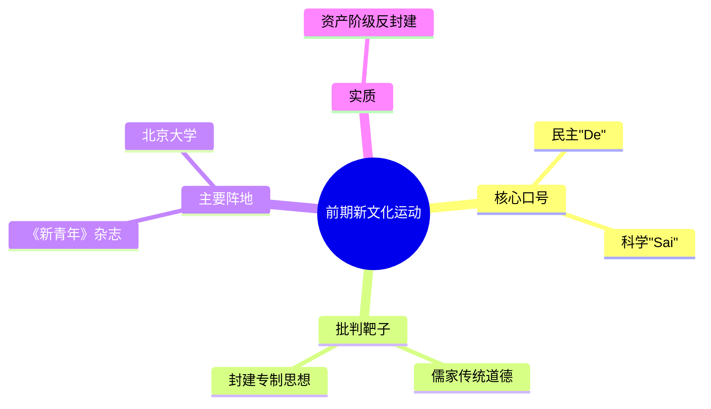

# 五四运动以前新文化运动的内容、意义与局限性

## 五四以前新文化运动的核心内容

辛亥革命虽然推翻了帝制，但为何没能真正改变中国？当袁世凯掀起“尊孔复古”逆流时，先进知识分子意识到：仅有政治制度的变革是不够的，必须进行一场彻底的思想启蒙。1915年陈独秀创办《青年杂志》（后改名《新青年》），标志着新文化运动的兴起。

这场运动的核心主张可以概括为“三提倡、三反对”：

-   **提倡民主与科学**：反对专制与迷信。“民主”指==资产阶级民主政治制度==，“科学”指自然科学及科学精神。
-   **提倡新道德**：反对旧道德。矛头直指维护封建专制的儒家传统道德（“吃人的礼教”）。
-   **提倡新文学**：反对旧文学。主张白话文取代文言文，使文化普及于民众。

> [!IMPORTANT]
> 批孔≠全盘否定孔子个人，而是针对==作为封建统治理论基础的儒家传统道德==。这是为了给中国发展资本主义扫清障碍。

## 历史意义与时代局限

如何评价这场运动？它既是伟大的思想解放，又带有明显的时代烙印。

### 历史意义

新文化运动是中国近代史上一次空前的思想解放运动。它动摇了封建思想的统治地位，使中国人民特别是==广大青年==受到民主与科学的洗礼，为马克思主义在中国的传播创造了条件。从近代化探索脉络看，它与维新变法、辛亥革命一脉相承，都要求实行资产阶级民主政治。

### 局限性

尽管影响深远，但五四以前的新文化运动存在三个根本局限，这也是后来转向马克思主义的关键原因：

| 局限维度 | 具体表现 | 本质原因 |
| :--- | :--- | :--- |
| 阶级立场 | 批判孔学是为发展资本主义扫障 | 资产阶级属性 |
| 实践路径 | 把改造国民性置于优先地位 | 脱离社会革命 |
| 思想方法 | 缺乏马克思主义批判精神 | 形式主义/绝对化 |

> [!WARNING]
> 许多领导人物使用的是==资产阶级方法==，对东西方文化存在“好就绝对好、坏就绝对坏”的形式主义偏向，未能将思想启蒙与工农群众的社会革命相结合。

## 易错辨析与真题应用

复习本知识点时，需警惕以下高频误区：

> [!CAUTION]
> -   **指导思想混淆**：前期是“民主与科学”，==不是==社会主义或马克思主义（后者是五四后才广泛传播）。
> -   **直接原因误判**：兴起标志是《新青年》创刊，但==直接原因==是袁世凯尊孔复古逆流，而非资本主义发展（那是经济基础）。
> -   **民主内涵窄化**：此处的“民主”特指==资本主义政治制度==，而非泛指人民权利或无产阶级民主。

以一道经典真题为例进行验证：

> **题目**：新文化运动中批孔实际上针对的是（ ）
> A. 儒家思想文化 B. 孔子思想学说 C. 儒家传统道德 D. 封建专制皇权

**解析**：倡导者并非要消灭所有儒家文化或否定孔子本人，也不是直接攻击皇权实体（帝制已亡）。他们批判的是被历代统治者神圣化、用来维系等级秩序的==儒家传统道德==。因此正确答案为 **C**。这印证了该运动“反封建思想根基”的实质，也体现了其服务于资产阶级民主革命的阶级属性。
