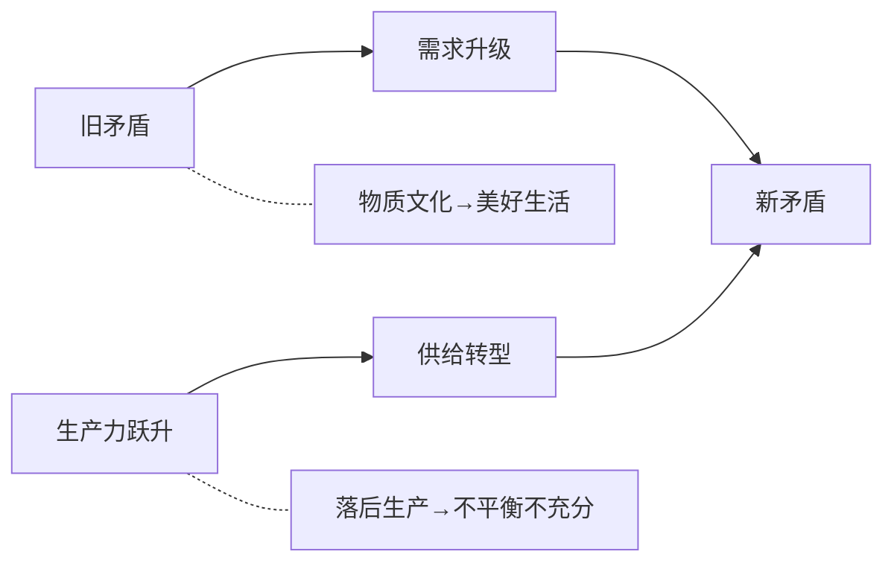

# 中国特色社会主义进入新时代的历史方位与重大意义

## 什么是新时代的历史方位

判断一个时代是否“新”，不能仅看时间推移，而要看社会发展的内在逻辑是否发生了质变。党的十九大作出重大政治论断：==中国特色社会主义进入了新时代==。这一历史方位的确立，并非否定过去，而是基于改革开放以来特别是十八大以来历史性成就的必然结果。它标志着近代以来久经磨难的中华民族迎来了从站起来、富起来到强起来的伟大飞跃。

> [!IMPORTANT]
> 新时代是承前启后、继往开来、在新的历史条件下继续夺取中国特色社会主义伟大胜利的时代，不是脱离社会主义初级阶段的新阶段。

## 为什么需要重新界定主要矛盾

既然我国仍处于社会主义初级阶段，为何要调整对社会主要矛盾的表述？这源于供需两端的深刻变化。一方面，稳定解决温饱并总体实现小康后，人民需求已从“物质文化”升级为涵盖民主、法治、公平、正义、安全、环境等的“美好生活需要”；另一方面，社会生产力显著提高，“落后的社会生产”已不再是全局性问题，==发展不平衡不充分==成为满足新需求的主要制约因素。

## 如何准确把握“两个没有变”

理解新时代，必须同时把握“变”与“不变”。社会主要矛盾的变化是关系全局的历史性变化，但==我国仍处于并将长期处于社会主义初级阶段的基本国情没有变==，==我国是世界最大发展中国家的国际地位没有变==。这“两个没有变”是制定路线方针政策的根本依据，防止因成就而滋生超越阶段的冒进倾向。

| 维度 | 已发生的变化 | 未改变的事实 |
| :--- | :--- | :--- |
| 需求侧 | 美好生活需要日益广泛 | 人民主体地位不变 |
| 供给侧 | 发展不平衡不充分凸显 | 初级阶段基本国情不变 |
| 国际坐标 | 综合国力显著提升 | 最大发展中国家地位不变 |

## 常见误区与答题要点

> [!WARNING]
> 切勿将“主要矛盾转化”等同于“基本国情改变”。考试中若出现“我国已跨越社会主义初级阶段”等表述，均为错误选项。

以简答题“新时代我国社会主要矛盾是什么，为什么会有这样的转变”为例，规范作答应包含三层：第一，准确写出新矛盾表述；第二，从需求侧说明“美好生活需要”的广泛性；第三，从供给侧指出“不平衡不充分”是当前主要制约因素。务必强调这一变化未改变初级阶段判断，避免失分。

> [!TIP]
> 记忆口诀：“一变两不变，供需双升级；美好对失衡，初级仍为基。”答题时先写结论再析原因，逻辑链完整方可得满分。
