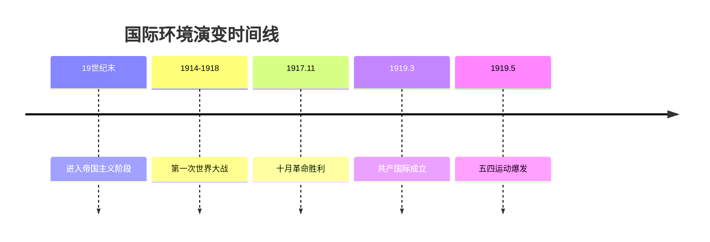

# 中国新民主主义革命发生的时代条件和国际环境（十月革命的影响）

中国的新民主主义革命不是凭空发生的。试想：如果世界还停留在19世纪自由资本主义时代，中国的反帝反封建斗争还能叫“新”民主主义革命吗？要理解这个“新”字，必须先看清它所处的时代条件和国际环境。

## 时代条件与国际环境是什么

> [!IMPORTANT]
> 核心结论：==第一次世界大战和俄国十月革命改变了整个世界历史的方向，划分了整个世界历史的时代==。中国的新民主主义革命正是在这一崭新时代条件下发生发展的。

具体包含四个维度的剧变：

1. **帝国主义阶段到来**：19世纪末20世纪初，西方发达国家从自由资本主义进入垄断资本主义（帝国主义）阶段。
2. **一战与格局洗牌**：1914—1918年一战爆发，欧洲衰落，美日崛起，日本成为中国的最大威胁。
3. **十月革命开辟新纪元**：1917年俄国十月社会主义革命胜利，开辟了人类历史的新纪元。
4. **共产国际与民族觉醒**：1919年列宁领导的共产国际成立，帮助中国等国先进分子创建共产党；亚非拉民族解放运动蓬勃兴起。

## 为什么需要关注国际环境

毛泽东在《中国革命和中国共产党》中最早提出“新民主主义革命”这一科学概念，并在《新民主主义论》等著作中系统阐明：==新民主主义革命不再是旧式的一般的资产阶级民主主义革命，而是世界无产阶级社会主义革命的一部分==。

如果没有十月革命，中国革命就找不到新的思想武器（马克思列宁主义）和新的国际同盟（世界无产阶级）。正是国际环境的根本变化，促使中国最终选择社会主义道路。

## 新旧民主主义革命的区别

怎么判断一场革命是“新”还是“旧”？关键看以下对比：

| 比较维度 | 旧民主主义革命 | 新民主主义革命 |
| :--- | :--- | :--- |
| **时代条件** | 世界资产阶级革命时代 | ==十月革命后的无产阶级革命时代== |
| **领导阶级** | 资产阶级 | 无产阶级 |
| **指导思想** | 三民主义等 | 马克思列宁主义 |
| **革命前途** | 建立资产阶级专政 | 过渡到社会主义社会 |
| **所属范畴** | 世界资产阶级革命一部分 | 世界无产阶级社会主义革命一部分 |

> [!NOTE]
> 材料分析题常考辨析：新民主主义革命的性质依然是“资产阶级民主主义革命”（因为任务是反帝反封建，不破坏一般私有制），但它是“新式的特殊的”，因为它由无产阶级领导，且为社会主义创造前提。

## 常见易错坑

> [!WARNING]
> 简答题问“时代条件”时，切勿照搬课件里关于“新中国打破封锁、70年代中美建交、十一届三中全会对外开放”的内容！那是新中国成立后及改革开放时期的外交努力，属于张冠李戴。答题必须紧扣“一战、十月革命、共产国际、二战”这条线索。

> [!CAUTION]
> 不要把“新民主主义革命”的起点和“时代条件”的起点搞混。时代条件的转折点是1917年十月革命，而中国新民主主义革命的开端是1919年五四运动。

## 真题实战演练

**题目**：最早提出新民主主义革命这一科学概念的文章是（ ）
A. 《中国社会各阶级的分析》 B. 《新民主主义论》 C. 《中国革命和中国共产党》 D. 《<共产党人>发刊词》

**解析步骤**：
1. 问自己：毛泽东在哪篇文章中对中国革命的对象、任务、动力、性质、前途逐一进行了详细阐述？答案是《中国革命和中国共产党》（排除A、D）。
2. 区分B和C：《新民主主义论》是“系统阐明”理论体系，而“最早提出”科学概念的是《中国革命和中国共产党》（1939年）。

**答案**：C。

> [!TIP]
> 记忆口诀：“最早概念找《中革》，系统阐明看三篇”。1939—1940年之交，《〈共产党人〉发刊词》《中国革命和中国共产党》《新民主主义论》共同构成了新民主主义理论体系。
