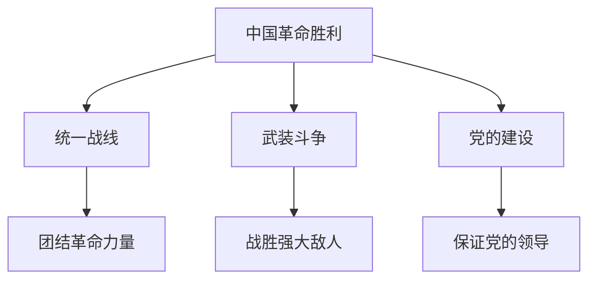

# 中国新民主主义革命胜利的原因、伟大意义和基本经验（三大法宝）

中国革命的胜利，是近代中国历史发展的必然结果，也是中国共产党领导人民长期奋斗的伟大成就。理解这一知识点，关键在于把握胜利的原因、意义和基本经验，尤其是“三大法宝”的内在逻辑。

## 胜利的原因

中国革命胜利的根本原因在于中国共产党的领导。中国共产党不仅代表工人阶级的利益，更代表整个中华民族和中国人民的利益。它以马克思主义为指导，结合中国实际形成了毛泽东思想，为革命提供了科学理论武装。在革命过程中，共产党人始终站在斗争最前线，表现出高度的牺牲精神和群众观念，赢得了人民的广泛支持。

此外，革命胜利还得益于广泛的群众基础和国际无产阶级的支持。中国革命是人民大众的革命，农民、工人、小资产阶级和民族资产阶级在不同阶段都参与了革命进程。

## 胜利的伟大意义

中华人民共和国的成立，标志着中国半殖民地半封建社会的结束，新民主主义社会在全国范围内的建立。它结束了帝国主义、封建主义和官僚资本主义的统治，实现了民族独立和人民解放，为国家的繁荣富强和人民的共同富裕创造了前提。

这一胜利也改变了世界政治格局，增强了社会主义阵营的力量，鼓舞了殖民地半殖民地人民的解放斗争。

## 基本经验：三大法宝

毛泽东指出：“统一战线，武装斗争，党的建设是中国共产党在中国革命中战胜敌人的三大法宝，三个主要的法宝。”

| 法宝 | 核心内容 | 作用 |
|------|----------|------|
| 统一战线 | 建立广泛的革命统一战线 | 团结一切可以团结的力量 |
| 武装斗争 | 坚持革命的武装斗争 | 以革命暴力反对反革命暴力 |
| 党的建设 | 加强共产党自身的建设 | 保证党的先进性和纯洁性 |

> [!IMPORTANT]
> ==三大法宝是中国革命胜利的基本经验，也是中国共产党领导革命的核心策略。==

## 常见误区与辨析

> [!WARNING]
> 注意区分“三大法宝”与“三大作风”。三大作风是理论联系实际、密切联系群众、批评与自我批评，属于党的建设内容，不能与三大法宝混淆。

另一个易错点是将“没有共产党就没有新中国”简单理解为口号，而忽视其历史依据。这一结论是中国人民基于切身体验确认的客观真理，体现了中国共产党在革命中的领导核心作用。

## 答题示例

**题目：为什么说“没有共产党就没有新中国”？中国革命取得胜利的基本经验是什么？**

**答案要点：**

第一，中国共产党代表中国人民和中华民族的根本利益，以毛泽东思想为指导，始终站在革命斗争最前线，赢得了人民的衷心拥护。

第二，中国革命胜利的基本经验是三大法宝：建立广泛的统一战线，坚持革命的武装斗争，加强共产党自身的建设。这三大法宝相互联系、相互促进，共同构成了中国革命胜利的根本保证。

> [!TIP]
> 记忆口诀：==“统战、武装、党建”==，分别对应“团结谁、怎么打、谁来带”。

这一知识点在考试中常以简答题形式出现，答题时应先明确三大法宝的内容，再结合历史事实说明其作用，最后点明其现实意义。
