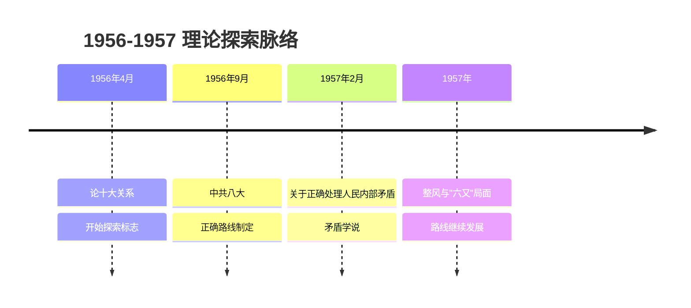

# 1956年至1957年中国共产党人在社会主义建设早期探索中的理论建树（《论十大关系》、中共八大、《关于正确处理人民内部矛盾的问题》）

## 这是什么

1956—1957 年，三大改造基本完成、社会主义制度刚建立，摆在党面前的问题从"如何建立社会主义"变成"如何建设社会主义"。以毛泽东为主要代表的中国共产党人提出了**马克思主义与中国实际"第二次结合"**的任务，围绕《论十大关系》、中共八大、《关于正确处理人民内部矛盾的问题》三篇/次核心成果，形成了社会主义建设早期探索的理论建树。

## 三大理论建树

### 《论十大关系》

1956 年 4 月发表，==是开始探索中国自己的社会主义建设道路的标志==。它从经济（主要）和政治两方面提出十大关系的指导方针，为中共八大做了理论准备。

### 中共八大

1956 年 9 月召开，制定了正确路线，为社会主义事业发展和党的建设指明方向。八大后又提出"可以消灭了资本主义，又搞资本主义"等新思想（"三个主体、三个补充"思路）。

### 《关于正确处理人民内部矛盾的问题》

1957 年 2 月发表，==创造性阐述社会主义社会矛盾学说==：社会主义社会仍存在矛盾，分敌我矛盾（专政）与人民内部矛盾（民主）两类，把正确处理人民内部矛盾作为国家政治生活的主题。

| 建树 | 时间 | 核心贡献 |
|---|---|---|
| 《论十大关系》 | 1956.4 | 探索标志、理论准备 |
| 中共八大 | 1956.9 | 正确路线、方向 |
| 《关于正确处理…》 | 1957.2 | 矛盾学说、长远指导 |

> [!IMPORTANT]
> ==1956—1957 年理论建树的核心，是围绕"如何建设社会主义"提出的三大成果：《论十大关系》（探索标志）、中共八大（正确路线）、《关于正确处理人民内部矛盾的问题》（矛盾学说）。==

## 常见的坑

> [!WARNING]
> 把"探索标志"记成中共八大。正确顺序是《论十大关系》先为八大做理论准备，==《论十大关系》才是探索标志==。

> [!TIP]
> 记忆口诀：**"论关系（起点）—开八大（路线）—讲矛盾（学说）"**，按 1956.4 → 1956.9 → 1957.2 时间轴串起来就不易混。

> [!NOTE]
> 与"毛泽东思想成熟"（土地革命后期和抗日战争时期，如《新民主主义论》《中国革命和中国共产党》）区分：1956—1957 年是**社会主义建设**的探索，不是新民主主义革命理论的成熟期。

## 一个答对的例子

题目：中国共产党人在 1956 年至 1957 年的早期探索中对社会主义建设有哪些理论建树？  
按六点作答即可：①"第二次结合"任务；②"向现代科学进军"；③《论十大关系》（探索标志）；④中共八大正确路线；⑤《关于正确处理人民内部矛盾的问题》（矛盾学说）；⑥整风与"六又"政治局面。

> [!CAUTION]
> 别漏掉①②⑥这三点：考试若只答三篇/次核心成果，会丢掉"第二次结合""向现代科学进军""六又政治局面"等分数点。
