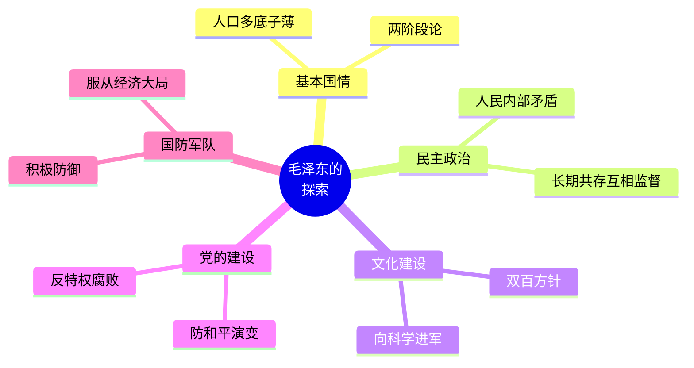

# 毛泽东是探索中国社会主义建设道路开创者的理解及对其历史地位的正确认识和评价（1945年《关于若干历史问题的决议》等）

## 它是什么

本章核心解决两个问题：**毛泽东在社会主义建设探索中做了什么**，以及**如何客观评价他的一生**。

1945年党的六届七中全会通过了《关于若干历史问题的决议》，总结了建党以来特别是六届四中全会至遵义会议前的经验教训。该决议使全党认识达到一致，为七大召开创造了条件。而到了社会主义建设时期，毛泽东又成为==探索中国社会主义建设道路的开创者==。

> [!IMPORTANT]
> 总体评价定调：全面评价毛泽东的一生，他的功绩是第一位的，是不可磨灭的。

## 为什么需要学这个

考试中常以简答题（如“为什么说毛泽东是开创者”）或材料分析题出现。如果不掌握探索的具体维度，答题时容易只写“功大于过”的空话而丢分。理解这段历史，也能明白薄一波同志提出的“始于毛，成于邓”这一重要命题的逻辑起点。

## 怎么做：五大探索维度与正确评价

毛泽东的探索可从五个维度展开记忆：

- **基本国情与发展阶段**：认清“大国、人口多、底子薄”，提出社会主义分为不发达和比较发达两个阶段。
- **民主政治**：把正确处理人民内部矛盾作为主题，坚持“长期共存、互相监督”。
- **文化**：实行“百花齐放、百家争鸣”，号召“向科学进军”。
- **党建**：最早觉察“和平演变”危险，强调保持艰苦奋斗作风，防止形成特权阶层。
- **国防**：提出建设现代化正规化国防军，制定积极防御战略。

在评价上，必须一分为二：他领导党和人民维护了国家独立，建立起社会主义基本制度；但后半生在探索中发生了“文化大革命”等严重错误，使社会主义事业走了大的弯路，应引为沉痛教训。

## 相近概念辨析

| 对比项 | 1945年《关于若干历史问题的决议》 | 探索中国社会主义建设道路 |
| :--- | :--- | :--- |
| **时间节点** | 延安时期（抗战胜利前夕） | 1956年社会主义改造基本完成后 |
| **核心任务** | 总结民主革命时期路线是非 | 解决“怎样建设社会主义”的问题 |
| **历史意义** | 统一全党思想，促成七大胜利召开 | 为中国特色社会主义理论提供基础 |

> [!WARNING]
> 不要把1945年的历史决议内容与建国后的探索混为一谈。1945年决议针对的是六届四中全会至遵义会议前的历史，而非社会主义建设时期。

## 常见的坑

> [!CAUTION]
> 看到“毛泽东的错误”就全盘否定，或者为了肯定功绩而回避“文化大革命”的错误。标准表述必须是：==功绩是第一位的，错误是第二位的==。

> [!TIP]
> 记忆口诀：“国情两段、民主矛盾、文化双百、党建防变、国防积极”。答简答题时，把这五个词扩充成句即可踩准得分点。

## 算对了的例子

**【真题演练】** 简述中共历史上第一个历史决议（1945年《关于若干历史问题的决议》）的主要内容及意义。

**满分作答逻辑**：
1. **背景/会议**：中共扩大的六届七中全会在延安召开并原则通过。
2. **内容**：对建党以后特别是党的六届四中全会至遵义会议前这一段党的历史及其经验教训进行了总结，对若干重大历史问题做出结论。
3. **意义**：使全党尤其是高级干部对中国革命基本问题的认识达到一致，增强了全党团结，为党的七大顺利召开创造了充分条件，有力促进了中国革命事业的发展。
