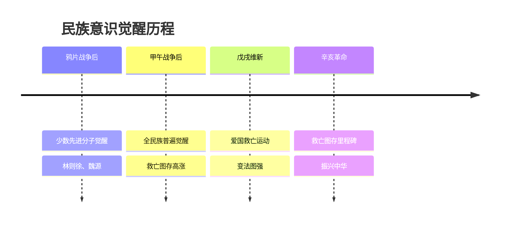

# 近代中国民族意识的觉醒（师夷长技以制夷、救亡图存）

近代中国民族意识的觉醒，是中国人民在反对外国侵略的斗争中，从“天朝上国”的迷梦中惊醒，逐步认识到民族危机并寻求救亡道路的过程。其核心脉络是：==鸦片战争后，少数先进分子开始“睁眼看世界”；甲午战争后，全民族普遍觉醒，“救亡图存”成为时代主题==。

## 觉醒的起点：师夷长技以制夷

鸦片战争后，先进的中国人开始痛定思痛，注意了解国际形势，研究外国历史地理，总结失败教训，寻找救国的道路和御敌的方法。

- **林则徐**：近代中国睁眼看世界的第一人。他组织翻译西方书刊，编成《四洲志》，初步打开了了解西方的窗口。
- **魏源**：在《海国图志》中提出==“师夷长技以制夷”==的思想，主张学习外国先进的军事和科学技术，以期富国强兵，抵御外国侵略，开创了中国近代向西方学习的新风。

> [!TIP]
> 记忆口诀：林则徐“睁眼看”，魏源“师夷长技”。前者重“了解”，后者重“学习”。

## 普遍觉醒：救亡图存成为时代主题

甲午战争以后，中华民族面临生死存亡的危机。帝国主义的瓜分狂潮和民族危机的刺激，使全民族开始有了普遍的民族意识的觉醒，救亡图存的思想日益高涨。

这种亡国灭种的危机感，增强了中华民族整体民族利益休戚与共的民族认同感和凝聚力，成为中华民族自立自强并永远立于世界民族之林的根本所在。

## 救亡图存的实践与局限

不同阶级和阶层提出了各自的救亡方案：

| 派别/事件 | 救亡主张 | 历史意义与局限 |
| :--- | :--- | :--- |
| 维新派（戊戌维新） | 只有维新变法才能救亡图存 | 高举救亡图存旗帜，推动民族觉醒；但对帝国主义抱有幻想，结果处处碰壁 |
| 革命派（辛亥革命） | 推翻君主专制，建立共和国 | 中国人民为救亡图存、振兴中华而奋起革命的里程碑，使中国发生历史性巨变 |
| 中国共产党（抗日战争） | 全民族抗战，争取民族独立 | 以最富于献身的爱国主义和模范行动，支撑起全民族救亡图存的希望，成为夺取抗战胜利的民族先锋 |

> [!IMPORTANT]
> 救亡图存不仅是思想口号，更是推动历史变革的实践动力。从维新变法到辛亥革命，再到全民族抗战，体现了民族意识觉醒的不断深化。

## 常见误区与辨析

> [!WARNING]
> 易错点一：混淆“睁眼看世界”与“师夷长技”。前者是林则徐，后者是魏源。
>
> 易错点二：认为民族意识在鸦片战争后已普遍觉醒。实际上，==普遍觉醒是在甲午战争以后==，此前仅限于少数先进分子。
>
> 易错点三：将“救亡图存”简单等同于“学习西方”。它更强调在民族危亡之际，各阶层为挽救民族危亡而进行的探索与抗争。

## 例题解析

**题目**：魏源在其（ ）中，提出了“师夷长技以制夷”的思想，主张学习外国先进的军事和科学技术，以期富国强兵，抵御外国侵略，开创了中国近代向西方学习的新风。

- A. 《四洲志》
- B. 《海国图志》
- C. 《夷情备采》
- D. 《盛世危言》

**答案**：B。

**解析**：《四洲志》是林则徐主持编译的；《海国图志》是魏源的代表作，系统阐述了“师夷长技以制夷”的思想；《盛世危言》是郑观应的著作，主张发展民族工商业。抓住“魏源—《海国图志》—师夷长技以制夷”这一对应关系即可准确作答。
