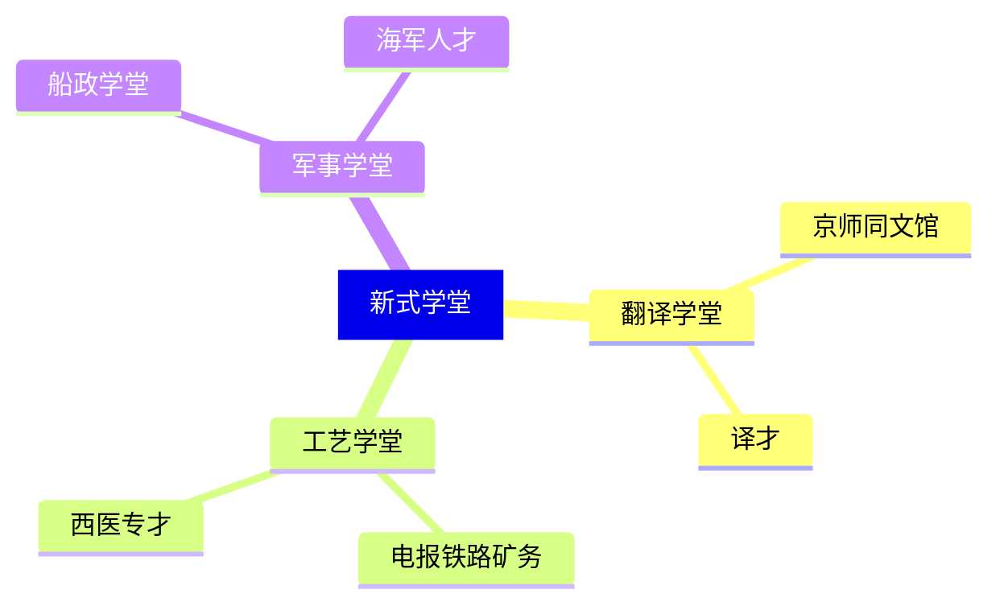
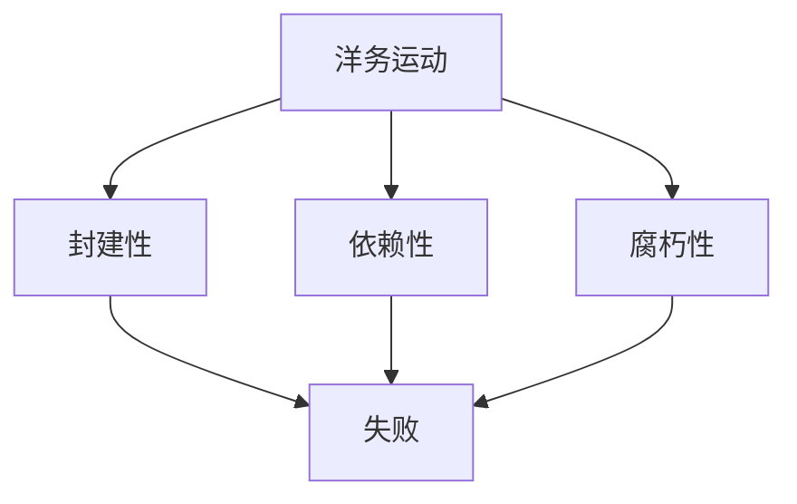

# 洋务运动的性质、主要内容（含新式学堂三种类型）、失败原因及教训

## 它是什么

> [!IMPORTANT]
> 核心结论：==洋务运动是封建统治者的自救改革，不是资产阶级革命==。

它是 19 世纪 60—90 年代，清朝统治集团里的 **洋务派** 打着“自强”“求富”旗号，引进西方军事装备、机器生产和近代教育，来==维护清朝封建统治==的运动。所以它一面办工厂、开学堂，有进步性；一面又死守“中体西用”，有落后保守性。

## 为什么需要它

两次鸦片战争和太平天国运动，让清廷感到“内忧外患”。想镇压人民、抵御外侮，就得学洋枪洋炮和近代工业。于是有了“师夷长技”的早期探索。

## 怎么做：新式学堂三种类型

考过简答：**洋务派创办新式学堂的主要类型（三类）**。

| 类型 | 代表 | 培养什么人 |
|---|---|---|
| 翻译学堂 | 京师同文馆 | 翻译人才 |
| 工艺学堂 | — | 电报、铁路、矿务、西医专才 |
| 军事学堂 | 船政学堂 | 新式海军人才 |

一个==算对了的例子==：答题只写“三类：翻译、工艺、军事”，并各举一例，就完整了。别只写“同文馆”。

## 和相近概念的区别

常有人把过渡时期总路线里的“一化三改”当成洋务运动。其实那是 1953 年中共提出的社会改造路线；洋务运动属于“对国家出路的早期探索”，是地主阶级搞的，不是社会主义改造。

> [!NOTE]
> 新文化运动也不是洋务运动。题目里若混入“新文化运动主要内容”，那是后期思想解放，不是本章早期探索。

## 为什么失败

先问一句：只换机器、不换制度，能救中国吗？

- **封建性**：“中体西用”，只想用技术补封建统治，不触碰旧制度。
- **依赖性**：处处靠外国设备与技术，列强不会让中国真富强。
- **腐朽性**：企业封建衙门式管理，贪污浪费盛行。

## 教训

> [!WARNING]
> 易错坑：别把失败只写成“武器不如人”。根子是==制度没变==。

由此得==核心结论==：==地主阶级不能担负起中国近代化的历史重任==。这也是第二章“早期探索”的关键落点。
