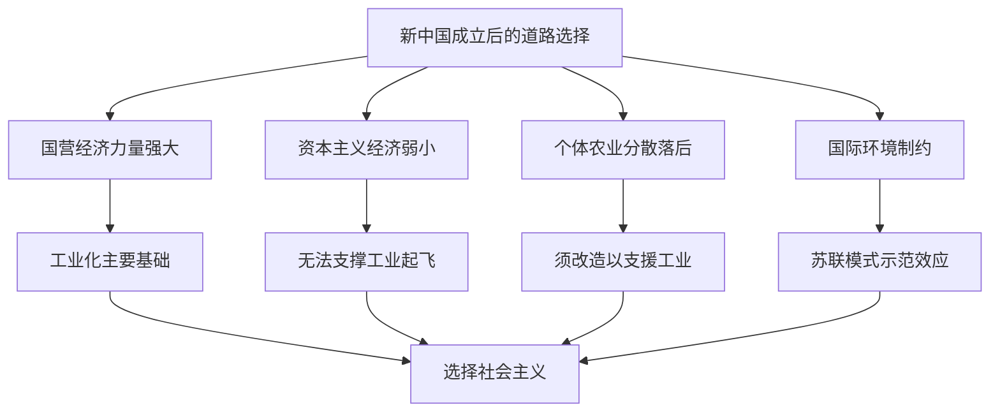
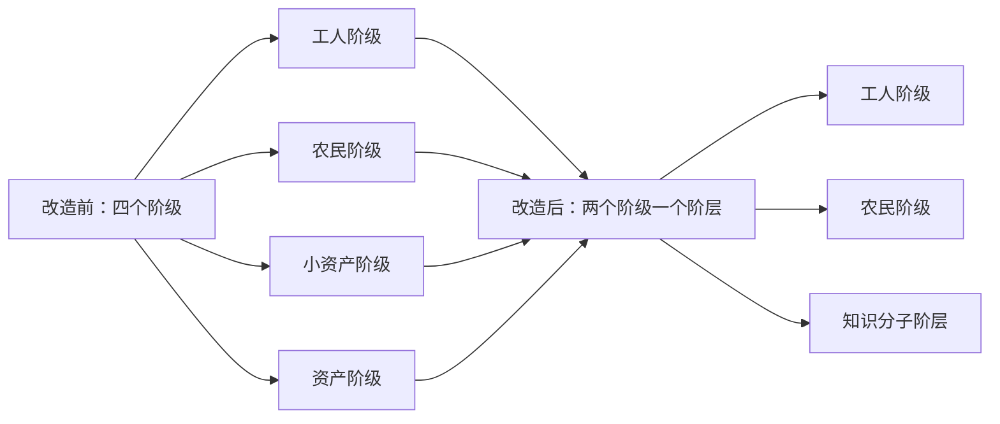

# 社会主义制度在中国的确立是历史和人民的选择的理解

## 为什么偏偏是“社会主义”

面对 1949 年后的道路选择，不妨先问自己：当时的中国，除了走社会主义道路，还有没有别的现实选项？

答案藏在当时的经济结构里。近代中国资本主义先天不足、后天失调，民族资本力量弱小、发展困难，根本无法承担“工业起飞”的重任。而**社会主义性质的国营经济**凭借没收官僚资本建立起来的雄厚实力，已经成为实现国家工业化的主要基础。国家的社会主义工业化，是国家独立和富强的当然要素和必要条件。

## 四个方面的历史必然

| 维度 | 核心判断 |
|------|----------|
| 国营经济 | 力量相对强大，是实现国家工业化的主要基础 |
| 资本主义经济 | 力量弱小、发展困难，不可能成为中国工业起飞的基础 |
| 个体农业 | 必须改造，才能保证工业发展、实现国家工业化 |
| 国际环境 | 冷战格局下，西方封锁、苏联援助，促使中国选择社会主义 |

对个体农业的改造尤为关键：小农经济分散落后，无法为工业化提供充足的粮食、原料和积累，==对个体农业进行社会主义改造，是保证工业发展、实现国家工业化的一个必要条件==。

> [!IMPORTANT]
> 这一选择是十分必要的、完全正确的。中国共产党创造性地完成了由新民主主义到社会主义的过渡，实现了中国历史上最伟大、最深刻的社会变革，开始了在社会主义道路上实现中华民族伟大复兴的历史征程。

## 和平赎买：一个算对了的例子

对资本主义工商业的改造最能体现“历史和人民的选择”。马克思、恩格斯曾提出和平赎买的设想，列宁在俄国尝试过但遭资产阶级拒绝；中国共产党将其付诸实践并取得成功。

> [!TIP]
> 赎买不是“花钱买企业”那么简单，而是让资本家在一定年限内从企业经营所得中获取一部分利润，同时把企业逐步转为国家所有。

按 1956 年全行业公私合营时核定的私股股额，总数为 24.1864 亿元。赎买实施过程中，资本家先后共获得约 32.5 亿元，超过其原有资产总额：

| 项目 | 金额（亿元） |
|------|-------------|
| 1949–1955 年利润 | 13 |
| 1955–1968 年定息 | 11 |
| 高薪 | 8.5 |
| **合计** | **≈32.5** |

> [!WARNING]
> 常见错误：把赎买总额写成“32.5 元”。结合上下文逻辑与历史常识，应为 **32.5 亿元**，且超过私股核定总额 24.1864 亿元。

这一政策的成效是多赢的：私营工商业在扩大生产、搞活流通、维持就业、增加税收方面继续发挥积极作用；国家争取到大多数民族资本家，将其逐步改造为自食其力的劳动者；许多人被安排担任领导职务，发挥经营管理特长。

## 与相近概念的区别

| 概念 | 含义 | 关键区别 |
|------|------|----------|
| 和平赎买 | 国家有偿将资本主义工商业改造为社会主义全民所有制 | 有偿、渐进，区别于无偿没收 |
| 没收官僚资本 | 无偿剥夺官僚买办资产，建立国营经济 | 无偿、直接，针对官僚资产阶级 |
| 农业合作化 | 引导个体农民走集体化道路 | 针对个体农业，非资本主义工商业 |

## 社会结构的历史性巨变

随着社会主义改造基本完成，中国社会阶级阶层结构发生根本变化：

官僚买办阶级消失，地主阶级被消灭，富农阶级正在消灭，民族资产阶级分子正由剥削者变为劳动者。工人阶级和农民阶级成为国家的主人，资产阶级作为阶级已被消灭。

> [!CAUTION]
> 不要把“社会主义改造完成”与“中华人民共和国成立”混为一谈：前者（1956 年）标志社会主义制度确立、进入社会主义初级阶段；后者（1949 年）标志新民主主义革命基本胜利、半殖民地半封建社会结束。

总之，社会主义制度在中国的确立，是==历史和人民的选择==。它奠定了中国一切进步和发展的基础，为后来的社会主义现代化建设开辟了广阔前景。
