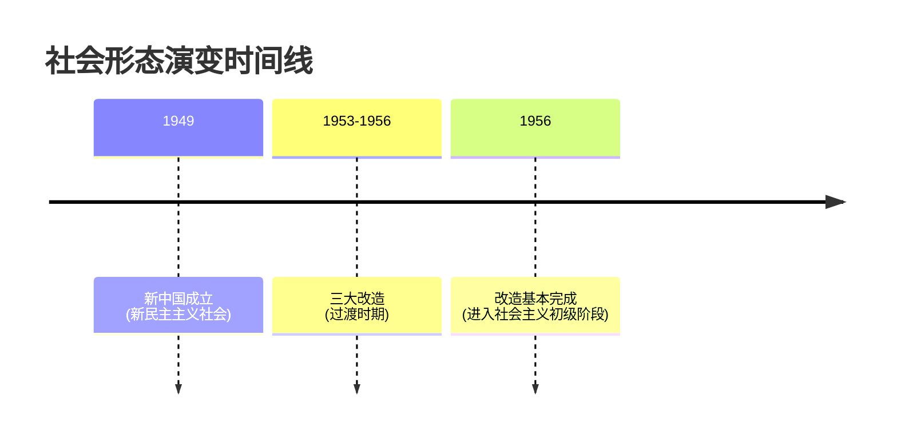

# 完成社会主义改造是中国历史上最伟大和最深刻的社会变革的原因及意义

# 完成社会主义改造是中国历史上最伟大和最深刻的社会变革

> [!IMPORTANT]
> ==核心结论==：社会主义改造的完成，标志着==社会主义基本制度在中国的确立==，中国从新民主主义社会进入==社会主义初级阶段==。这是20世纪中国第二次历史性巨变。

## 为什么是“最伟大、最深刻”的变革？

这一论断主要基于以下四个维度的历史性突破：

1.  **制度根本转变**：消灭了延续几千年的生产资料私有制和阶级剥削制度。社会主义经济成为国民经济主导，确立了社会主义经济制度。
2.  **平稳过渡奇迹**：在几亿人口大国，以==和平方式==消灭私有制，未造成生产力破坏，反而促进工农业发展，避免了巨大社会动荡。
3.  **理论创新贡献**：创造性地开辟了适合中国特点的改造道路（如和平赎买），丰富和发展了马克思主义科学社会主义理论。
4.  **解放生产力**：为后续社会主义现代化建设和人民生活水平提高奠定了根本政治前提和制度基础。

## “和平赎买”：独创性的实践案例

在对资本主义工商业的改造中，中国共产党实施了==和平赎买==政策，这是理解“伟大变革”的关键实例。

> [!TIP]
> **记忆要点**：马克思、恩格斯曾提出设想，列宁尝试未果，中国共产党成功实践。

### 实施效果与数据验证

通过“四马分肥”到“定息”的方式，国家不仅利用了私营工商业的积极作用，还成功将资本家改造为自食其力的劳动者。

| 项目 | 金额/状态 | 说明 |
| :--- | :--- | :--- |
| **核定私股总额** | 24.1864 亿元 | 1956年全行业公私合营时核定 |
| **资本家所得总计** | **32.5 亿元** | **超过原资产总额** |
| 其中：利润 | 13 亿元 | 1949-1955年 |
| 其中：定息 | 11 亿元 | 1955-1968年 |
| 其中：高薪 | 8.5 亿元 | 职务工资等 |

> [!NOTE]
> **阶级结构变化**：
> 官僚买办阶级消失，地主阶级消灭。
> 民族资产阶级分子由==剥削者==转变为==劳动者==。
> 社会结构演化为：“两个阶级（工人、农民）+ 一个阶层（知识分子）”。

## 常见误区与辨析

> [!WARNING]
> **易错点**：不要混淆“新民主主义社会”与“社会主义社会”。
> - **新民主主义社会**：过渡性质，五种经济成分并存，国营经济领导。
> - **社会主义社会**：公有制占主体，剥削制度基本消灭。

**思考引导**：
为什么说资本主义经济不能成为中国工业起飞的基础？
因为资本主义经济力量弱小、发展困难，且当时的国际环境（西方封锁）促使中国必须依靠强大的==社会主义国营经济==来实现国家工业化，这是历史和人民的选择。

总之，这一变革不仅确立了制度，更为实现中华民族伟大复兴开启了历史征程。
