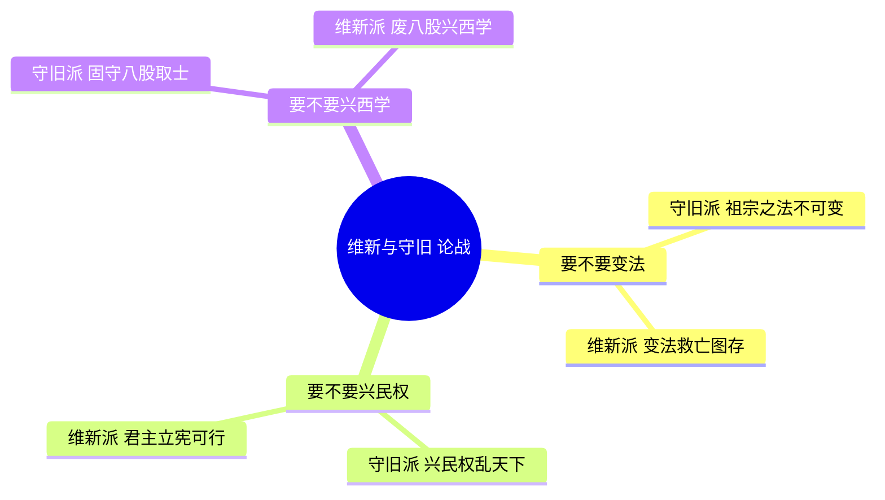
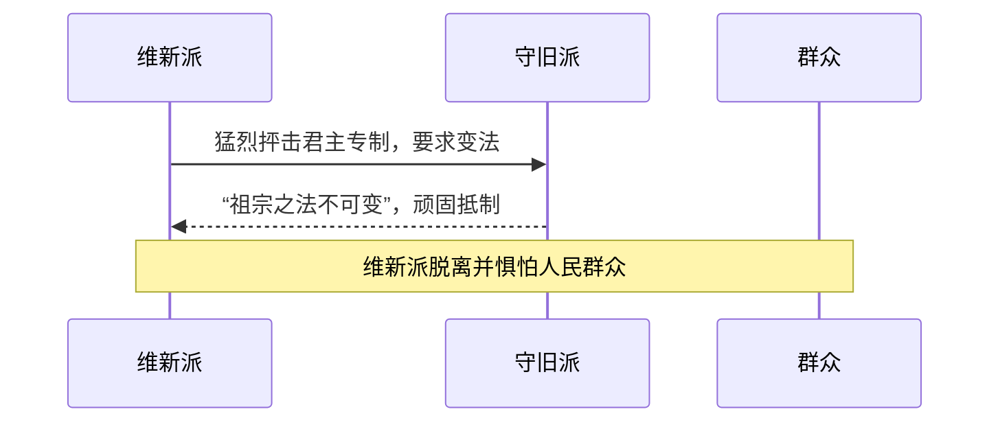

# 维新派与守旧派的论战（要不要变法、兴民权设议院、废八股改科举兴西学）

## 为什么要关注这场论战？

1895年甲午战败后，民族危机空前加深。康有为、梁启超等维新派试图通过变法救亡图存，但他们的主张直接冲击了统治集团中守旧势力的利益与信念。这场论战，不仅是政策之争，更是两种世界观的碰撞。

你需要把握的核心是：==这场论战的实质，是资产阶级思想与封建主义思想在中国的第一次正面交锋。==

## 论战的三个核心议题

维新派与守旧派（以徐桐、刚毅等为代表）围绕以下三个问题展开了激烈论辩：

| 核心议题 | 守旧派主张 | 维新派主张 |
| :--- | :--- | :--- |
| **一、要不要变法** | “祖宗之法不可变”，变革会动摇国本。 | “变者，古今之公理也。”只有变法才能==救亡图存==。 |
| **二、要不要兴民权、设议院** | 兴民权会使“君权旁落”，导致天下大乱。 | 君主专制是衰败之根，实行==君主立宪==才能长治久安。 |
| **三、要不要废八股、兴西学** | 八股取士是选拔人才的根本，西学是“奇技淫巧”。 | ==废八股、改科举、兴西学==是培育真才实学的当务之急。 |

## 论战的核心武器：理论著作

为了给变法提供理论依据，维新派著书立说，对传统思想进行了创造性的重新解释。

-   **康有为**：《新学伪经考》和《==孔子改制考==》。他大胆宣称东汉以来的古文经是“伪经”，并借孔子之名论证“改制”的合法性，将孔子包装成改革家。这看起来是“托古”，实则是为变法“开路”。
-   **梁启超**：主笔上海《时务报》，其文章《==变法通议==》笔锋常带感情，系统阐述了变法的必要性。
-   **严复**：在天津《国闻报》上，翻译了赫胥黎的《==天演论==》，以“物竞天择，适者生存”的生物进化论来警示国人：中国若再不变法，必将被淘汰。
-   **谭嗣同**：在《==仁学==》中，对封建纲常名教进行了最猛烈的抨击。

> [!IMPORTANT]
> 核心考点：维新派的理论宣传本身也带有局限性。例如康有为的“托古改制”，恰恰反映了维新派==不敢从根本上否定封建主义==，需要从旧的思想权威中寻找变法的合法性。

## 常见的坑：维新派的软弱性

考试中一个“高频坑”是混淆维新派的局限性与守旧派的观点。

> [!WARNING]
> **易错辨析**：
> 题目可能会问：“维新派主张推翻清朝统治，建立民主共和国”。这个表述是**错误**的。
> -   **维新派**的理想政治方案是==君主立宪==，他们不敢触动封建君主专制的根基，仅希望通过改良来限制君权。
> -   **革命派**（如孙中山）才主张用革命手段推翻清政府，建立民主共和国。这也是二者最根本的区别。

另一个常见错误是将“兴民权”理解为赋予人民真正的民主权利。维新派所说的“民权”，在当时主要指==资产阶级和士绅参政的权利==，他们与广大民众始终是脱离的，甚至惧怕群众运动。

## 论战的遗产与教训

这场论战打破了思想界的沉寂，推动了民族觉醒，为后来的革命运动埋下了思想火种。然而，维新变法最终还是失败了，其教训发人深省。

> [!CAUTION]
> **失败的深层根源**：
> 变法的失败，其根本原因不仅是守旧势力的强大，更在于维新派自身的阶级局限性：
> 1.  **不敢否定封建主义**：在政治、思想和经济上都与封建势力有着千丝万缕的联系。
> 2.  **对帝国主义抱有幻想**：期望通过英日等国的支持实现变法。
> 3.  **==惧怕人民群众==**：活动局限于官僚士大夫和知识分子的小圈子，得不到民众支持。

这场论战及其后续的变法实践，雄辩地证明：在半殖民地半封建的中国，企图通过统治者自上而下的==改良道路根本走不通==。要争取民族独立和国家富强，必须采用革命的手段。
