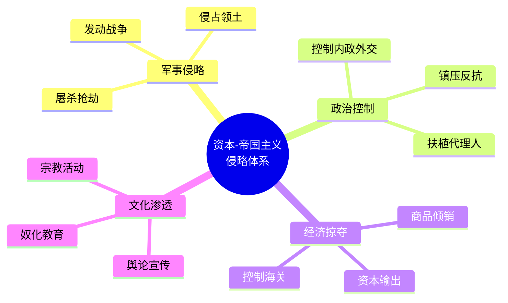

# 资本—帝国主义对中国的侵略（军事、政治、经济、文化侵略）

## 资本—帝国主义对中国的侵略

近代中国沦为半殖民地半封建社会的根本原因，在于==资本—帝国主义的侵略==。列强通过军事、政治、经济、文化四种手段，逐步控制了中国命脉。

> [!IMPORTANT]
> 核心逻辑：军事是先锋，政治是保障，经济是基础，文化是灵魂。四者相互配合，旨在==灭亡中国==而非帮助中国发展资本主义。

### 侵略的四个维度

| 维度 | 主要手段与表现 | 目的/后果 |
| :--- | :--- | :--- |
| **军事** | 发动战争、屠杀人民、勒索赔款、侵占领土 | ==首先和主要==的手段，打破中国防线 |
| **政治** | 控制内政外交、镇压反抗、扶植代理人 | 操纵中国政权，建立“以华制华” |
| **经济** | 控制通商口岸、剥夺关税自主权、商品倾销、==资本输出== | 操控经济命脉，使中国成为附庸 |
| **文化** | 宗教渗透、创办报刊、宣扬奴化思想 | 麻醉精神，摧毁民族自尊心 |

### 关键辨析：商品输出 vs 资本输出

很多同学在区分这两个概念时容易混淆。请注意时间线和性质的变化：

*   **19世纪末以前**：以==商品输出==为主。列强将中国作为销售市场和原料产地。
*   **19世纪末以后**（甲午战争后）：进入帝国主义阶段，==资本输出==成为重要形式。包括开设工厂、设立银行、政治贷款、争夺路矿权。

> [!TIP]
> 记忆技巧：早期卖货（商品），后期投资（资本）。《马关条约》允许日本在华设厂，标志着列强对华经济侵略由商品输出为主转为==资本输出==为主。

### 常见误区与考点

1.  **根本原因 vs 直接原因**：
    *   问：近代中国贫穷落后的==根本原因==？
    *   答：==资本—帝国主义的侵略==（选项C）。注意不是统治集团腐败（这是内部原因，非根本外部根源）。
2.  **文化渗透的目的**：
    *   不要误选“传播西方科学”。其真实目的是==宣扬殖民主义奴化思想==，麻醉中国人民精神（选项C）。
3.  **最终目的**：
    *   列强并非想帮助中国富强，而是为了==瓜分中国，灭亡中国==（选项D）。虽然因中国人民反抗导致“瓜分图谋破产”，但其野心从未改变。

### 真题演练

**例题**：19 世纪末资本主义进入帝国主义阶段后，（ ）成为殖民主义剥削的重要形式，并出现瓜分世界的狂潮。
A. 商品输出
B. 资本输出
C. 贩卖奴隶
D. 掠夺土地

**解析**：
根据课件知识点，19世纪末随着垄断资本主义形成，列强急需海外投资场所。此时，==资本输出==取代商品输出成为主要剥削形式。
*   A项是自由资本主义阶段特征。
*   C项是早期殖民扩张特征。
*   D项虽存在，但不是帝国主义阶段最典型的*新*特征。
*   **正确答案：B**

> [!WARNING]
> 易错点：不要看到“侵略”就只想到打仗。经济上的==资本输出==和政治上的==扶植代理人==（如清政府、北洋军阀）同样是侵略的重要组成部分，且更具隐蔽性和持久性。
