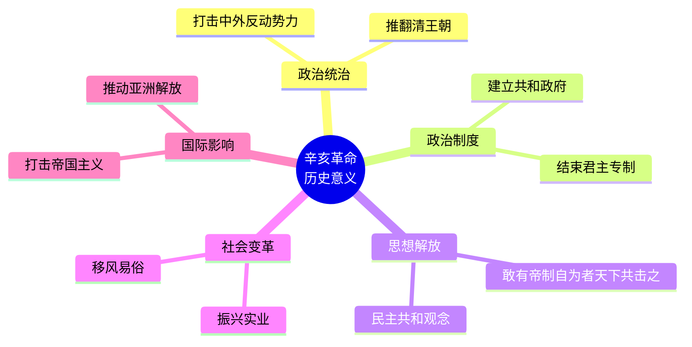

# 辛亥革命引起近代中国历史性巨大变化的意义

## 它是什么：一座“里程碑”

辛亥革命（1911 年）是资产阶级领导的、以推翻君主专制、建立资产阶级共和国为目的的革命，是一次==比较完全意义上的资产阶级民主革命==。在近代史上，它是中国人民救亡图存、振兴中华而奋起革命的一座==里程碑==，使中国发生了历史性的巨变。

> [!IMPORTANT]
> 历史意义的标准表述是“五个变化”：政治统治、政治制度、思想解放、社会变革、国际影响。答题时按此五点展开，每点先结论后展开。

## 为什么需要：它改变了什么

想一个问题：皇帝被看作至高无上、神圣不可侵犯的绝对权威——如果连皇帝都可以被打倒，还有什么陈腐的东西不可以被怀疑、不可以被抛弃？这正是辛亥革命最深层的冲击。

## 怎么做：五点展开

**第一，推翻清王朝，沉重打击反动势力。** 辛亥革命推翻了封建势力的政治代表、帝国主义在中国的代理人清王朝的统治，使中国反动统治者在政治上乱了阵脚。此后，帝国主义和封建势力再也不能建立起比较稳定的统治，为中国人民的斗争开辟了道路。

**第二，结束君主专制，建立共和政府。** 它结束了中国延续两千多年的封建君主专制制度，建立了中国历史上第一个资产阶级共和政府，使民主共和的观念开始深入人心，形成了“==敢有帝制自为者，天下共击之==”的民主主义观念。因此，当袁世凯、张勋先后复辟帝制时，均受到社会舆论的强烈谴责和人民群众的坚决反抗。

**第三，推动思想解放。** 皇帝都可以被打倒，激发了人民的爱国热情和民族觉醒，打开了禁锢思想进步的闸门。

**第四，推动社会变革。** 南京临时政府以振兴实业为目标，设立实业部，颁布有利于工商业发展的政策，使随后几年成为资本主义发展的“黄金时代”。同时提倡社会新风、扫除“风俗之害”：改用公历，下级见上级不再行跪拜礼，以“先生”“君”取代“老爷”等称呼，男子剪辫、女子放足之风席卷全国。

**第五，国际影响。** 辛亥革命不仅在一定程度上打击了帝国主义的侵略势力，而且推动了亚洲各国民族解放运动的高涨。

## 与相近概念的区别

| 维度 | 辛亥革命 | 戊戌变法（改良） |
|------|----------|------------------|
| 方式 | 革命（暴力） | 改良（自上而下） |
| 政体目标 | 废除君主制，建共和国 | 保留君主，行立宪 |
| 结果 | 推翻清王朝，结束帝制 | 百日而亡 |

> [!WARNING]
> 不要把“结束了封建制度”写成“结束了封建社会”。辛亥革命结束的是==封建君主专制制度==（政体），中国半殖民地半封建的社会性质并未改变——这也是它失败的一面。

## 一个答对了的例子

**题目：为什么说辛亥革命引起了近代中国的历史性巨大变化？**

**答题要点（五点）：**

① 推翻清王朝，沉重打击中外反动势力，使其在政治上乱了阵脚；
② 结束两千多年封建君主专制制度，建立第一个资产阶级共和政府，民主共和观念深入人心；
③ 给人们带来一次思想上的解放；
④ 促使社会经济、思想习惯和社会风俗发生新的积极变化；
⑤ 一定程度上打击帝国主义侵略势力，推动亚洲各国民族解放运动高涨。

> [!TIP]
> 记忆口诀：**“推翻王朝、结束帝制、思想解放、社会变革、影响亚洲”**——五句话对应五个得分点，简答题按此顺序默写即可。
