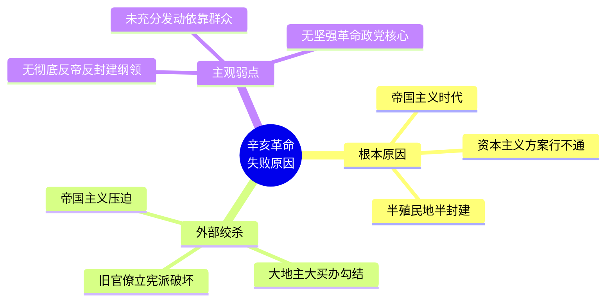

# 辛亥革命失败的原因及其说明的问题（资产阶级共和国方案行不通）

辛亥革命虽然推翻了清王朝，建立了中国历史上第一个资产阶级共和政府，颁布了《中华民国临时约法》，使民主共和观念深入人心，但最终果实被袁世凯窃取。这场“比较完全意义上的资产阶级民主革命”为何没能救中国？

## 失败原因剖析

我们可以从客观环境与主观力量两个维度来拆解：

> [!IMPORTANT]
> ==根本原因在于半殖民地半封建社会中，资本主义建国方案行不通。==帝国主义决不允许中国建立一个独立富强的资产阶级共和国，必然加以绞杀。

具体而言，失败原因可梳理为以下结构：

- **没有提出彻底的反帝反封建的革命纲领**：革命派甚至幻想帝国主义支持，不敢触动封建土地制度。
- **不能充分发动和依靠人民群众**：脱离占人口绝大多数的农民，导致革命缺乏深厚根基。
- **不能建立坚强的革命政党**：同盟会组织松散，无法作为团结一切革命力量的强有力核心。

## 为什么资产阶级共和国方案行不通？

在近代中国的政治实践中，摆在人民面前的建国方案主要有三种。为什么唯独第二种走不通？

| 建国方案 | 代表阶级 | 目标 | 结局 |
| :--- | :--- | :--- | :--- |
| 地主与买办资产阶级 | 北洋军阀等 | 维持半殖民地半封建统治 | 被人民抛弃 |
| ==民族资产阶级== | 革命派 | 建立名副其实的资产阶级共和国 | ==行不通== |
| 工人阶级及同盟者 | 共产党 | 创建新民主主义的新中国 | 历史的选择 |

> [!NOTE]
> 方案行不通由当时中国所处的时代条件和国内阶级关系决定：
> 1. **外国有过的，中国不能有**：中国受帝国主义压迫，建立资产阶级共和国是列强不能容忍的。
> 2. **自身太软弱**：民族资产阶级没有勇气和能力领导人民进行彻底反帝反封建斗争，无法为建国扫清障碍。

## 历史教训与启示

辛亥革命的失败说明了一个极其残酷却清醒的事实：

> [!TIP]
> ==资产阶级共和国的方案没有能够救中国，先进的中国人需要进行新的探索，为中国谋求新的出路。==

这直接推动了后来新文化运动的兴起与马克思主义在中国的传播。

## 答题实战演练

以考过的简答题为例：“辛亥革命为什么会失败？它的失败说明了什么？”

**【满分作答逻辑】**

1. **先答根本（客观）**：在帝国主义时代、半殖民地半封建的中国，资本主义建国方案行不通。帝国主义与以袁世凯为代表的大地主、大买办及旧官僚、立宪派内外勾结绞杀了革命。
2. **再答主观（三点）**：①无彻底反帝反封建纲领；②不能充分发动依靠群众；③不能建立坚强革命政党作核心。
3. **最后答教训**：表明资产阶级共和国方案未能救中国，先进中国人需进行新探索、谋求新出路。

> [!WARNING]
> 常见丢分坑：只写主观弱点（如没发动群众），漏掉“根本原因”（帝国主义时代、半殖民地半封建社会性质）。考试时务必先点明==根本原因==，再展开主观错误。
