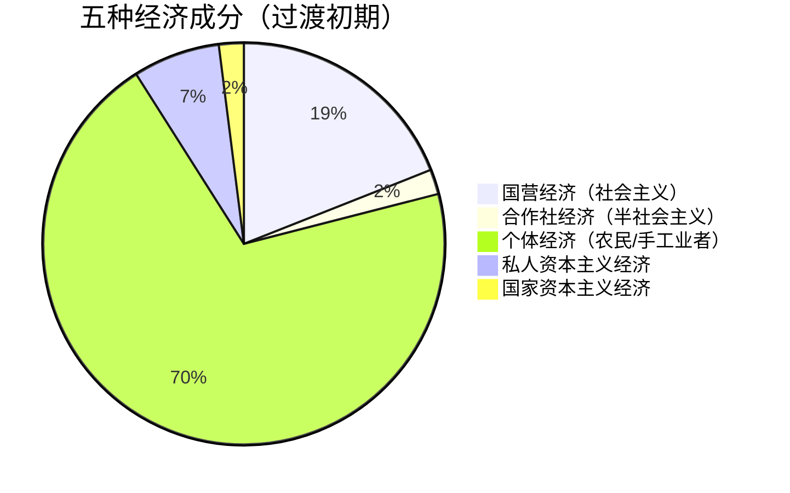
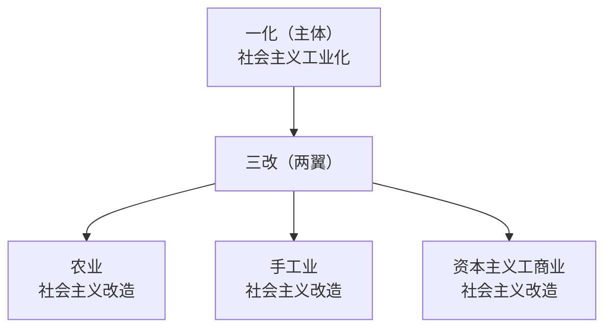

# 党在过渡时期的总路线及其历史必然性

## 过渡时期总路线：从“能造什么”到“必须过渡”

近代以来，中国人都有一个朴素的愿望：造自己的飞机、汽车、拖拉机。但到 1952 年底，国民经济恢复虽已完成，毛泽东却尖锐地指出：“现在我们能造什么？能造桌子椅子，能造茶碗茶壶……但是，一辆汽车、一架飞机、一辆坦克、一辆拖拉机都不能造。”

这就引出一个根本问题：新民主主义社会已经建立了，为什么不继续走下去，非要“过渡”？

### 新民主主义社会为何“过渡”

新民主主义社会不是一个凝固不变的社会形态。其根本特征在于经济成分的多样性与力量的消长。

> [!IMPORTANT]
> 五种经济成分中，==社会主义性质的国营经济虽比重不大，但处于领导地位==；个体经济如汪洋大海，非社会主义因素仍占很大比重。这种格局决定了新民主主义社会必然是一个过渡性社会，不可能长期维持。

在政治上，工人阶级的领导权和马克思主义的指导地位，使社会主义因素从一开始就居于主导。经济上，国营经济控制着国民经济命脉，合作社经济是引导个体经济走向集体化的桥梁。

> [!TIP]
> 理解“过渡性”的核心线索：社会主义因素不断增长 + 非社会主义因素逐步被改造 → 整个社会必然走向社会主义。

### 总路线的内容与“一化三改”

1953 年，党正式提出过渡时期总路线：

> 从中华人民共和国成立，到社会主义改造基本完成，这是一个过渡时期。党在这个过渡时期的总路线和总任务，是要在一个相当长的时期内，逐步实现国家的社会主义工业化，并逐步实现国家对农业、对手工业和对资本主义工商业的社会主义改造。

概括起来就是**“一化三改”**，被形象地称为“一体两翼”：

- **“一化”**：逐步实现社会主义工业化，这是总路线的**主体**。
- **“三改”**：逐步实现对农业、手工业、资本主义工商业的社会主义改造，这是总路线的**两翼**。

> [!WARNING]
> 过渡时期总路线是“建设与改造同时并举”的路线，==工业化是改造的物质基础，改造是工业化的制度保障==，二者相互促进，不可割裂。

### 历史必然性：为什么只能走这条路

**第一，国营经济力量强大，是实现工业化的主要基础。**
新中国成立后通过没收官僚资本，建立了掌握经济命脉的国营经济。1952 年，国营工业产值占全国工业总产值的 56%。要实现国家工业化，必须依靠和壮大这一力量。

**第二，资本主义经济弱小分散，无法承担工业化重任。**
民族资本主义工业规模小、技术落后、结构畸形，主要集中在轻工业。1952 年，私营工业只占全国工业总产值的 39%，且资金匮乏，不可能成为中国工业起飞的基础。

**第三，个体农业制约工业化，必须走合作化道路。**
小农经济分散落后，商品率极低，既无法为工业化提供充足的粮食和原料，也无法形成旺盛的市场需求。不改造个体农业，工业化就会“跛脚走路”。

**第四，国际环境的倒逼。**
以美国为首的西方国家对新中国实行封锁禁运，只有苏联等社会主义国家愿意提供援助。苏联的社会主义建设经验，为中国提供了直接的参照。

> [!CAUTION]
> 常见误区：认为“过渡是人为加速的结果”。实际上，==从新民主主义到社会主义的转变，是当时中国社会内在矛盾运动和国际环境共同作用的必然结果==。社会主义经济因素的增长、资本主义因素的受限、个体经济的困境，都指向同一个方向。

### 一道经典选择题的解答逻辑

考试中经常出现这样的题目：

> **中华人民共和国的成立，标志着新民主主义革命阶段的基本结束和社会主义革命阶段的开始，即由新民主主义到社会主义的过渡时期。**

这一判断的依据在于：新中国成立后，虽然还要继续完成民主革命的遗留任务（如土地改革），但政权已掌握在工人阶级手中，==社会主义革命的任务已经开始启动，没收官僚资本本身就带有社会主义革命的性质==。因此，1949—1956 年这一时期的根本性质是“过渡时期”，其起点是中华人民共和国成立，终点是三大改造基本完成。

> [!NOTE]
> 区分两个起点：新民主主义革命的起点是 1919 年五四运动，社会主义革命的起点是 1949 年新中国成立。过渡时期不是独立的社会形态，而是从新民主主义向社会主义的渐变过程。
