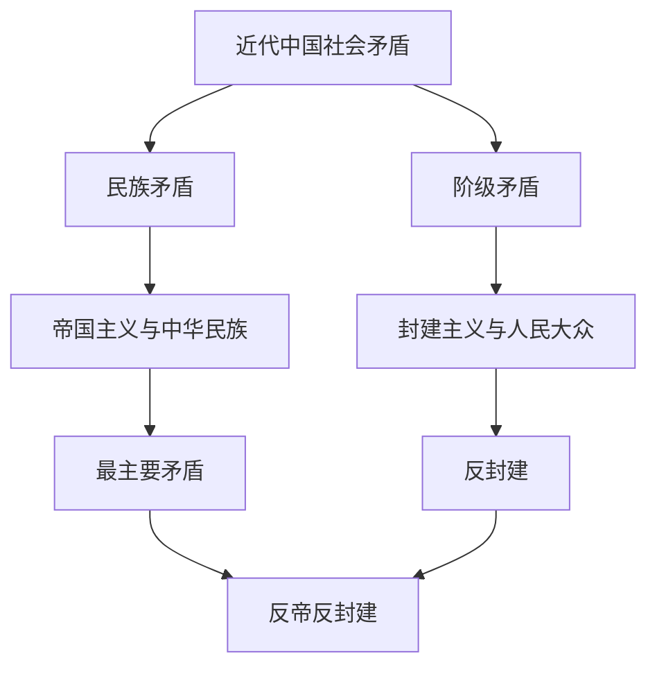

# 近代中国社会的主要矛盾（帝国主义和中华民族的矛盾、封建主义和人民大众的矛盾）

## 它是什么

近代中国半殖民地半封建社会的矛盾错综复杂，包括中华民族与资本-帝国主义的矛盾、农民阶级与地主阶级的矛盾、资产阶级与地主阶级的矛盾、无产阶级与资产阶级的矛盾、封建统治阶级内部各集团派系的矛盾、各帝国主义国家在中国争夺的矛盾等。

其中，占支配地位的主要矛盾是：

> [!IMPORTANT]
> ==帝国主义和中华民族的矛盾、封建主义和人民大众的矛盾==。这两对主要矛盾及其斗争贯穿整个中国半殖民地半封建社会的始终，并对中国近代社会的发展变化起着决定性作用。

前者属于民族矛盾，后者属于阶级矛盾。两对矛盾互相交织，其中，**帝国主义和中华民族的矛盾是最主要的矛盾**。

## 为什么需要

主要矛盾决定近代中国革命的对象和任务。资本-帝国主义的侵略和本国封建势力对人民的压迫，是中国落后、贫困的根本原因。因此，中国人民必须把反对帝国主义的民族斗争和反对封建主义的阶级斗争统一起来，争取民族独立、人民解放，并为国家繁荣富强、人民共同富裕创造条件。

判断一种斗争是否抓住主要矛盾，可以看它是否触及帝国主义和封建主义的联合统治。戊戌维新派不敢否定封建主义，又对帝国主义抱有幻想，说明改良道路难以完成反帝反封建任务；辛亥革命推翻清王朝，沉重打击了中外反动势力；中国共产党在大革命中提出反对帝国主义、反对军阀的政治口号，进一步明确了革命方向。

## 两对矛盾如何变化

“最主要”不等于任何时期、任何具体斗争中民族矛盾都排在第一位，要结合斗争形势判断。

| 情形 | 矛盾地位的变化 | 典型表现 |
|---|---|---|
| 资本-帝国主义发动侵略战争 | 民族矛盾特别尖锐，阶级矛盾暂时降到次要和服从地位 | 鸦片战争、第二次鸦片战争、中法战争、中日甲午战争、义和团反帝运动 |
| 帝国主义与反动统治阶级结盟，共同压迫人民 | 阶级矛盾上升为主要矛盾，斗争矛头主要直接指向封建政权 | 太平天国农民战争、辛亥革命 |
| 国内战争根本威胁中外反动势力统治 | 外国侵略者与国内封建统治者公开站在一条战线上 | 太平天国后期清政府“借师助剿” |

> [!WARNING]
> 不要把“封建主义和人民大众的矛盾”答成“农民阶级和地主阶级的矛盾”。后者只是前者的具体表现之一，“人民大众”的范围更广。也不要把“两对主要矛盾”误答为“三组”或漏掉“最主要的矛盾”。

## 相近概念与答题方法

社会性质、主要矛盾和历史任务相互衔接，但不能混为一谈：

| 问题 | 规范答案 |
|---|---|
| 社会性质 | 半殖民地半封建社会 |
| 两对主要矛盾 | 帝国主义和中华民族的矛盾；封建主义和人民大众的矛盾 |
| 最主要的矛盾 | 帝国主义和中华民族的矛盾 |
| 革命任务 | 反对帝国主义、反对封建主义 |

答“近代中国社会有哪些矛盾”时，先列举各种矛盾，再突出两对主要矛盾及其决定作用；答“主要矛盾及其相互关系”时，还要写出互相交织、主次地位随形势变化，并各举一例。

## 一个答对了的例子

**题目：简述近代中国社会的两对主要矛盾及其相互关系。**

**参考答案：**近代中国社会的两对主要矛盾是帝国主义和中华民族的矛盾、封建主义和人民大众的矛盾。它们贯穿半殖民地半封建社会始终，互相交织，其中帝国主义和中华民族的矛盾是最主要的矛盾。外国发动侵略战争时，民族矛盾特别尖锐，如中日甲午战争；中外反动势力结盟压迫人民时，阶级矛盾可能上升为主要矛盾，如辛亥革命。两对主要矛盾决定了中国人民必须把反帝民族斗争与反封建阶级斗争统一起来。
