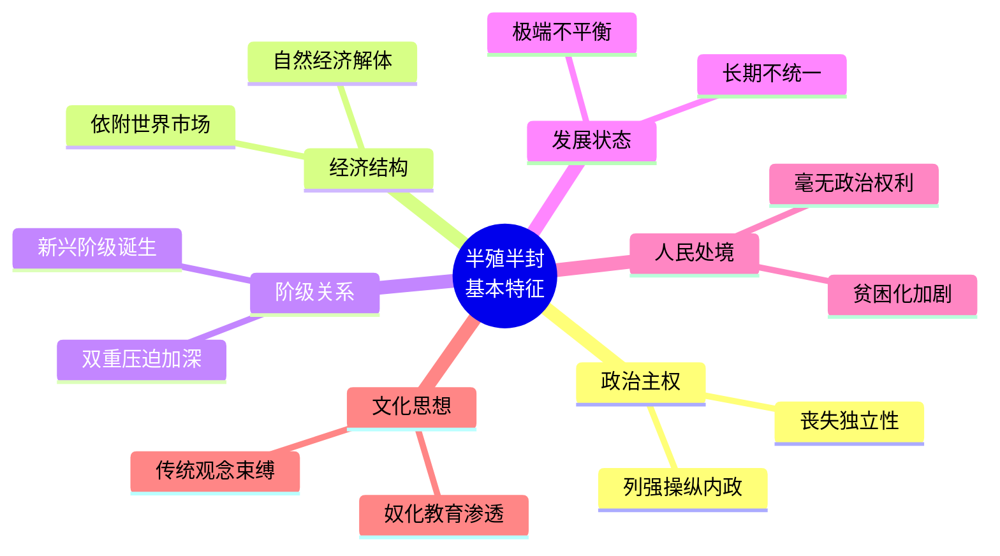

# 近代中国半殖民地半封建社会的形成与基本特征

## 什么是半殖民地半封建社会

近代中国社会性质并非简单的“落后封建国家”，而是==半殖民地半封建社会==。这一概念包含两个不可分割的维度：

-   **半殖民地**：指形式上独立，但政治、经济、外交受帝国主义控制，丧失完整主权。
-   **半封建**：指自然经济解体，资本主义因素产生，但封建剥削制度（地主土地所有制）仍占主导。

> [!IMPORTANT]
> 核心定性：鸦片战争后，中国既不是完全的殖民地，也不是纯粹的封建社会，而是两者交织的过渡形态。这是理解近代一切革命与改革的逻辑起点。

## 六大基本特征与内在逻辑

教材归纳了六个基本特征，死记硬背容易混淆。不妨思考：这些特征是孤立存在的吗？其实它们是由“帝国主义侵略”与“封建势力勾结”这两条线索串联起来的。

[!TIP]
记忆口诀：“政经阶发人文”——政治失权、经济依附、阶级变动、发展失衡、人民困苦、文化奴化。答题时按此框架展开，避免漏点。

## 主要矛盾的动态演变

认识了社会性质，就能推导出主要矛盾。近代中国存在多重矛盾，但起决定作用的是两对：==帝国主义与中华民族的矛盾==、==封建主义与人民大众的矛盾==。

> [!WARNING]
> 易错坑：两对矛盾的地位并非一成不变！考试中常考查“矛盾转化”的情境判断。

| 历史情境 | 上升为主要矛盾 | 退居次要地位 | 典型史实 |
| :--- | :--- | :--- | :--- |
| 外敌发动侵略战争时 | 民族矛盾 | 阶级矛盾 | 鸦片战争、甲午战争 |
| 中外反动势力勾结压迫时 | 阶级矛盾 | 民族矛盾 | 太平天国、辛亥革命 |
| 威胁列强在华根本利益时 | 民族+阶级合流 | — | 清廷“借师助剿” |

## 真题解析与避坑指南

以单选题为例：“造成近代中国贫穷落后的根本原因是（ ）”。

-   A. 中国落后的经济制度
-   B. 中国落后的政治制度
-   C. 资本—帝国主义的侵略
-   D. 统治集团的腐败

**正确选项为 C**。许多同学误选 A 或 B，是因为只看到了“半封建”的一面。实际上，正是资本-帝国主义的侵略（选择8也印证了其首要手段是军事侵略），阻碍了中国独立发展资本主义的可能，使封建制度得以苟延残喘。==外部侵略是根源，内部腐朽是条件==，二者不能本末倒置。

> [!CAUTION]
> 高危误区：切勿将“半殖民地”等同于“殖民地”。《辛丑条约》标志着半殖民地社会完全形成，但中国始终保留了名义上的中央政府，这与印度等完全殖民地有本质区别。简答题若问“社会性质”，必须答全“半殖民地半封建”，少写任何一半均不得分。
