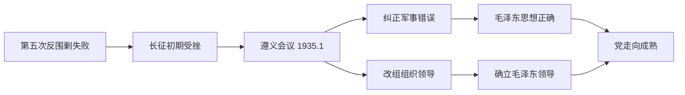

# 遵义会议的历史意义及其在党的历史上的伟大转折作用

1935 年 1 月，红军长征途中，中共中央政治局在贵州遵义召开扩大会议——即遵义会议。当时党正面临第五次反"围剿"失败和长征初期严重受挫的严峻局面，王明"左"倾冒险主义在党中央占统治地位，军事指挥屡屡失误。遵义会议正是在这一生死存亡的紧急关头召开的。

## 会议解决的两个最迫切问题

> [!IMPORTANT]
> 遵义会议集中全力解决了当时最为紧迫的==军事问题==和==组织问题==，而没有全面讨论政治路线问题（这是为避免党内分裂、争取多数的策略考量）。

- **军事问题**：批判了博古、李德在第五次反"围剿"和长征初期军事指挥上的错误，==肯定了毛泽东军事思想的正确性==。
- **组织问题**：改组中央领导机构，==结束了王明"左"倾冒险主义在党中央的统治==，毛泽东被增选为政治局常委，事实上确立了毛泽东在红军和党中央的领导地位。

## 历史意义

遵义会议是中国共产党历史上==生死攸关的转折点==，其伟大意义体现在三个方面：

| 意义维度 | 具体表现 |
| --- | --- |
| 路线转折 | 使党的路线转到把马克思列宁主义普遍真理同中国革命实际相结合的轨道 |
| 领导核心 | 确立了毛泽东在红军和党中央的领导地位 |
| 党的成熟 | ==第一次独立自主地运用马克思列宁主义解决中国革命问题==，标志着党从幼年走向成熟 |

> [!TIP]
> 记忆口诀：**"生死转折、路线结合、独立成熟"**——抓住"转折点、相结合、成熟标志"三个关键词即可覆盖主要得分点。

> [!WARNING]
> 常见易错：遵义会议**没有**选举毛泽东为党的最高领导人（当时博古仍是负总责，后由张闻天接任），也不**不是**通过"确认毛泽东思想"这一提法（"毛泽东思想"概念 1943 年才正式提出），会议只是在事实上肯定其军事思想正确性。

## 解题示例

> **选择题**："之所以说遵义会议在事实上确立了以毛泽东为核心的党中央的正确领导"，主要是指（ ）
> A. 会议确认了毛泽东军事思想的正确性　B. 毛泽东被选举为党的最高领导人
> C. 会议独立自主运用毛泽东思想解决党内问题　D. 会后毛泽东掌握军事领导权

分析：B、C、D 均与史实不符（"毛泽东思想"提法尚不存在，最高领导职务当时也未变动），只有 A 准确反映会议在军事层面的实质性肯定。**答案：A**。
