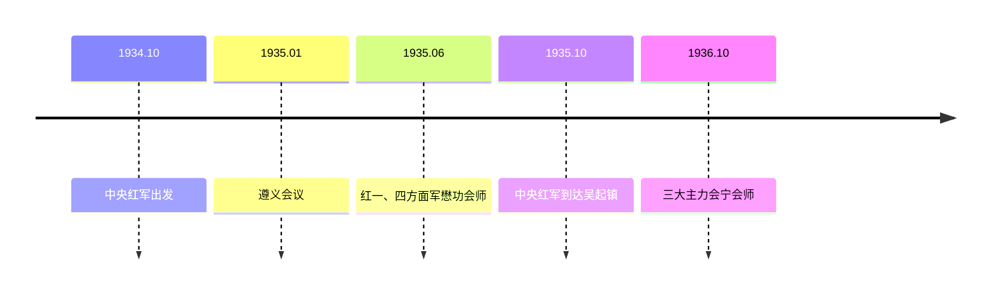

# 红军长征的胜利与伟大的长征精神的内涵

## 红军长征的胜利

1934 年 10 月，第五次反“围剿”失利后，中央红军（红一方面军）被迫实行战略转移，开始长征。1936 年 10 月，红一、二、四方面军在甘肃会宁会师，宣告长征胜利结束。

> [!IMPORTANT]
> 三大主力红军会师的地点是 ==甘肃会宁==，时间是 1936 年 10 月。

注意区分几个容易混淆的地点：

| 事件 | 时间 | 地点 |
|---|---|---|
| 红一、四方面军会师 | 1935 年 6 月 | 四川懋功 |
| 中央红军到达陕北 | 1935 年 10 月 | 吴起镇 |
| 红二、六军团与红四方面军会师 | 1936 年 7 月 | 四川甘孜 |
| ==三大主力红军会师== | ==1936 年 10 月== | ==甘肃会宁== |

> [!WARNING]
> 吴起镇只是中央红军与陕北红军的会师，不是三大主力会师；懋功、甘孜都只是部分部队会师。题目问“三大主力红军会师”，答案一定是会宁。

## 长征精神的内涵

> [!IMPORTANT]
> 长征精神是中国共产党人和人民军队革命风范的生动反映，是中华民族自强不息的民族品格的集中展示，是以爱国主义为核心的民族精神的最高体现。

长征精神包括五个方面：

1. 把全国人民和中华民族的根本利益看得高于一切，坚定革命的理想和信念，坚信正义事业必然胜利的精神。
2. 为了救国救民，不怕任何艰难险阻，不惜付出一切牺牲的精神。
3. 坚持独立自主、实事求是，一切从实际出发的精神。
4. 顾全大局、严守纪律、紧密团结的精神。
5. 紧紧依靠人民群众，同人民群众生死相依、患难与共、艰苦奋斗的精神。

> [!TIP]
> 记忆口诀：==“理想高于天，牺牲为救民，独立又求实，大局纪律团，人民是根基”==。五点分别对应理想信念、牺牲精神、思想路线、组织纪律、群众路线。

## 长征胜利的历史意义

长征的胜利，粉碎了国民党反动派消灭红军的企图，保存了党和红军的基干力量，使中国革命转危为安。长征一结束，中国革命的新局面就开始了。

> [!NOTE]
> 长征精神为中国革命不断从胜利走向胜利提供了强大精神动力。回答简答题时，先写五点内涵，再补一句意义，才能拿满分。

> [!CAUTION]
> 不要把遵义会议（1935 年 1 月）与长征胜利结束混为一谈。遵义会议是党的历史上生死攸关的转折点，但长征结束的标志是 1936 年 10 月会宁会师。
