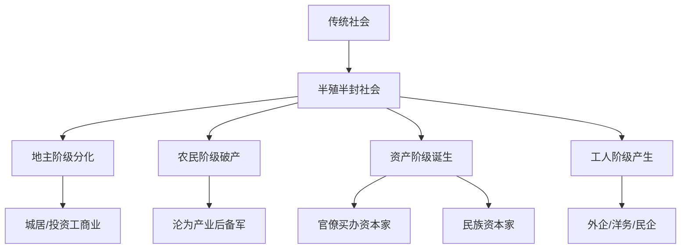

# 近代中国阶级结构的变动与工人阶级的产生及特点

## 近代中国阶级结构为何必然变动？

要理解工人阶级的产生，首先要问：在鸦片战争前只有“地主-农民”对立的中国，为何会凭空长出新阶级？根本动力在于==外国资本主义入侵打破了自然经济==。随着通商口岸开放与洋务运动兴起，旧的生产关系解体，新的雇佣劳动关系出现，阶级结构随之重组。这不仅是人口职业的变化，更是中国社会性质变为半殖民地半封建的直接体现。

## 四大阶级的演变图谱

近代阶级变动并非简单的“新旧替代”，而是呈现出复杂的转化与新生并存局面。

> [!IMPORTANT]
> ==工人阶级先于资产阶级产生==是核心考点。中国工人最早诞生于19世纪40-50年代的外国在华企业，而非本国民族企业。这一时间差决定了中国工人阶级具有特殊的革命资历与国际视野。

| 阶级 | 来源与构成 | 政治态度与特点 |
| :--- | :--- | :--- |
| 地主阶级 | 部分转化为资本家，多数仍靠地租 | 反动统治基础，但内部发生分化 |
| 农民阶级 | 自耕农减少，贫雇农增加 | 革命主力军，但受小生产者局限 |
| 资产阶级 | 买办、商人、地主、官僚转化 | 官僚买办依附列强；民族资产阶级具==两面性== |
| 工人阶级 | 破产农民、手工业者、城市贫民 | ==三重压迫==下革命性最强，纪律性强 |

## 如何精准把握工人阶级特点？

复习时不能只背“最革命”，需从三个维度构建逻辑链：

1.  **压迫深度决定革命强度**：身受帝国主义、封建势力、资产阶级==三重压迫==，且剥削程度远超西方同行，故反抗最坚决。
2.  **分布集中决定组织优势**：早期工人集中在沿海沿江大城市及大型厂矿，便于传播思想和组织动员。
3.  **出身纽带决定联盟基础**：绝大多数来自破产农民，与广大农民有==天然联系==，为工农联盟奠定阶级基础。

> [!TIP]
> 答题口诀：“三压一集一天然”。即三重压迫、集中分布、天然联系农民。这三点是区别于其他国家无产阶级的中国特色。

## 易错辨析与实战应用

> [!WARNING]
> 切勿将“民族资产阶级的两面性”套用于工人阶级。工人阶级没有妥协性，只有革命的彻底性。另外，==农民是主力军，工人是领导阶级==，二者地位不可混淆。

以简答题“从半殖民地半封建社会到社会主义制度确立，我国阶级关系发生了怎么样的变化？”为例，标准作答需覆盖完整时间线：

*   **起点（半殖半封）**：准确描述四大阶级的产生与特点，强调工人阶级的先进性。
*   **过渡（新民主主义革命）**：点出土地革命消灭地主阶级、抗战时期减租减息调整关系。
*   **终点（社会主义改造后）**：==地主阶级被消灭，民族资产阶级被改造为劳动者==，最终形成“工人、农民、知识分子”的崭新结构。

> [!NOTE]
> 此题虽属“上编综述”，但答案必须延伸至下编“社会主义改造”。若只答到1949年则严重失分。阅卷采分点在于“变化的过程”而非静态描述。
