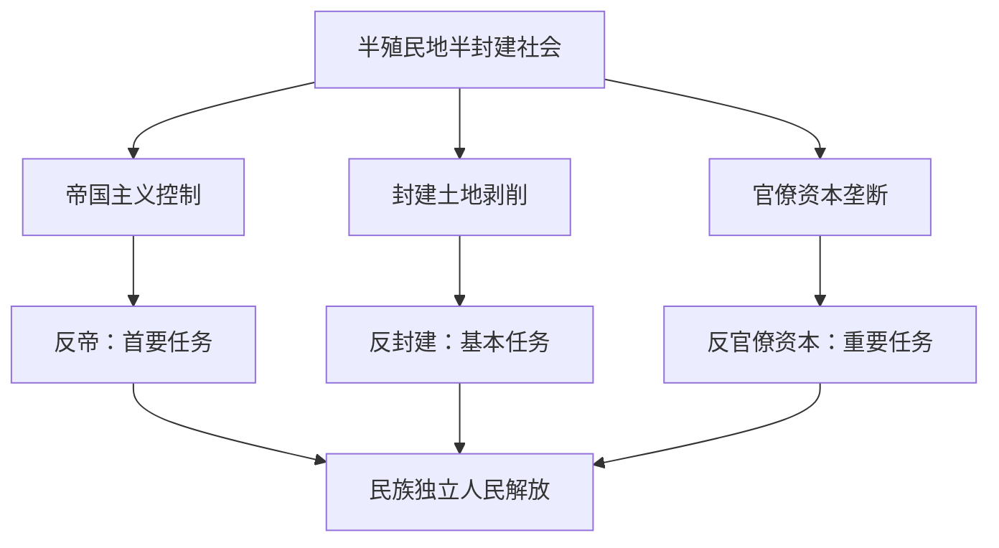

# 新民主主义革命必须把帝国主义、封建主义、官僚资本主义作为对象的原因

> [!IMPORTANT]
> 新民主主义革命的对象是帝国主义、封建主义和官僚资本主义，即“三座大山”。判断依据不是“凡资本主义都反对”，而是看它们是否压迫中国人民、阻碍民族独立和社会进步。

## 为什么必须反对“三座大山”

近代中国是半殖民地半封建社会，主要矛盾是帝国主义和中华民族的矛盾、封建主义和人民大众的矛盾。帝国主义、封建主义与后来形成的官僚资本主义相互勾结，使广大人民特别是农民日益贫困破产。因此，革命必须把反帝的民族斗争和反封建的阶级斗争统一起来。

| 革命对象 | 主要危害 | 对应任务 | 地位 |
|---|---|---|---|
| 帝国主义 | 控制中国政治经济，压制民族资本主义，阻挠中国独立进步 | 打破外国资本的控制，争取民族独立 | ==首要任务== |
| 封建主义 | 以封建土地所有制为基础，使农民受剥削、农村生产力受束缚 | 彻底改革土地制度，解放农民和生产力 | ==基本任务== |
| 官僚资本主义 | 依靠国家政权和特权垄断经济，同帝国主义、封建主义结合，挤压民族资本 | 没收官僚资本，归新民主主义国家所有 | ==重要任务== |

## 为什么不能把民族资本主义也列为对象

官僚资本主义不等于一般资本主义，更不等于民族资本主义。民族资本主义发展缓慢、力量软弱，受到三重压迫；民族资产阶级既有革命性，又有妥协性，可以在一定条件下参加革命或保持中立。新民主主义革命破坏的是帝国主义、封建主义和官僚资本主义的反动统治，并不一般地消灭资本主义私有制。

> [!WARNING]
> 不要把“新民主主义革命是资产阶级民主革命”理解为“由资产阶级领导”。它的性质由反帝反封建的任务决定，其“新”主要体现在==无产阶级领导==；新旧民主主义革命的根本区别也是领导权问题。

## 答题示例

题目：为什么中国的新民主主义革命必须把帝国主义、封建主义、官僚资本主义作为对象？

规范作答：三者是压在中国人民身上的“三座大山”，共同维护半殖民地半封建社会。第一，反对帝国主义、打破外国资本的控制，是首要任务；第二，反对封建主义、彻底改革土地制度，是基本任务；第三，反对官僚资本主义、没收官僚资本归新民主主义国家所有，是重要任务。只有推翻三者，才能实现民族独立和人民解放，为国家富强创造条件。

> [!TIP]
> 简答题按“总起三座大山＋首要、基本、重要三项任务＋革命目标”作答；不要把三项任务的次序和关键词写混。
