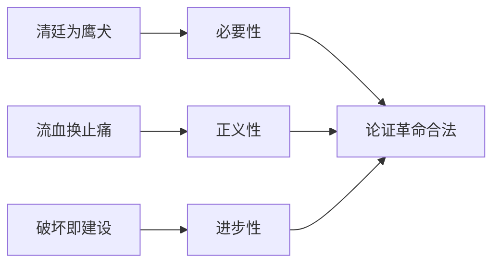

# 资产阶级革命派与改良派关于革命与改良的辩论（必要性、正义性、进步性）

## 论战的背景与阵地

1905—1907 年，资产阶级革命派与改良派围绕"中国究竟走革命道路还是改良道路"展开大论战。革命派以 ==《民报》== 为主要阵地，改良派以 ==《新民丛报》== 为主要阵地。

辩论焦点有三：

| 焦点 | 核心问题 | 涉及制度选择 |
| --- | --- | --- |
| 要不要以革命手段推翻清王朝 | 破坏与建设的关系 | 推翻 vs 保留清廷 |
| 要不要推翻帝制实现共和 | 君主立宪制 vs 民主共和制 | 政体之争 |
| 要不要进行社会革命 | 土地国有、平均地权 | 经济制度之争 |

其中 ==要不要以革命手段推翻清王朝== 是论战的==焦点==（最核心的分歧）。

## 革命的必要性、正义性、进步性

革命派在这场论战中，从三个角度论证了革命的合法性：

- **必要性**：清政府已沦为帝国主义的"鹰犬"。爱国必须革命。只有通过革命，才能"免瓜分之祸"，获得民族独立和社会进步。
- **正义性**：革命固然有牺牲，但不革命、容忍清王朝统治，中国人民就不能免除痛苦和牺牲。革命虽不免流血，却可"救世救人"，是==疗治社会的良药==。
- **进步性**：革命中付出的努力与牺牲，以==换取历史进步==为补偿。==革命本身正是为了建设==，破坏与建设是革命的两个方面。

> [!TIP]
> 记忆口诀：**"鹰犬—止血—建设"**。鹰犬→必要（不革命就亡国），止血→正义（革命是疗救），建设→进步（破坏是为了建设）。

## 常见混淆：论战结果 ≠ 革命彻底胜利

改良派主张君主立宪，革命派主张民主共和。革命派在论战中胜出，扩大了革命影响，**但这次论战的胜利并未使革命成为现实**——辛亥革命本身仍存在客观局限与主观弱点。

> [!WARNING]
> 易错坑：主观方面常被漏答——辛亥革命失败的主观原因包括：① 没有提出彻底的反帝反封建革命纲领；② 不能充分发动和依靠人民群众；③ 不能建立坚强的革命政党。这是**主观原因**，与"论战如何论证三性"是两个不同题干，别串答案。

## 例题示范（简答）

**问**：革命派和改良派在论战中是如何论述革命的必要性、正义性、进步性的？

**答**：1905—1907 年，革命派与改良派分别以《民报》《新民丛报》为阵地展开大论战。革命派论证了：
① **必要性**——清政府是帝国主义的"鹰犬"，爱国必须革命，只有革命才能免瓜分之祸；
② **正义性**——革命虽有牺牲，但容忍清廷统治中国人民不能免除痛苦，革命是疗治社会的良药；
③ **进步性**——革命中的牺牲以换取历史进步为补偿，革命本身正是为了建设。

> [!NOTE]
> 三性与三民主义相呼应：民族主义对应必要性（反帝求独立），民权主义对应正义性（反君主专制），民生主义对应进步性（社会革命、平均地权）。三民主义的核心是==民权主义==（创立民国）。
