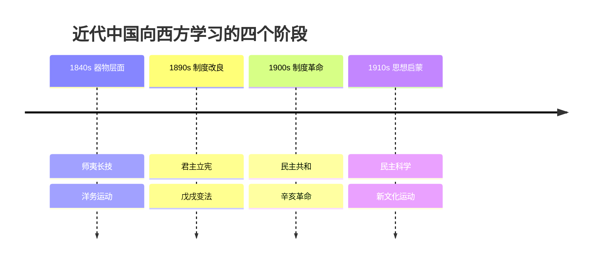
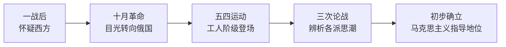

# 中国的先进分子为什么和怎样选择了马克思主义

## 中国先进分子为什么和怎样选择了马克思主义

近代中国面对“数千年未有之大变局”，救亡图存是所有先进分子的核心命题。要理解这个问题，不妨先问自己一个问题：**如果各种方案都试过了，为什么最后偏偏是马克思主义赢了？**

### 从“学西方”到“怀疑西方”：选择的历史前提

鸦片战争后，中国人向西方学习的热情是逐步升级的：

每一轮尝试都比上一轮更深入，但结果都是失败。毛泽东在《论人民民主专政》中概括得很直白：“要救国，只有维新，要维新，只有学外国。”然而辛亥革命后建立的资产阶级共和国，在议会制、多党制的表壳下迅速沦为军阀争夺政权的工具——时人感叹“无量头颅无量血，可怜购得假共和”。==西方道路在中国的实践碰壁，这是怀疑的起点，也是重新寻找方向的前提。==

> [!NOTE]
> 注意“学西方”本身并不错。问题在于：一战后资本主义的内在矛盾充分暴露——世界大战、经济危机、殖民掠夺，让中国人看到“老师”的另一面。巴黎和会上列强把德国在山东的权益转给日本，更直接击碎了“公理战胜强权”的幻想。

### 三个条件汇流：为什么马克思主义能“接得住”

仅仅“怀疑西方”不等于会自动选择马克思主义。马克思主义在中国落地，需要同时具备思想准备、阶级基础和外部契机：

| 条件 | 具体内容 | 它解决了什么问题 |
|:---|:---|:---|
| **思想启蒙** | 五四新文化运动破除了对旧思想、旧道德的迷信；知识界围绕“问题与主义”、社会主义与无政府主义等问题展开三次大论战 | 为接受一种全新的世界观扫清了思想障碍 |
| **阶级基础** | 五四前后，中国产业工人已达二百余万，罢工斗争不断，工人阶级登上政治舞台 | 马克思主义找到了它植根的土壤——需要理论的阶级正在觉醒 |
| **外来契机** | 十月革命成功，俄国建立的第一个社会主义国家给中国提供了可参照的现实道路 | 从“隔着纱窗看晓雾”变为“有一个可以学习的样本” |

> [!IMPORTANT]
> 三个条件缺一不可：==没有思想启蒙，马克思主义进不来；没有工人阶级，马克思主义站不住；没有十月革命，中国人看不到现实可行之路。==

### “怎样选择”：不是一夜之间的决定

选择马克思主义不是一个瞬间行动，而是一个逐步聚焦的过程。如果把时间线拉开：

这里的关键在于：==“选择”是在对比中完成的。== 五四前后传入中国的思潮远不止马克思主义一种——无政府主义、新村主义、基尔特社会主义、实用主义都颇有市场。三次大论战实际上是在反复回答同一个问题：**哪种理论能更有效地改造中国社会？** 马克思主义在论战中占据上风，不是因为口号更响，而是因为它对帝国主义、封建势力的解释力和对群众性革命运动的方案设计，比其他思潮更贴近中国的实际需求。

> [!WARNING]
> 常见误区：把“选择马克思主义”等同于“十月革命一声炮响就自动改信了”。实际上，从1917年十月革命到1921年建党，中间隔了整整四年。这四年正是反复比较、激烈论辩、实践检验的过程。

### 一个“算对了”的例子

以李大钊为例来观察“怎样选择”的具体路径。1917年他还在写《青春》一类的启蒙文章；1918年发表《庶民的胜利》《布尔什维主义的胜利》，开始把眼光投向十月革命；1919年他主持《新青年》“马克思主义研究号”，系统介绍唯物史观、剩余价值学说和阶级斗争理论；同年参与“问题与主义”论战，明确主张“必须有一个根本解决”。此后，他在北大开设马克思主义课程、组织马克思学说研究会。==从“介绍”到“信从”再到“传播”，这个路径具有典型性==——它不是先信了再找理由，而是在持续的阅读、讨论、比较中逐步聚焦。

### 与“新文化运动”的关系辨析

不少同学容易把“新文化运动”和“马克思主义传播”混为一谈。两者的关系是：

- **新文化运动的前期**（1915—1918）以“民主”与“科学”为旗帜，主要内容是反封建的思想启蒙，还不涉及马克思主义；
- **新文化运动的后期**（1919以后）在五四运动推动下，逐渐分裂为不同倾向，其中以李大钊、陈独秀为代表的一部分人转向马克思主义。

所以更准确的说法是：==新文化运动为马克思主义的传播提供了思想土壤，但马克思主义成为主流并不是新文化运动的自然延伸，而是五四以后新的历史条件下比较与选择的结果。==

> [!TIP]
> 记忆简答题的四条要点，可以压缩成四个关键词：**“实践失败—思想启蒙—阶级壮大—外力推动”**。对应课本答案中的（1）斗争实践（2）思想启蒙（3）阶级基础（4）外来影响。考试时按这个框架展开，每条补上具体史实即可。
