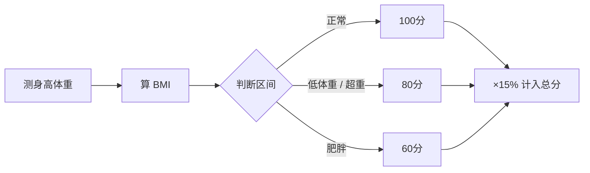

# 体重指数（BMI）单项评分标准及计算

## 先想清楚：BMI 到底在测什么？

体重指数（Body Mass Index, BMI）是体测中**唯一不靠“现场发挥”的项目**。它不看你跑多快、跳多远，而是用身高和体重的关系，判断你的身体成分是否处在健康区间。它的权重是 **15%**，和肺活量并列第一梯队，直接决定总分上限。

为什么不用单纯的体重？因为 60kg 对 1.60m 和 1.75m 的人来说，意义完全不同。BMI 把身高因素“标准化”掉，让不同身高的人可以放在同一把尺子下比较。

## 计算公式与评分标准

$$BMI = \frac{体重(kg)}{身高^2(m^2)}$$

> [!TIP]
> 计算顺序：先算身高平方，再用体重去除。别先除身高再除身高，容易把单位带错。

大学阶段的评分标准如下：

| 类别 | 低体重（80分） | 正常（100分） | 超重（80分） | 肥胖（60分） |
| :--- | :--- | :--- | :--- | :--- |
| 大学男生 | ≤ 17.8 | 17.9 ~ 23.9 | 24.0 ~ 27.9 | ≥ 28.0 |
| 大学女生 | ≤ 17.1 | 17.2 ~ 23.9 | 24.0 ~ 27.9 | ≥ 28.0 |

> [!IMPORTANT]
> 男女生**正常区间上限相同（23.9）**，差异只在低体重分界线：男生 17.8，女生 17.1。超重和肥胖的界值两性一致。

## 一个算对的例子

体重 60kg，身高 1.75m 的同学：

$$BMI = 60 \div (1.75 \times 1.75) = 60 \div 3.0625 \approx 19.6$$

对照上表：19.6 落在 `17.9 ~ 23.9` 区间，==评分 100 分，等级正常==。这个分**直接计入总分**，不需要你在跑道上多花一秒力气。

## 常见坑与边界判断

> [!WARNING]
> BMI 恰好卡在边界值时，判断方向最容易出错。规则是：**低体重区间闭合，正常区间从“边界值 + 0.1”开始**，超重和肥胖同样如此。

以男生为例：

- 17.9 ≤ BMI ≤ 23.9 → **正常**
- 刚好 24.0 → **超重**，不是正常
- 刚好 28.0 → **肥胖**，不是超重

> [!CAUTION]
> 身高单位必须是**米**。如果代入 175（厘米），会得到 $60 \div 175^2 \approx 0.002$，错得离谱。体测现场输入错误是最常见的失分原因之一。

## BMI 与其他体测项目的关系

> [!NOTE]
> BMI 拿不到 100 分时，最多只能得 80 分，和“及格区”的肺活量、跑步等项目分数拉开的差距，往往需要用**加分项目**（引体向上、仰卧起坐、1000/800 米）来弥补。但加分不能改变 BMI 本身的得分。

BMI 不需要临场爆发力，它反映的是你**一段时间内的身体状态**。想在这个项目上拿满分，功夫在平时——体重管理比考前一天突击更实在。
