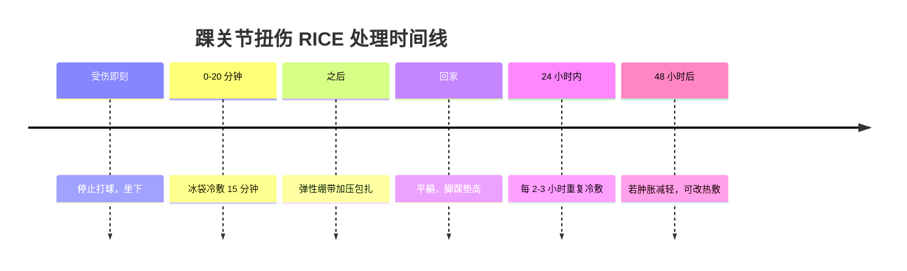

# 急性闭合性软组织损伤的RICE处理原则
扭伤脚踝、拉伤大腿、撞伤膝盖——这些在运动场上再常见不过。皮肤没有破，但里面已经出血、肿胀、疼痛。这就是**急性闭合性软组织损伤**：组织受损但表皮完整，伤处与外界不相通。

问题来了：受伤后的**前24～48小时**，是决定恢复快慢的黄金窗口。处理对了，消肿快、恢复早；处理错了，可能肿得更厉害，甚至留下慢性疼痛。那么，第一时间该做什么？

### RICE是什么

RICE 是四个英文单词首字母的缩写，代表急性期处理的四个步骤：

| 字母 | 英文 | 中文 | 作用 |
|------|------|------|------|
| R | Rest | 制动休息 | 减少出血，防止损伤加重 |
| I | Ice | 冷敷 | 收缩血管，止血、消肿、镇痛 |
| C | Compression | 加压包扎 | 限制肿胀，固定伤处 |
| E | Elevation | 抬高患肢 | 利用重力促进回流，减轻肿胀 |

> [!IMPORTANT]
> ==RICE 原则适用于急性闭合性软组织损伤后 24～48 小时内的早期处理。== 核心目标是：**止血、消肿、镇痛、防二次损伤**。

### 为什么是这个顺序

受伤的瞬间，局部小血管破裂出血，组织液渗出，炎症反应启动。如果此时**热敷、按摩、揉搓或者继续活动**，血管扩张、血流加快，出血和渗出会迅速加重，肿胀从“鸡蛋”变成“馒头”。

所以 RICE 的逻辑链是：

先停下（R），再降温（I），然后压住（C），最后抬起（E）——顺序不要颠倒。

### 每一步怎么做

**Rest（制动）**
立即停止运动，避免伤肢负重。必要时用夹板、拐杖辅助。不要“咬牙再打一局”。

**Ice（冷敷）**
用冰袋、冰块包毛巾或冷水毛巾敷在伤处。每次 **15～20 分钟**，每隔 **2～3 小时**一次，持续 24～48 小时。

> [!WARNING]
> 冰块不要直接接触皮肤，防止冻伤。每次冷敷不宜超过 20 分钟，否则可能引起局部血管反射性扩张，反而加重肿胀。

**Compression（加压包扎）**
用弹性绷带从远心端向近心端缠绕包扎，松紧以“有压力但不阻断血液循环”为宜。若伤肢末梢（手指或脚趾）发麻、发紫、发凉，说明太紧，要松开重包。

**Elevation（抬高）**
将伤肢抬高，最好**高于心脏水平**，利用重力促进静脉血和淋巴液回流。躺着时把脚垫在被子上即可。

### 和容易混淆的做法区别

| 做法 | RICE 原则观点 | 理由 |
|------|--------------|------|
| 热敷 | ❌ 急性期禁止 | 扩张血管，加重出血和肿胀 |
| 按摩、揉搓 | ❌ 急性期禁止 | 机械刺激加重组织损伤 |
| 立即贴膏药 | ⚠️ 谨慎 | 部分膏药含活血成分，见下 |
| 继续活动“活动开” | ❌ 错误 | 加重出血，延长恢复 |
| 48 小时后热敷 | ✅ 可考虑 | 促进淤血吸收和组织修复 |

> [!CAUTION]
> “揉一揉散瘀血”是流传很广的误区。急性期任何对伤处的按压、揉搓、转动，都相当于**在刚破裂的血管上继续施加破坏**。RICE 里的 Rest 本身就包含了“别去动它”。

### 一个算对了的例子

打篮球时落地踩到别人脚上，脚踝外侧迅速肿起、疼痛。正确做法如下：

如果处理得当，急性期的肿胀会明显减轻。以脚踝为例，加压包扎后观察脚趾颜色和感觉：脚趾温暖、活动正常，说明压力合适；若发紫发麻，说明包扎过紧。

> [!TIP]
> 记不住 RICE 的中文？谐音记忆：**“冷（I）静（R）压（C）力抬高（E）”**——先冷静别动，再冷敷，加压包扎，抬高患肢。急性期的“冷静”就是最重要的处置。
