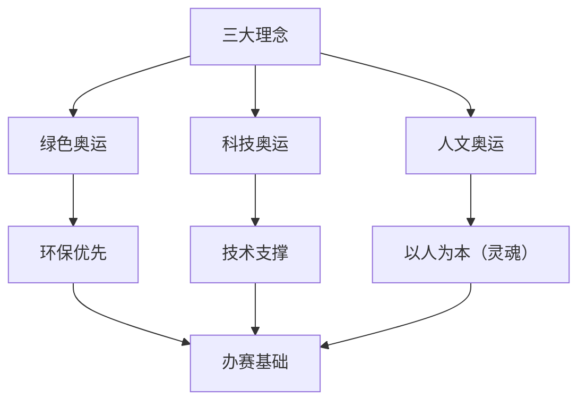

# 2008年北京奥运会三大理念（绿色奥运、科技奥运、人文奥运）

## 北京奥运会三大理念

2008 年北京奥运会提出了“绿色奥运、科技奥运、人文奥运”三大理念。这三个理念不是简单的口号堆叠，而是相互支撑的整体：==绿色奥运关注赛事与环境的关系，科技奥运提供实现手段，人文奥运则是灵魂与归宿==。

先看一个容易答错的点：三大理念中**没有“经济奥运”**。考题中凡出现“经济奥运”混入选项，直接排除即可。三大理念的全称是“绿色奥运、科技奥运、人文奥运”，务必记准。

> [!IMPORTANT]
> 2002 年 7 月 13 日，《北京奥运行动规划》正式公布，提出“新北京、新奥运”两大主题和“绿色奥运、科技奥运、人文奥运”三大理念。

### 三大理念各指什么

| 理念 | 核心指向 | 关键词 |
|------|----------|--------|
| 绿色奥运 | 奥运与环境的关系 | 环保、改善环境、绿色消费 |
| 科技奥运 | 奥运与科技手段的关系 | 新技术、信息化、场馆建设 |
| 人文奥运 | 奥运与人的关系 | ==以人为本==、文化、和谐 |

**绿色奥运**的实质是关注奥运会与环境之间的关系。在奥运设施规划和建设中，==把环境保护作为首要条件==，制定严格的生态环境标准和系统保障制度，借助奥运推进城市环境保护宣传，鼓励公众自觉选择绿色消费。这不是“经济增长”优先，也不是“宣扬历史”优先。

**科技奥运**强调把现代科学技术多角度、多渠道地嵌入奥运会，通过广泛应用当代最先进的科技成果，让科学精神、科学思维和科技成就渗透到奥运会的每一个细节。

**人文奥运**是要突出==“以人为本”==的思想。它强调以文化为基础，以人为中心，促进人的全面发展，实现和谐、和睦、和平。北京奥运会会徽“中国印·舞动的北京”正是中国传统典型文化元素的集中体现，突出的是人文奥运理念，而非绿色或科技。

### 为什么人文奥运是灵魂

“同一个世界，同一个梦想”这句口号，深刻反映了 2008 年北京奥运会的核心理念，体现了==人文奥运==所蕴含的和谐价值观。

> [!TIP]
> 看到“和谐价值观”“以人为本”“中国文化元素”这类表述，对应的一定是**人文奥运**。看到“环境保护”“绿色消费”对应**绿色奥运**。看到“新技术”“高科技场馆”对应**科技奥运**。

三者的逻辑关系可以用下图理解：

### 一个看题的思路

题目问：“不属于 2008 年北京奥运会的三大理念的是____。”选项给出“绿色奥运、科技奥运、经济奥运、人文奥运”。

拆解：三大理念的全称中只有“绿色、科技、人文”三个修饰词。==“经济奥运”从未出现在任何官方表述中==，是干扰项。答案选 C。

再如题目问：“‘同一个世界，同一个梦想’体现了____所蕴含的和谐价值观。”口号强调“同一个梦想”与“和谐”，落脚点在人的共同价值与文化认同上，对应人文奥运。答案选 C（人文奥运）。

> [!WARNING]
> 不要把“绿色奥运”等同于单纯的“种树绿化”。它的实质是==环保理念贯穿赛事运作全过程==，包括场馆建设、交通组织、能源使用、废弃物处理等系统工程。考题中的“把环境保护作为首要条件”考的就是这个实质。
