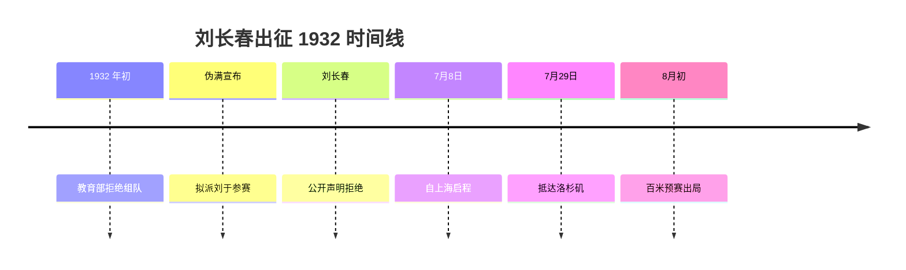

# 刘长春与中国首次参加奥运会（1932年洛杉矶）

## 它是什么

==1932 年洛杉矶奥运会，是中国第一次参加奥运会；刘长春是走进奥运赛场的第一个中国运动员。==

这次参赛不是一次普通的体育出征，而是在民族危亡关头的一次爱国行动。要理解它，可以先想两个问题：

- 当时的中国，为什么**想参加**却**参加不了**？
- 日本侵略者为什么要打刘长春的主意？

## 历史背景：一场“抢人”与“护国”的较量

1932 年，第 10 届奥运会在美国洛杉矶举行。中国体育界本希望派队参赛，但国民党政府教育部以“国难当头、时间匆忙、准备不足”为由拒绝。与此同时，日本帝国主义操纵下的伪“满洲国”宣布，将派东北选手**刘长春、于希渭**代表伪满参赛，企图借国际舞台制造“满洲国”是“独立国家”的假象。

这一阴谋激起全国愤慨。刘长春是东北大学学生、当时全国百米纪录保持者，他当即在《体育周报》上表态：

> “良心尚在，热血尚留，岂能叛国，做人牛马。”

在爱国人士协助下，他辗转成行，经 21 天海上颠簸，于 1932 年 7 月 29 日抵达洛杉矶，受到数百名华侨热烈欢迎。

## 结果与意义

刘长春参加了男子 100 米、200 米预赛，均未能晋级。长途跋涉、体力透支、缺乏系统训练，使他“铩羽而归”。但历史意义远超奖牌：

- ==首次参赛==：打破了中国与奥运无缘的历史；
- ==维护主权==：粉碎了伪满借奥运分裂中国的图谋；
- ==精神象征==：展现了体育与民族命运紧密相连的爱国精神。

> [!IMPORTANT]
> 刘长春参赛的政治意义大于竞技成绩。他代表的不是伪“满洲国”，而是**中国**。

## 相近概念辨析

| 事件 | 时间 | 地点 | 关键人物 | 意义 |
|---|---|---|---|---|
| 中国首次参加奥运会 | 1932 | 洛杉矶 | 刘长春 | 首次参赛，抵制伪满 |
| 新中国首次参加奥运会 | 1952 | 赫尔辛基 | 中国代表团 | 新中国亮相奥运 |
| 中国恢复 IOC 合法席位 | 1979 | — | — | 名古屋决议 |
| 中国首枚奥运金牌 | 1984 | 洛杉矶 | 许海峰 | 实现金牌零突破 |

> [!WARNING]
> 易错点：不要把“1932 年洛杉矶”与“1984 年洛杉矶”混淆。两次都在洛杉矶，但 1932 是**首次参赛**，1984 是**许海峰夺金**。

## 常见考题

> [!TIP]
> 记忆口诀：**“三二洛杉矶，长春第一人”**。

- 中国第一次参加奥运会：==1932 年洛杉矶奥运会==
- 走进奥运赛场的第一个中国运动员：==刘长春==

刘长春的故事说明：体育从来不只是竞技，更是国家主权与民族尊严的体现。
