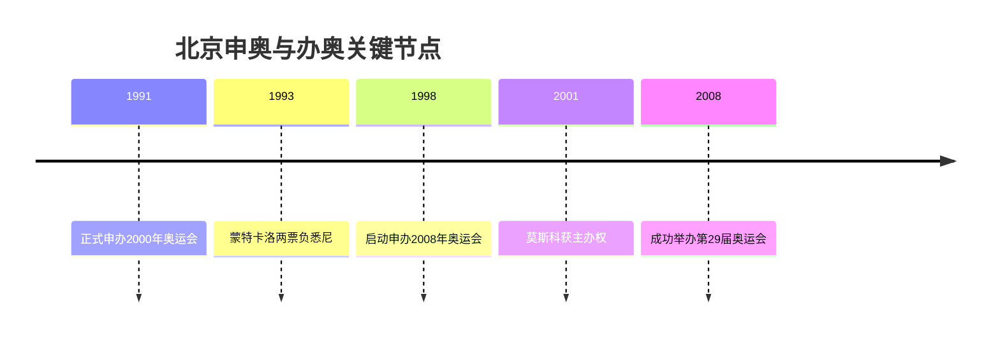
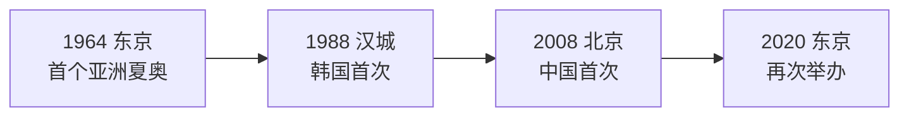

# 中国申办与举办奥运会的历史进程

## 中国申奥与办奥的历史进程

奥林匹克运动的基本功能单位是国家奥委会，中国正是通过中国奥委会（COC）与国际奥委会（IOC）的互动，一步步走向奥运舞台中央。这段历史既是体育史，也是国家发展的缩影。

### 早期接触与初次申办

中国与奥林匹克的联系始于 20 世纪初，但真正的实质性突破发生在改革开放后。1991 年，中国正式提出申办 2000 年奥运会，北京成为候选城市。这次申办在 1993 年蒙特卡洛投票中以两票之差负于悉尼，留下了深刻遗憾。

> [!NOTE]
> 首次申奥失利后，中国并未放弃，而是总结经验、积蓄力量，为下一次申办做准备。

### 申奥成功：2001 年莫斯科之夜

2001 年 7 月 13 日，是一个载入史册的日子。时任国际奥委会主席的萨马兰奇在莫斯科举行的 IOC 第 112 次全会上宣布：**北京获得 2008 年第 29 届夏季奥运会主办权**。

这次成功绝非偶然。国际奥委会看重的不仅是中国的竞技实力，更是中国作为**最大的发展中国家**所展现出的综合国力和承办大型国际赛事的能力。

> [!IMPORTANT]
> 2008 年奥运会是在**最大的发展中国家**举办的奥运会，这一表述体现了奥运会对发展中国家体育事业发展的推动作用。

### 北京奥运会的筹办方针

在筹办过程中，北京奥组委确立了明确的办赛方针：

| 方针 | 内涵 |
|------|------|
| 开放办奥运 | 学习借鉴国际先进经验 |
| 创新办奥运 | 在赛事组织、科技应用上突破 |
| 节俭办奥运 | 注重赛后利用，避免铺张浪费 |

> [!WARNING]
> "积极办奥运"并非官方提出的方针，考试常以此设置干扰项。

### 亚洲奥运城市的历史脉络

北京并非第一个举办夏季奥运会的亚洲城市。在此之前，**日本东京（1964 年）**成为首个主办夏季奥运会的亚洲城市，韩国汉城（1988 年）紧随其后。2008 年北京奥运会的举办，使亚洲成为举办夏季奥运会次数最多的大洲之一。

### 历史意义

北京奥运会的成功举办，实现了中华民族的百年奥运梦想，向世界展示了改革开放后的中国形象，同时也极大推动了我国群众体育、竞技体育和体育产业的协调发展，为奥林匹克运动在人口最多的国家传播作出了重要贡献。
