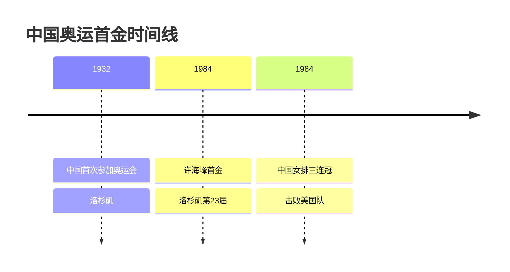
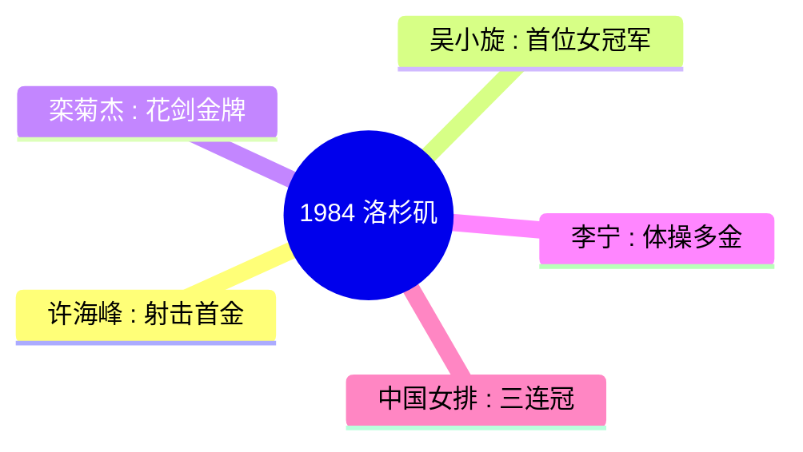
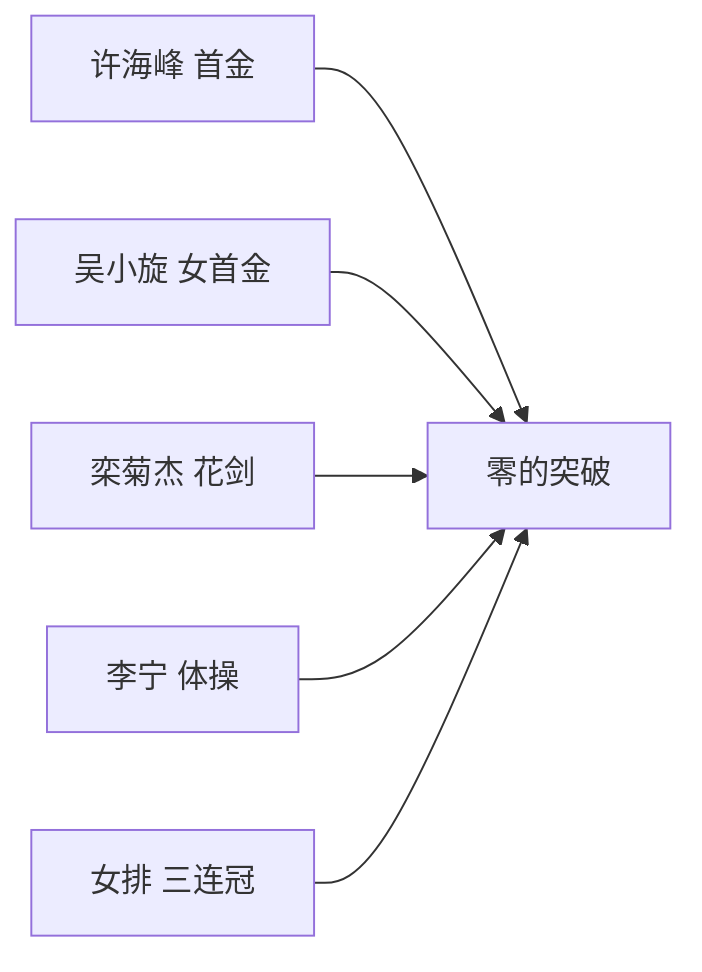

# 许海峰与中国奥运首金（1984年洛杉矶）

许海峰这枚金牌，看起来只是一条"谁得了第一"的记忆题，但它背后牵着中国奥运史的三件事：==零的突破==、奥运首金的双重含义、以及 1984 洛杉矶中国队的整体表现。把它放在一起理解，比死记人名牢得多。

先问一句：为什么偏偏是射击项目抢下首金？奥运会的赛程里，射击比赛结束早、单发决定名次，往往第一天就产生金牌。1984 年 7 月 29 日，许海峰在男子自选手枪 60 发比赛中以 $566$ 环的成绩夺冠——这一枪，打掉了中国奥运金牌"零"的纪录。

## 两个"首金"，别搞混

考试题里有两层"首金"，经常被学生合并成一个：

- **本届奥运会的首枚金牌**：许海峰打下的是 1984 洛杉矶奥运会产生的**第一块金牌**，由国际奥委会主席萨马兰奇亲自宣布。
- **中国的第一枚奥运金牌**：同一块牌，=="零的突破"== 的意义就在这里。

> [!IMPORTANT]
> 记住这一条：**许海峰 = 1984 洛杉矶 = 中国奥运首金**。同届的吴小旋是==中国第一位奥运会女冠军==（射击），两个"第一位"不要互换。

## 1984 洛杉矶：不只许海峰

当年中国队 $15$ 金、$8$ 银、$9$ 铜，首次进入金牌榜前四。关键人物可以用下面这张图串起来：

## 和相近知识点的区分

| 事件 | 时间 | 考点关键词 |
|---|---|---|
| 中国首次参加奥运 | 1932 洛杉矶 | ==刘长春==，单刀赴会 |
| 中国奥运首金 | 1984 洛杉矶 | ==许海峰==，射击 |
| 中国首位女冠军 | 1984 洛杉矶 | 吴小旋，射击 |
| 刘翔 110 米栏 | 2004 雅典 | $12.91$ 秒平世界纪录 |

> [!WARNING]
> **易错坑**：1932 和 1984 都是洛杉矶，但 1932 是"首次参赛"，1984 才是"首金"。看到"洛杉矶"就想当然选 1984，是常见翻车点。

## 一个做对了的例子

> **题目**：在第 23 届夏季奥运会上，中国运动员（　）夺得本届奥运会的首枚金牌，打破了中国奥运会金牌"零"的纪录。
> A. 王义夫　B. 许海峰　C. 李宁　D. 栾菊杰

**思路**：抓两个关键词——"第 23 届"（1984 洛杉矶）+ "首枚金牌/零的纪录"。四个选项里，李宁是体操、栾菊杰是花剑、王义夫是后续射击名将，只有 ==许海峰== 同时满足"射击"和"首金"。**答案：B**。

> [!TIP]
> 记忆口诀：**"84 洛城许海峰，一枪打掉零字头"**。再补一句"吴小旋女冠军，栾菊杰花剑秀"，同届考点一次串齐。

> [!NOTE]
> 延伸辨析：颁奖仪式由本届奥委会组委会主席主持，萨马兰奇以国际奥委会主席身份宣布——这是因为那块金牌既是本届第一金，也是中国第一金，双重意义让仪式规格格外高。
