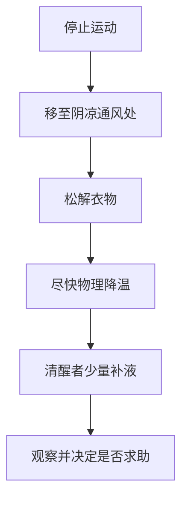

# 运动中中暑的症状识别与现场急救

## 为什么要先识别、再降温

高温、高湿或通风不良时运动，人体产热增加而散热受阻，可能出现中暑。现场处理的目标不是“等它自己缓过来”，而是==尽快脱离高温环境并有效降温==。发现有人头晕、乏力、恶心、动作不稳或意识异常，应立即停止运动，询问情况并观察体温、皮肤、脉搏和精神状态；症状严重或持续加重时，及时呼叫专业救援。

## 中暑有哪些表现

常见表现包括：

- **皮肤潮红**：体表血管扩张，皮肤可发热；
- **体温升高**：提示散热失衡；
- **脉搏加快**：身体循环负担加重；
- 还可伴头晕、口渴、乏力、恶心、出汗异常等。

精神状态可能表现为萎靡、反应迟钝、烦躁或意识障碍，不能把“神情亢奋”当作典型中暑表现。因此，题目问“哪项不属于中暑表现”，应选 **D. 神情亢奋**。

> [!IMPORTANT]
> 识别时抓住三个高频信号：==皮肤潮红、体温升高、脉搏加快==，同时重点观察意识是否异常。

## 现场急救怎么做

可按“转移—降温—补液—观察求助”的顺序处理：

1. **转移**：立即将患者移至阴凉、通风处，避免继续暴晒和剧烈运动。
2. **降温**：解开或松解多余衣物，可用凉湿毛巾擦拭、冷敷等方式帮助散热，并配合通风。不要因等待饮料而延误物理降温。
3. **补液**：患者清醒且能正常吞咽时，可饮用清凉饮料；不要给热饮料。症状严重者切忌一次狂饮，应少量多次。
4. **求助**：若出现意识不清、抽搐、无法饮水或症状严重，应立即寻求医疗救助，不强行喂水，以免呛咳、误吸。

> [!TIP]
> 严重症状者补液记作：==少量多次，每次不超过 $300\ \text{mL}$==。对应选择题选 **A. 300**。

## 相近概念与常见误区

| 情况 | 识别与处理重点 |
|---|---|
| 中暑 | 核心是高热与散热障碍，先转移、降温，再合理补液 |
| 皮肤晒伤 | 主要是日晒后的皮肤损伤，可按课件要求冷敷、湿敷，不能代替中暑降温 |
| 气体事故 | 先保障通风和人员安全，防止中毒等事故，不能按普通中暑处理 |

> [!WARNING]
> 常见错误是“中暑后喝热饮料发汗”。正确做法是移至阴凉通风处、尽快物理降温，并按情况给予清凉饮料。

> [!CAUTION]
> 不要只凭“出汗多”或“脸色红”判断病情轻重。意识异常、无法安全吞咽时，严禁强行灌水，应立即求助。

**例题核对**：中暑现场救护的错误做法是“给患者饮用热饮料”，故选 **C**；其余三项——阴凉通风、清凉饮料、物理降温——均符合现场救护原则。
