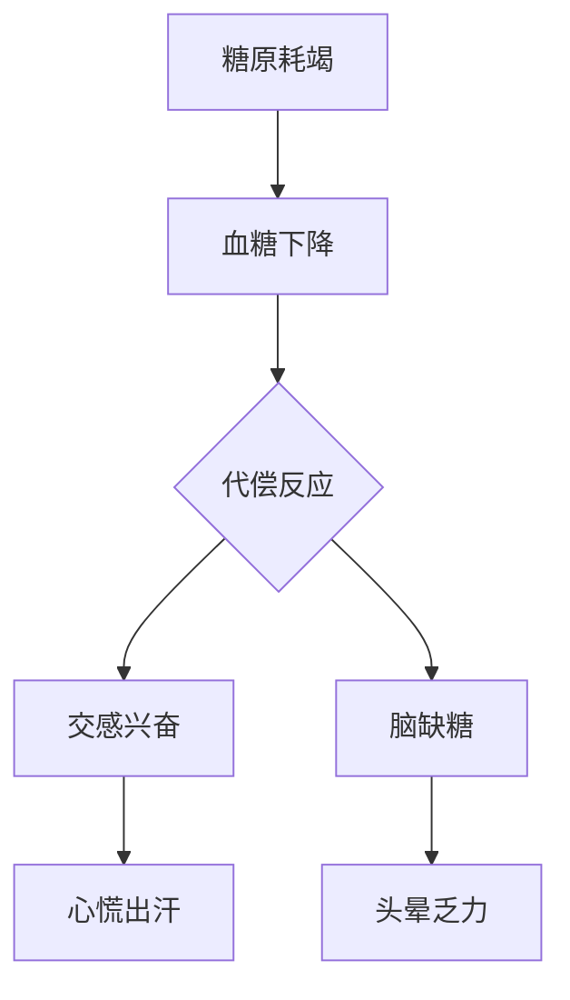

# 运动性低血糖症的表现与紧急处理

## 什么是运动性低血糖症

当你在长跑或高强度球类运动中，是否突然感到==头晕眼花、心慌手抖、出冷汗==，甚至思维迟钝？这很可能不是单纯的“累”，而是运动性低血糖症。它指在运动过程中或结束后，因体内糖原储备耗竭或消耗过快，导致血糖浓度低于正常值（通常 $<3.9\ \text{mmol/L}$），进而引发以交感神经兴奋和脑功能障碍为主要特征的急性代谢紊乱。

> [!IMPORTANT]
> 核心定义：运动中/后血糖过低引发的急性综合征，==本质是能量供应危机==，而非单纯疲劳。

## 为什么会发生与如何识别

大脑几乎完全依赖血糖供能。当长时间剧烈运动使肌糖原、肝糖原大量消耗，且未及时补充外源性糖分时，血糖骤降便会触发机体警报。

典型表现分为两个层面：

-   **交感神经兴奋症状**：饥饿感、面色苍白、出冷汗、脉搏细速、手颤。这是身体在“求救”。
-   **中枢神经系统症状**：注意力不集中、反应迟钝、言语不清，严重者出现抽搐、昏迷。这是大脑“宕机”的信号。

> [!WARNING]
> 若运动中出现无法解释的极度疲乏伴冷汗，==切勿硬撑==，应立即停止运动并检测或按低血糖处理。

## 紧急处理与相近概念辨析

一旦怀疑低血糖，必须争分夺秒提升血糖浓度。

| 对比维度 | 运动性低血糖症 | 中暑（热衰竭/热射病） |
| :--- | :--- | :--- |
| 核心病因 | 糖代谢紊乱，能量不足 | 体温调节失衡，水盐丢失 |
| 关键体征 | 冷汗、手抖、饥饿感 | 高热、皮肤干热或湿冷、无汗 |
| 首要措施 | ==口服浓糖水/糖块== | 移至阴凉处、物理降温 |
| 禁忌操作 | 禁止仅补水不补糖 | 禁止饮用热饮料 |

> [!TIP]
> 急救口诀：==停、测、补、观==。立即停止运动；有条件测血糖；清醒者口服15~20g快速糖（如葡萄糖水、果汁）；观察15分钟，未缓解则重复补糖或送医。

[!CAUTION]
> 意识障碍者==严禁经口喂食==，防止窒息，应立即静脉推注50%葡萄糖溶液并呼叫急救。

## 常见误区与真题解析

许多同学容易将低血糖与中暑混淆，尤其在夏季运动时。请思考：如果一名同学在高温下运动后晕倒，现场救护中哪项做法是错误的？

回顾课件配套选择题第241题：中暑现场救护的错误做法是 **C. 给患者饮用热饮料**。虽然该题考查中暑，但反向印证了运动急症处理的通用原则——==无论低血糖还是中暑，热饮均会加重代谢负担或升温==。低血糖急救同样强调使用常温或微温的含糖液体，避免刺激胃肠影响吸收。

> [!NOTE]
> 预防胜于急救：空腹不宜剧烈运动；超过1小时的耐力运动应每30~60分钟补充含碳水化合物饮料；有糖尿病史者运动前后需监测血糖。
