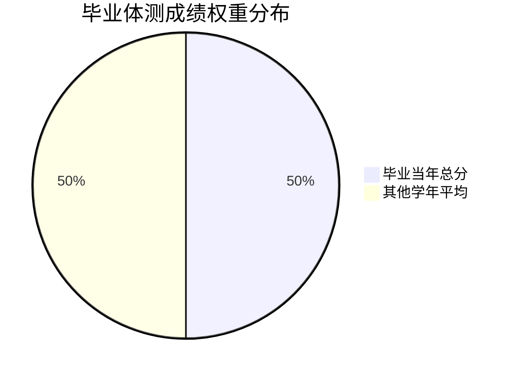

# 体质健康测试总分等级评定（优秀、良好、及格、不及格）

# 体质健康测试总分等级评定

## 它是什么与为什么需要

体质健康测试不仅是体育课程的成绩，更是大学生毕业资格的**硬性门槛**。根据《国家学生体质健康标准》，测试成绩按学年评定，分为**优秀、良好、及格、不及格**四个等级。

==核心结论==：体测成绩直接挂钩**评奖评优**与**毕业证书**。若毕业当年体测成绩不达标，可能面临无法按时毕业的风险（按结业或肄业处理）。

## 等级划分与关键阈值

测试总分由各项指标加权计算得出，满分 100 分。等级划分如下：

| 等级 | 分数区间 | 关键权益/后果 |
| :--- | :--- | :--- |
| **优秀** | $90.0 \sim 100$ | 可参评最高级别奖学金 |
| **良好** | $80.0 \sim 89.9$ | ==具备评奖评优资格== |
| **及格** | $60.0 \sim 79.9$ | 达到毕业基本要求 |
| **不及格** | $< 60.0$ | 需补测；毕业总分不足 50 分按结业/肄业处理 |

> [!IMPORTANT]
> **评奖评优红线**：只有达到**良好及以上**（$\ge 80$ 分）的学生，才有资格参与各类奖学金和三好学生的评选。仅“及格”是不够的。

## 毕业成绩怎么算？

很多同学在低年级忽视体测，导致毕业时总分被拉低。毕业时的体测成绩并非简单平均，而是采用加权算法：

$$
\text{毕业成绩} = \text{毕业当年总分} \times 50\% + \text{其他学年平均分} \times 50\%
$$

> [!TIP]
> **策略建议**：由于毕业当年占比高达 50%，即使前三年成绩一般，大四最后一年全力冲刺拿到高分，仍能显著拉升最终毕业成绩。反之，若大四摆烂，前功尽弃。

## 特殊情形：免测与加分

### 免测政策
因残疾或重大疾病无法参加测试的学生，需提供相关证明申请免测。
*   **普通免测**：成绩记为免测，不影响毕业，但通常不能评优。
*   **残疾免测**：凭残疾证申请，该学年度成绩记为 **80 分**（良好），且==仍可参加评优与评奖==。

### 加分项目
在引体向上（男）、仰卧起坐（女）、1000米/800米跑中表现优异者，可获得额外加分，计入总分，但总分不超过 100 分。

## 常见误区与避坑指南

1.  **混淆“及格”与“毕业线”**：
    *   单学年 $\ge 60$ 分为及格。
    *   但毕业时若总成绩 $< 50$ 分，将无法获得毕业证（按结业/肄业处理）。这是一个更低的“生死线”。
2.  **忽视 BMI 权重**：
    *   BMI（体重指数）占总分 15%。公式为 $BMI = \frac{\text{体重}(kg)}{\text{身高}^2(m^2)}$。
    *   正常范围（100分）：男生 $17.9 \sim 23.9$，女生 $17.2 \sim 23.9$。超重或低体重都会扣分，切勿只练肌肉忽略体重控制。
3.  **误以为“及格”就能评优**：
    *   这是最大的坑。记住：**评优必须良好（$\ge 80$）**。

## 实例演练

**问题**：小明大四毕业，他大一至大三的体测平均分是 75 分。为了拿到毕业证并争取评优，他大四至少需要考多少分？

**解析**：
1.  **保毕业**：毕业总分需 $\ge 50$。
    $$ 75 \times 0.5 + X \times 0.5 \ge 50 \Rightarrow 37.5 + 0.5X \ge 50 \Rightarrow X \ge 25 $$
    只要大四考 25 分以上即可毕业（显然很容易）。
2.  **争评优**：毕业总分需达到“良好”档次吗？不，评优看的是**单学年成绩**是否达到良好，或者学校具体规定。但若要求毕业总评达到良好（假设）：
    $$ 75 \times 0.5 + X \times 0.5 \ge 80 \Rightarrow 37.5 + 0.5X \ge 80 \Rightarrow X \ge 85 $$
    
    *注意：根据南邮考题逻辑，评优资格通常看**学年成绩**是否达到良好。若小明想在大四当年评优，他大四单次测试需 $\ge 80$ 分。*

> [!WARNING]
> 务必关注每年教务处发布的具体执行细则，特别是关于“毕业当年”权重的最新通知。
