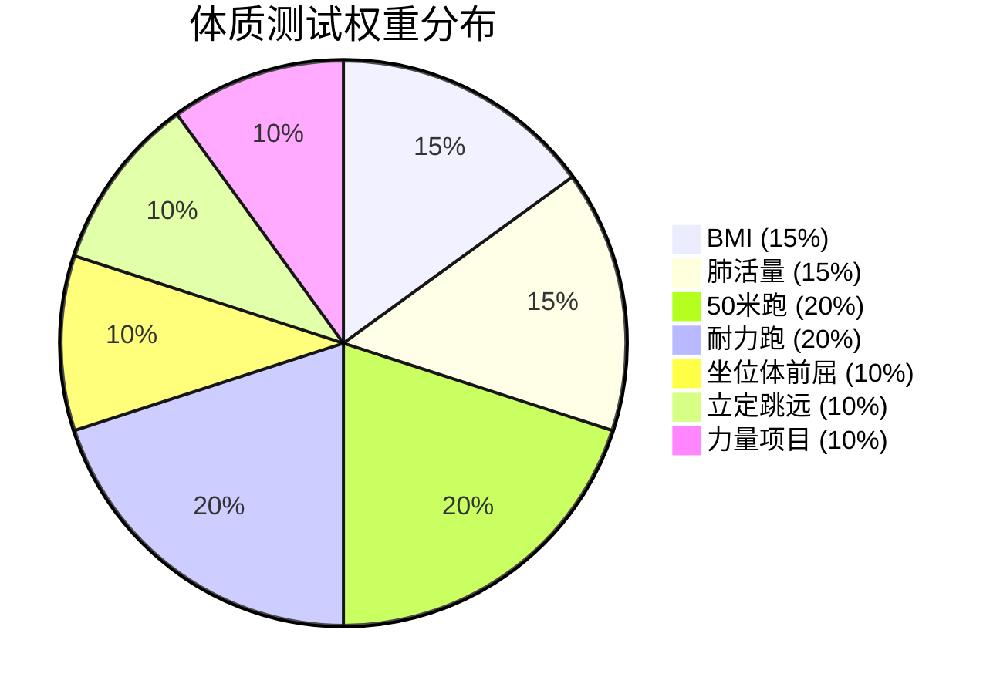

# 大学生体质健康测试项目设置（男女差异）

## 测试项目设置的底层逻辑

为什么男生测1000米和引体向上，女生却测800米和仰卧起坐？这并非简单的“降低难度”，而是基于==男女生理机能差异的精准评价==。若用同一套绝对标准衡量，既无法反映真实体质水平，也违背了体育评价的科学性原则。理解这一差异，是读懂评分表、避免备考方向错误的前提。

## 项目构成与权重体系

《国家学生体质健康标准》将测试指标分为三类，男女生仅在“力量”与“耐力”两项上存在分化：

> [!IMPORTANT]
> ==男女差异仅存在于耐力与力量项目==，其余五项指标及权重完全一致。

| 指标类别 | 男生项目 | 女生项目 | 考查核心素质 |
| :--- | :--- | :--- | :--- |
| 耐力类 | 1000米跑 | 800米跑 | 心肺功能与有氧耐力 |
| 力量类 | 引体向上 | 一分钟仰卧起坐 | 上肢相对力量 / 腰腹核心力量 |

## 年级分层与评分应用

你是否注意到评分表中每个项目都有“1-2年级”和“3-4年级”两列数据？这是因为随着年龄增长，身体发育趋于成熟，==高年级标准略高于低年级==。例如男生引体向上满分（100分），大一需19个，大三则需20个；女生800米满分从3:18提升至3:16。查表时务必先确认自己的年级组别，否则成绩判定必然出错。

> [!WARNING]
> 引体向上在及格线以下部分分数段显示“-”，表示该分值无对应标准，实际测试中低于60分即按不及格计分，不存在中间过渡档。

## 计算示例：男生总分核算

假设某大二男生测试结果如下，我们演示如何正确查表并加权计算：

-   bmi：22.0（正常范围，得100分）
-   肺活量：4800ml → 查男生表1-2年级列，对应90分
-   50米跑：7.0s → 对应85分
-   1000米跑：3:42 → 对应80分
-   坐位体前屈：17.7cm → 对应80分
-   立定跳远：248cm → 对应80分
-   引体向上：15个 → 对应80分

$$
\text{总分} = 100 \times 0.15 + 90 \times 0.15 + 85 \times 0.20 + 80 \times 0.20 + 80 \times 0.10 + 80 \times 0.10 + 80 \times 0.10 = 84.5
$$

最终得分84.5，等级评定为“良好”。

> [!TIP]
> 备考优先级排序：==50米跑与耐力跑合计占40%==，是提分关键；力量项目虽仅占10%，但男生引体向上零分率高，提前训练性价比极高。

> [!CAUTION]
> 切勿混淆男女生评分表！曾有男生误查女生800米标准来评估自己1000米成绩，导致严重误判。查表三步法：==定性别→定年级→定项目==，缺一不可。
