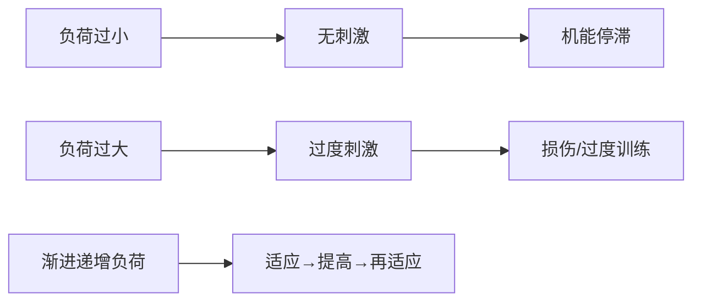

# 体育锻炼的基本原则（循序渐进、全面性、经常性等）

## 体育锻炼的基本原则

体育锻炼不是“动了就好”，而是需要遵循科学规律。为什么有些人越练越伤、效果停滞？根本原因往往在于违背了以下基本原则。

### 循序渐进原则

**是什么**：指体育锻炼的内容、负荷、方法和时间，必须由易到难、由简到繁、由小到大，逐步提高。身体对运动刺激的适应是一个渐进过程。

**为什么需要**：突然施加过大负荷，身体来不及适应，极易导致过度疲劳、软组织损伤甚至心血管意外。反之，若始终维持同一负荷，机能水平达到“高原期”后便不再提高。

**常见的坑**：
- *周末勇士*：平时不练，周末狂练数小时，极易诱发横纹肌溶解或关节损伤。
- *线性递增*：以为每周必须加量，忽略了身体状态波动。正确做法是==负荷递增，但留出调整期==。

### 全面性原则

**是什么**：指体育锻炼应全面发展身体的各个部位、各器官系统的机能、各种身体素质（力量、速度、耐力、灵敏、柔韧）和心理品质。

**为什么需要**：人体是一个统一整体，长期进行单一运动会导致局部负担过重，而某些薄弱环节（如核心肌群、柔韧性）被忽略后，会形成“木桶短板”，增加损伤风险，并限制整体运动表现。

- 单一长跑者若从不进行力量训练，膝关节周围肌力不足，易患跑步膝。
- 只练胸、二头肌而忽视背、腿，会形成上交叉综合征、肌力失衡。

[!IMPORTANT]
> ==全面发展不等于平均分配==。应在全面训练基础上，根据个人目标有所侧重，但绝不能完全缺失某类素质训练。

### 经常性原则

**是什么**：体育锻炼必须持之以恒，成为日常生活的一部分，使其产生“积累效应”。

**为什么需要**：运动带来的机能改善（如线粒体增生、糖原储备增加、骨密度提高）是==可逆的==。停止训练后，这些适应会逐步消退。两次锻炼间隔过长，每次的刺激都像“从头开始”，难以在稳固基础上叠加。

[!WARNING]
> 常见误区：以“每周一次体育课”作为全部锻炼量。体育课的作用是传授方法、激发兴趣、提供指导，要真正提升健康水平，必须保证==除体育课外每周至少 2～3 次、每次 30 分钟以上的规律锻炼==。

### 区别对待原则

**是什么**：指根据锻炼者的年龄、性别、健康状况、体质基础、锻炼目的等个体差异，选择适宜的内容、方法和运动负荷。

**一个算对了的例子**：
两位同龄大学生，甲想提高 1000 米成绩（目前 4 分 30 秒），乙 BMI 28、刚起步减脂。

- 甲的处方：以间歇跑为主（如 400 米 × 6 组，配速 1 分 30 秒），辅以核心力量训练。强度中上。
- 乙的处方：以快走与慢跑交替进行（快走 5 分钟 + 慢跑 2 分钟 × 4 组），辅以全身大肌群抗阻训练（自身重量为主）。强度中等偏下。

[!CAUTION]
> 照搬高水平运动员或健身网红的计划，是导致初学者放弃或受伤的主要诱因。别人的高强间歇、大重量复合动作，未必适合当前阶段。

### 小结与快速对比

| 原则 | 核心含义 | 违反时的典型后果 |
| :--- | :--- | :--- |
| **循序渐进** | 负荷逐步递增 | 损伤、过度疲劳、平台期停滞 |
| **全面性** | 身体各素质、各部位均衡发展 | 肌力失衡、局部劳损、体态异常 |
| **经常性** | 持之以恒，形成积累效应 | 机能消退，效果不累积 |
| **区别对待** | 因人而异，个性化处方 | 效果差、放弃或受伤 |

[!TIP]
> 记忆口诀：**渐、全、常、别** —— “逐渐全面，常常区别对待”。每规划一个阶段的锻炼，都可以用这四个字快速过一遍：本周负荷比上周增加合理吗？身体各区域都练到了吗？这周保证最少 3 次了吗？这个计划适合现在的我吗？
