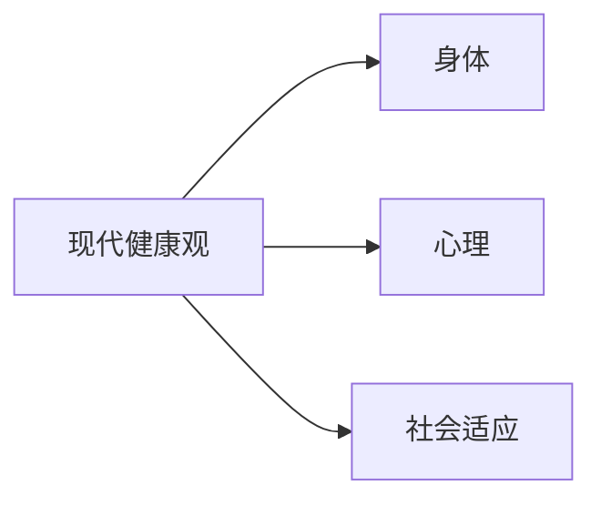

# 现代健康观（身体、心理、社会适应三维健康）

## 什么是现代健康观

传统看法常把“没病”当成健康；但南邮《体育理论》第3章“运动健康基础”采用的是==现代健康观：健康是身体、心理、社会适应三个维度的完满状态==，不是单看体检指标。

它对应国际共识：1989年WHO把道德健康也纳入讨论，但课件主线仍是“三维”。从题库也能印证——奥林匹克主义强调身、心、精神均衡结合，IPC会标三色蝌蚪代表“心智、身体和精神”，都在说人不能只练肌肉。

## 为什么需要三维视角

只盯身体会漏掉两类问题：一是心理压力导致的失眠、焦虑；二是离群、人际冲突造成的适应不良。体育锻炼若只追求跑得快、举得重，忽略情绪调节和团队协作，就偏离了健康教育目标。

> [!TIP]
> 记忆法：==体、心、社，三脚架==——少一条腿就不稳。

## 和相近概念的区别

| 概念 | 维度 | 常见错误理解 |
|---|---|---|
| 无病即健康 | 仅身体 | 忽略心理与社交 |
| 体质好 | 偏身体 | 不等于社会适应好 |
| 现代健康观 | 身体+心理+社会适应 | 三维缺一不可 |

课件题里“同一个世界，同一个梦想”体现的是**人文奥运**的和谐价值观，正呼应“社会适应”与人的全面发展。而奥林匹克全面发展目标题答案给的是“生理健康和心理健康”，说明书中有的表述把“精神/社会”并入广义心理层，做题要看清选项层级。

## 怎么做：落实到运动参与

在体育课与锻炼中同步落实三环：

1. 身体：规律进行有氧、力量与柔韧练习；
2. 心理：用运动缓解焦虑、培养坚持与自信；
3. 社会适应：参加集体项目、遵守规则、学会合作与尊重对手。

> [!WARNING]
> 坑点：不要把“社会适应”简单等同于“会来事”。在体育语境里，它指遵守规范、处理竞争与合作、融入群体的能力。

## 一个算对了的例子

看这道考过的题：

> 《奥林匹克宪章》指出“奥林匹克主义是将身、心和精神方面的各种品质均衡结合起来……它将体育运动与______融为一体”，基础是“奋斗乐趣、榜样价值、伦理原则”。
> 答案：**A. 文化，奋斗中所体验到的乐趣、优秀榜样的教育价值**

为什么选A？因为奥林匹克主义强调“身心精神均衡”，必须和**文化/教育**融合，而不是政治；后半句也不是爱国主义力量，而是奋斗乐趣与榜样教育。它正好印证现代健康观不是单维身体观，而是身心与社会价值共同提升的人生哲学。

> [!IMPORTANT]
> 考点结论：==三维健康=身体、心理、社会适应；奥林匹克相关题优先选“文化/教育”，不选“政治”==。
