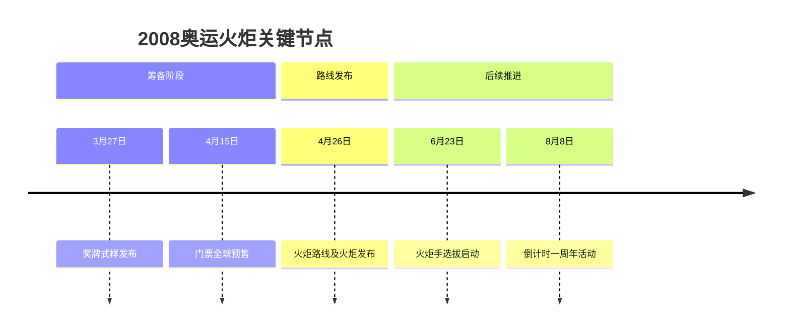

# 2022年北京冬奥会火炬传递特色与路线

看到“火炬传递路线取意”这个考点，你是否只记住了答案却忽略了背后的文化逻辑？为什么2008年北京奥运会的圣火传递不选择象征自然风貌的“山川”或纯粹的“奥林匹克精神”，而是锚定“丝绸之路”？这不仅是历史知识考查，更是理解奥运理念与中国文化融合的关键切口。

## 核心定义与文化取意

2008年北京奥运会火炬接力传递计划路线于2007年4月26日正式发布，其==核心取意为“丝绸之路”==。这一设计并非简单的地理路径复刻，而是将古代陆上与海上丝绸之路作为文化符号，寓意中国与世界的和平交流、文明互鉴。路线覆盖境外19个城市、境内116个城市和地区，通过航空、铁路、公路三种方式完成31个省（自治区、直辖市）的转场，每日由208名火炬手每人传递200米，单日里程40-50公里。

> [!IMPORTANT]
> 路线取意≠实际地理轨迹
> “丝绸之路”是文化象征与设计灵感，并非要求火炬严格沿古丝路行走。考试中若出现“完全重合”“仅走陆路”等表述均为错误选项。

## 易混概念辨析

复习时最容易将“丝绸之路”与其他选项混淆，需从设计意图层面区分：

| 选项 | 是否取意 | 辨析要点 |
| :--- | :--- | :--- |
| 丝绸之路 | ✅ 正确 | 官方公布的文化主题，象征中外交流 |
| 中国书画艺术 | ❌ 干扰项 | 属于奖牌、会徽等视觉设计元素 |
| 奥林匹克精神 | ❌ 干扰项 | 是所有奥运活动的共性基础，非专属取意 |
| 中国辽阔山川 | ❌ 干扰项 | 是路线途经的自然景观，非设计本源 |

> [!WARNING]
> 切勿将“境内传递亮点”等同于“取意”。课件中提到的各地特色展示是路线执行层面的内容，而“丝绸之路”是顶层设计理念，二者属于不同维度。

## 真题解析与记忆锚点

以经典考题为例：2008年北京奥运会火炬传递路线取意于（B. 丝绸之路）。解题关键在于锁定“取意”二字——它问的是设计灵感来源，而非传递形式或精神内涵。可结合时间线强化记忆：

> [!TIP]
> 记忆口诀：“丝路传圣火，交流连世界”。将“丝绸之路”与“中外交流”绑定，排除其他仅描述形式或通用精神的选项。同时注意2007年4月26日是路线发布日，常与奖牌、门票等时间节点混合考查排序题。

需要特别留意的是，本章标题虽为“北京奥运会理念与文化”，但课件内容聚焦2008年夏奥会，==切勿将2022年冬奥会火炬传递特色与此知识点混淆==。南邮《体育理论》考试中，该考点始终以2008年夏奥会为唯一命题对象，答题时需严格对应年份与赛事类型。
