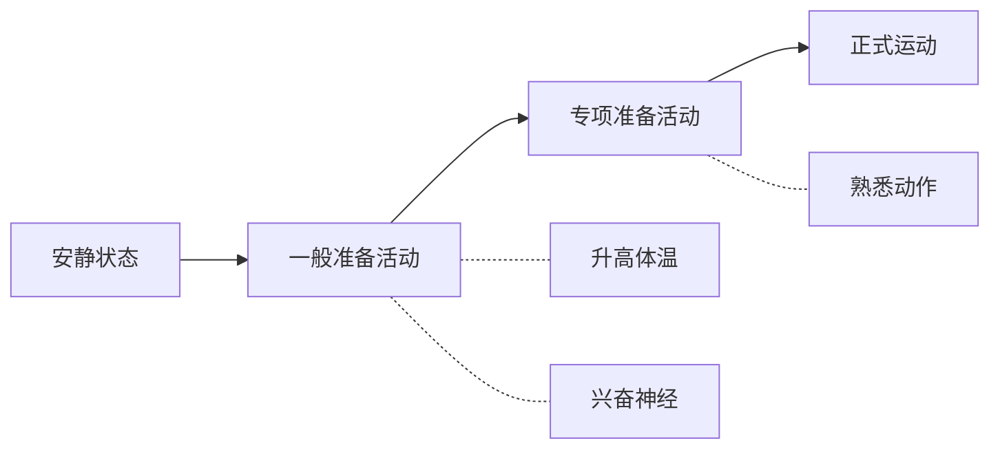

# 准备活动与整理活动的目的及生理学意义

## 它是什么

==准备活动==指正式运动或上课前所做的各种身体练习，俗称"热身"；==整理活动==指运动结束后所做的放松练习，俗称"冷身"。两者都属于一次完整体育课或训练课的固定环节，不是可做可不做的"附加项"。

## 为什么要准备活动

一次剧烈运动前，身体其实还处在"安静状态"：肌肉温度低、血液大部分在内脏、关节滑液少、神经兴奋性不高。直接开练容易抽筋、拉伤，动作也做不出来。准备活动本质上是给身体一个"过渡期"。

主要生理作用：

- ==提高中枢神经兴奋性==，缩短反应时，动作更协调；
- ==升高肌肉与关节温度==，肌纤维弹性、伸展性变好；
- 促进关节滑液分泌，减小摩擦；
- 使血液从内脏向骨骼肌重新分配，心输出量上升；
- 提高呼吸机能，克服内脏器官的"生理惰性"。

## 为什么要整理活动

剧烈运动突然停下，血液大量滞留在下肢肌肉，回心血量骤降，可能出现头晕、恶心、"重力性休克"。整理活动通过慢跑、走动、拉伸，帮助身体平稳回到安静状态：

- 促进乳酸等代谢产物清除，加快恢复；
- ==防止血液在下肢淤积==，避免运动后晕厥；
- 通过拉伸缓解肌肉紧张，减轻延迟性肌肉酸痛（DOMS）。

> [!IMPORTANT]
> 核心记忆：准备活动的生理学意义 = ==克服生理惰性、提高兴奋性、升高体温、预防损伤==；整理活动的生理学意义 = ==加速恢复、防止重力性休克、排清代谢产物==。

## 准备活动 vs 整理活动

| 项目 | 准备活动 | 整理活动 |
| --- | --- | --- |
| 时间 | 正式运动前 | 正式运动后 |
| 强度 | 由小到大 | 由大到小 |
| 主要内容 | 一般性 + 专项性练习 | 慢跑、走、拉伸、放松 |
| 心率变化 | 逐步上升 | 逐步下降 |
| 目的 | 兴奋、升温、防伤 | 恢复、防晕、排酸 |

## 常见的坑

- **只做一般准备活动，不做专项准备活动**。如篮球课只慢跑不练变向、投篮模仿，实际效果打折。
- **准备活动做过头**，做到疲劳，等于提前消耗了正式运动的体能。
- **整理活动跳过**。课后立刻坐下或蹲下聊天是典型错误。
- 与运动损伤处理混淆：急性损伤 ==**早期**== 用 RICE 原则（休息、冷敷、加压、抬高），==**晚期**== 才用按摩、理疗、功能锻炼。冷敷是早期手段，放到晚期就错了。

> [!WARNING]
> 判断题常见陷阱：课前"不宜过分饱腹或空腹"是正确要求，不是可选项；课中不得吃零食、不得随意旷课同样属于课堂常规。

## 一个对的例子

题：下列哪种不是急性运动损伤**晚期**的处理方法？
A. 按摩　B. 理疗　C. 冷敷　D. 功能锻炼

晚期目的是恢复功能、消除粘连：按摩、理疗、功能锻炼都符合；==冷敷（冷疗）属于早期（24～48 h 内）止血镇痛手段==，放在晚期反而影响血液循环、延缓恢复。故选 **C**。
