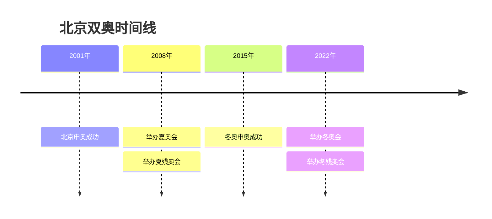

# 2022年北京冬奥会概况及双奥之城意义

## 北京冬奥会的概况

2022年北京冬奥会即第24届冬季奥林匹克运动会，于2022年2月4日至20日举行，北京赛区、延庆赛区和张家口赛区共同承担赛事。北京冬奥会设7个大项、15个分项、109个小项；北京冬残奥会于3月4日至13日举行，设6个大项、78个小项。

冬奥会的口号是“一起向未来”，会徽为“冬梦”，吉祥物为“冰墩墩”。北京冬奥会秉持“绿色、共享、开放、廉洁”的办奥理念，并落实“简约、安全、精彩”的办赛要求。

> [!IMPORTANT]
> 北京成为全球首个既举办过夏季奥运会、又举办过冬季奥运会的城市，因此被称为==“双奥之城”==。

## “双奥之城”的意义

“双奥之城”不是简单地指“举办过两次体育比赛”，而是强调北京先后完成夏奥会与冬奥会的筹办、举办工作。其意义主要体现在：

- **展现国家综合实力**：大型赛事的组织、交通、场馆、医疗和志愿服务，集中体现城市治理能力。
- **推动冰雪运动普及**：以冬奥会带动群众参与冰雪运动，促进“带动三亿人参与冰雪运动”。
- **促进区域协同发展**：京张高铁等基础设施改善北京与张家口的联系，推动交通、旅游和体育产业协同。
- **体现可持续发展**：部分2008年场馆经过改造继续服务2022年赛事，如国家游泳中心由“水立方”转换为“冰立方”。
- **传播奥林匹克文化**：从2008年的“同一个世界，同一个梦想”到2022年的“一起向未来”，都强调团结、友谊与共同进步。

## 易混概念与常见坑

| 项目 | 2008年北京奥运会 | 2022年北京冬奥会 |
|---|---|---|
| 赛事性质 | 夏季奥运会 | 冬季奥运会 |
| 届次 | 第29届 | 第24届 |
| 核心理念或要求 | 绿色奥运、科技奥运、人文奥运 | 绿色、共享、开放、廉洁 |
| 口号 | 同一个世界，同一个梦想 | 一起向未来 |
| 典型场馆利用 | 新建并完善场馆体系 | 改造利用部分夏奥场馆 |

> [!WARNING]
> 不要把“第29届夏季奥运会”误记成“第29届冬奥会”，也不要把“人文奥运”与“一起向未来”混为同一届赛事的内容。残奥会另有届次和项目设置，不能直接与奥运会相加。

## 例题与记忆方法

**例题：**“同一个世界，同一个梦想”体现了哪一理念所蕴含的和谐价值观？  
A. 绿色奥运　B. 科技奥运　C. 人文奥运　D. 重在参与

**答案：C。**“同一个世界”强调不同国家和民族相互理解，“同一个梦想”强调共同追求和平、友谊与进步，核心是对人的尊重与关怀，因此属于人文奥运。

> [!TIP]
> 可用“零八三人文，二二向未来；夏奥二十九，冬奥二十四”串联记忆。做届次题时先判断夏奥还是冬奥，再回忆年份与届次。
