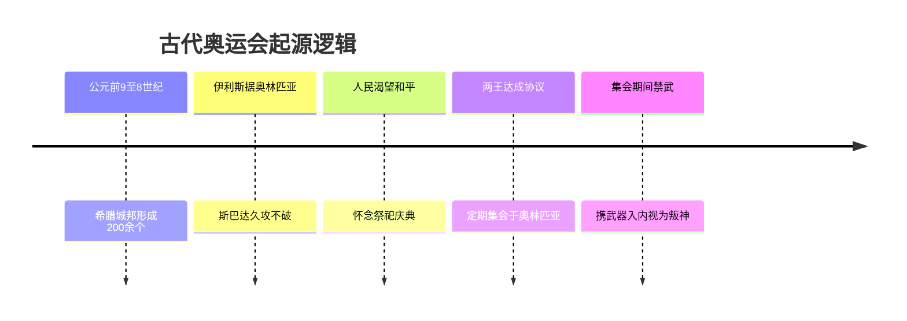
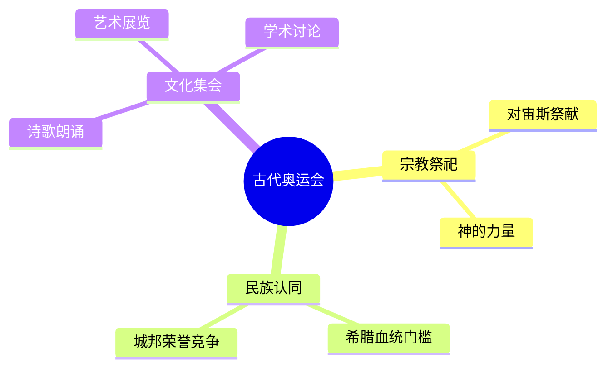

# 古代奥运会的起源、举办地（奥林匹亚）与停办

## 古代奥运会的起源、举办地与停办

先从一个看似矛盾的现象入手：古希腊城邦之间天天打仗，斯巴达人尤其想吞并奥林匹亚所在的伊利斯地盘，可偏偏在奥林匹亚办起了一场持续一千多年的“停战赛会”。**战争催生了竞技，但对和平的渴望才让它制度化。**

### 它是什么

“奥林匹克”最初不是一个体育词汇。它原指古希腊时期在**奥林匹亚**举行的对天神**宙斯**的祭祀活动，其中包含的体育比赛被称作“奥林匹亚竞技”。文艺复兴以后，人们才把“奥林匹亚竞技”改称“古代奥林匹克运动会”，并把同期举行的学术讨论、诗歌朗诵、艺术展览等文化活动一并纳入“奥林匹克”这个大概念之下。

> [!IMPORTANT]
> ==古代奥运会每 4 年在奥林匹亚举办一次==，从公元前 776 年至公元 393 年，共举办 **293 届**，历时 **1169 年**。它本质上是==宗教祭祀性赛会==，不是单纯的体育比赛。

### 为什么在奥林匹亚

伊利斯人占据着奥林匹亚，斯巴达人久攻不破。长年战争让双方都疲惫不堪，人民强烈渴望回到祭祀和庆典的正常生活中。于是伊利斯王与斯巴达王达成协议：**定期在奥林匹亚举行集会**。协议特别规定——==集会期间携带武器进入奥林匹亚即背叛神明==，应当受罚；有能力惩罚而不惩罚者，也算叛神。这条“神圣休战”条款，是赛会能稳定延续的制度基石。

### 参赛资格与赛会性质

古代奥运会的参赛条件相当严格，核心门槛是：

> [!WARNING]
> ==必须具有希腊血统==，并且是自由民。女性不得参加，甚至已婚妇女不得观看。

从这里能看出它的两重底色：一方面，它体现的是**神的力量**——竞技是对宙斯的最好献祭，冠军被视为“受神眷顾之人”；另一方面，它又是**希腊民族精神的象征**——各城邦在竞技场上证明本邦公民的体魄与秩序，本质上展示的是希腊奴隶制城邦文化的优越感。

### 为什么停办

公元 393 年，罗马皇帝狄奥多西一世把基督教定为国教，认为这类异教祭祀活动必须取缔，古代奥运会就此停办。此后 1500 年间无人再办，直到 1896 年顾拜旦推动在雅典举办首届现代奥运会。

### 常见的坑与易混点

| 易混项 | 正确结论 |
|---|---|
| 举办地 | **奥林匹亚**（不是雅典；雅典是 1896 年首届现代奥运会主办城市） |
| 计届 | 293 届（不是 296 或 283） |
| 历时 | 1169 年（公元前 776 — 公元 393） |
| 性质 | 宗教祭祀性赛会（不是纯体育赛会） |
| 圣火采集地 | 现代奥运火种仍需从**希腊奥林匹亚**的赫拉神庙遗址采集，火炬接力传到主办城市 |

> [!TIP]
> 记“奥林匹亚”别只当地名。它是**宙斯圣地 + 和平集会 + 竞技与文化活动叠加**的复合场域。选择题若问“古代奥运会是的象征”，选“希腊民族精神”；若问“体现了的力量”，选“神”。

### 一个算对了的例子

题目：古代奥运会每 4 年在古希腊的\_\_\_\_举办一次，共举办了 293 届，历时 1169 年。

- 错选雅典的同学，是把“现代奥运首届主办地”错套在古代上；
- 错选 296 或 283 届，通常是把“公元前 776 到 393 年”除以 4 时忘了首尾都算届数。
- 正确算法：$(393 - (-776)) = 1169$ 年，跨度 ÷ 4 ≈ 292.25，取整后按“两头都赛”得 ==293 届==，答案 A：奥林匹亚。
