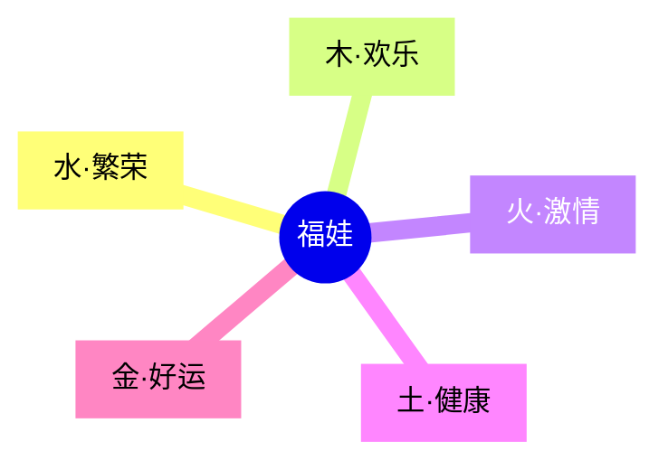

# 北京奥运会及冬奥会吉祥物、会徽的文化寓意

## 会徽与吉祥物的功能定位

看到“奥运会最权威的形象标志”这一描述，你会首先想到吉祥物还是会徽？虽然两者都是视觉识别系统的核心，但层级完全不同。==会徽是奥运会最权威的形象标志==，它承载着主办国的国家意志与奥林匹克精神的官方表达；而吉祥物则是更具亲和力、面向大众传播的文化使者。理解这一区别，是掌握本章文化寓意的逻辑起点。

> [!IMPORTANT]
> 会徽具有唯一性与法定权威性，是区分不同届次奥运会的核心符号；吉祥物则侧重于情感连接与文化叙事。

## 北京奥运吉祥物的文化解码

提到北京2008年奥运会吉祥物，你能准确说出它们的数量及组合含义吗？答案是5个，即“福娃”。这并非随意设定，而是对应着奥林匹克五环的颜色与中国传统“五行”哲学：

-   **贝贝**（蓝/水）：象征繁荣，源自鱼纹样
-   **晶晶**（黑/木）：象征欢乐，源自大熊猫
-   **欢欢**（红/火）：象征激情，源自圣火纹样
-   **迎迎**（黄/土）：象征健康，源自藏羚羊
-   **妮妮**（绿/金）：象征好运，源自京燕造型

五个名字连读谐音“==北京欢迎你==”，将中国祝福与奥运理念完美融合。这种“多角色组合”模式在奥运史上较为罕见，体现了中华文化的包容性与整体观。

## 冬奥吉祥物与会徽的延续创新

从夏奥到冬奥，文化表达如何既一脉相承又体现时代特征？北京2022年冬奥会吉祥物“冰墩墩”以熊猫为原型，结合冰晶外壳，寓意创造非凡、探索未来；冬残奥会吉祥物“雪容融”则以灯笼为创意，象征温暖与光明。其会徽“冬梦”以汉字“冬”为灵感，上半部分展现滑冰运动员造型，下半部分表现滑雪姿态，中间舞动线条代表举办地起伏的山峦与赛道，==实现了汉字书法与冰雪运动的视觉同构==。

> [!TIP]
> 记忆口诀：夏奥五娃迎客，冬奥一墩一融；会徽看“冬”字变形，吉祥物辨冰壳与灯笼。

## 易混概念与真题辨析

复习时需注意区分“首次出现”与“正式命名”的时间节点。例如选择题64考查夏季奥运会吉祥物最早出现年份，正确答案是1972年慕尼黑奥运会（Waldi），而非1968年墨西哥城的非官方形象“雪士”。此外，历届吉祥物名称易混淆：Waldi（1972）、Hodori（1988汉城）、Cobi（1992巴塞罗那），需结合主办城市精准匹配。

| 要素         | 会徽               | 吉祥物             |
| ------------ | ------------------ | ------------------ |
| 核心功能     | 权威标识           | 文化传播           |
| 设计重心     | 抽象符号+文字      | 具象角色+故事      |
| 北京案例     | “中国印·舞动的北京” | 福娃 / 冰墩墩      |
| 考试关键词   | ==最权威==         | 数量、谐音、原型   |

> [!WARNING]
> 切勿将1968年“雪士”视为首个官方吉祥物，考题中“最早出现”特指经国际奥委会正式认可的1972年Waldi。
